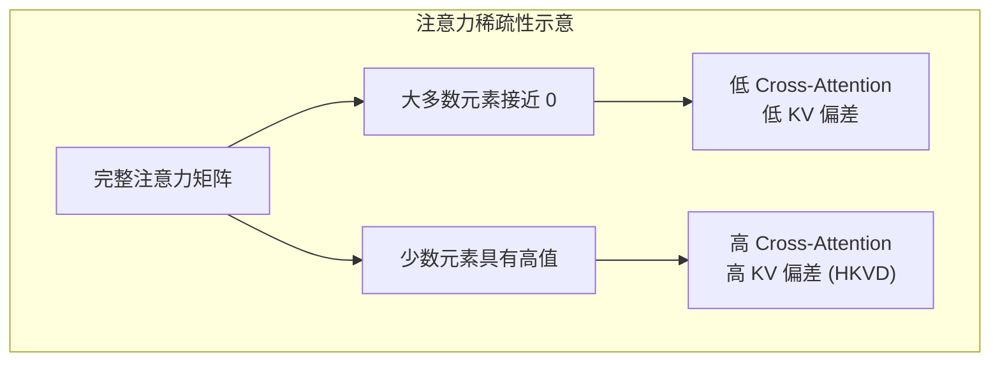

比较同一输入的两次前向：一次完整重算，一次拼入旧 KV。每个位置的新旧 K、V 之差描述了缓存偏差；注意力分布之差则反映这些偏差怎样影响模型读取上下文。

---

## 2.2 数学基础

### 2.2.1 符号定义

| 符号 | 描述 |
|------|------|
| $i$ | 层索引 |
| $j$ | Token 索引 |
| $KV$ | KV Cache |
| $KV_i$ | 第 $i$ 层的 KV |
| $KV_i[j]$ | 第 $i$ 层第 $j$ 个 token 的 KV |
| $KV^{full}$ | 完全重计算的 KV Cache |
| $KV^{pre}$ | 预计算的 KV Cache |
| $KV^{new}$ | CacheBlend 更新后的 KV Cache |
| $A_i$ | 第 $i$ 层的前向注意力矩阵 |
| $A_i^{full}$ | Full KV Recompute 的前向注意力矩阵 |
| $A_i^{pre}$ | Full KV Reuse 的前向注意力矩阵 |
| $A_i^{new}$ | CacheBlend 的前向注意力矩阵 |

### 2.2.2 KV Deviation（KV 偏差）

**定义**：KV Cache $KV$ 在第 $i$ 层第 $j$ 个 token 的 **KV 偏差** 定义为 $KV_i[j]$ 与 $KV_i^{full}[j]$ 之间的绝对差：

$$\Delta_{kv}(KV_i, KV_i^{full})[j] = |KV_i[j] - KV_i^{full}[j]|$$

这衡量了给定 KV 在特定 token 和层上与完整 Prefill 的 KV Cache 相比有多大差异。

### 2.2.3 Attention Deviation（注意力偏差）

**定义**：第 $i$ 层的前向注意力矩阵 $A_i$ 的**注意力偏差**定义为其与 $A_i^{full}$ 差异的 L-2 范数：

$$\Delta_{attn}(A_i, A_i^{full}) = ||A_i - A_i^{full}||_2$$

Full KV Reuse 由于缺少 Cross-Attention 而导致前向注意力矩阵的偏差。

### 2.2.4 优化目标

使用这些符号，CacheBlend 的目标可以形式化为：

> 如何快速将预计算的 KV Cache $KV^{pre}$ 更新为新的 KV Cache $KV^{new}$，使得任意层 $i$ 上的注意力偏差 $\Delta_{attn}(A_i^{new}, A_i^{full})$ 最小化。

### 2.2.5 RoPE 位置编码

**Rotary Position Embedding (RoPE，旋转位置编码)** 是现代 LLM 中常用的位置编码方案。

**定义**：对于需要嵌入到位置 $m$ 的 query 向量 $q$ 和 key 向量 $k \in \mathbb{R}^d$，RoPE 编码位置信息如下：

$$q_m, k_m = R^d_{\Theta,m}\{q, k\}$$

其中旋转矩阵为：

$$R^d_{\Theta,m} = \begin{pmatrix}
\cos m\theta_0 & -\sin m\theta_0 & \cdots & 0 & 0 \\
\sin m\theta_0 & \cos m\theta_0 & \cdots & 0 & 0 \\
\vdots & \vdots & \ddots & \vdots & \vdots \\
0 & 0 & \cdots & \cos m\theta_{d/2-1} & -\sin m\theta_{d/2-1} \\
0 & 0 & \cdots & \sin m\theta_{d/2-1} & \cos m\theta_{d/2-1}
\end{pmatrix}$$

超参数 $\Theta \in \{\theta_i = 10000^{-2i/d}, i \in [0, 1, ..., d/2-1]\}$

### 2.2.6 RoPE 的关键性质：相对位置不变性

**命题**：RoPE 只依赖相对位置。

对固定的未旋转向量 $q,k$，位置 $m+l$ 上的 query 与位置 $m$ 上的 key 的内积可以写成

$$
(R_{m+l} q)^T (R_m k) = q^T R_{-l} k .
$$

这里使用标准 RoPE 的正交旋转性质，位置编码部分只取决于两者相差多少。实际 q、k 还由当前层隐藏状态决定；换上文会改变它们本身。已旋转 K 可以做位移修正，原型保存的旋转前 K 则直接使用新位置。[原型的位置处理](../05-algorithms/01-rope-recovery.md)

---

## 2.3 关键洞察

### 2.3.1 Insight 1: HKVD Tokens 对注意力偏差的主导作用

> **洞察 1**：在第 $i$ 层，重计算具有更高 KV 偏差的 token $j$ 的 KV（即 $\Delta_{kv}(KV_i, KV_i^{full})[j]$）会以更大的幅度减少注意力偏差（即 $\Delta_{attn}(A_i, A_i^{full})$）。

论文图 6 用 MuSiQue 比较 Mistral-7B、Yi-34B 和 Llama-70B。作者按各位置的 KV 偏差排序，提高重算比例，再计算各层注意力偏差的平均值。优先重算最靠前的高偏差位置时，曲线下降最明显；继续增加位置后，边际变化趋缓。[论文图 6](https://arxiv.org/html/2405.16444v3#S4.F6)

### 2.3.2 Insight 2: 层间 HKVD Tokens 的高相关性

> **洞察 2**：在一层上具有最高 KV 偏差的 token 很可能在下一层也具有最高的 KV 偏差。

例如，如果第一层的 HKVD tokens 是 token 2、3 和 5，那么这三个 token 在第二层也可能比其他大多数 token 具有更高的 KV 偏差。

图 8 在相同模型和数据集上，按相邻两层各 token 的 KV 偏差排名计算 Spearman 秩相关系数。图中相邻层的排名普遍有较高相关性，因此较早的检查层能为后层提供候选。某个位置是否应当重算，仍要结合当前输入；相邻层的注意力矩阵也可能不同。[论文图 8](https://arxiv.org/html/2405.16444v3#S4.F8)

### 2.3.3 注意力稀疏性的理论基础

HKVD tokens 只占一小部分的原因可以用**注意力稀疏性**来解释——这是许多先前研究在 Transformer 模型中观察到的一个广泛性质。

**注意力稀疏性**指的是：在注意力矩阵中，高注意力通常只发生在少量 token 与其前面的 token 之间。

论文图 7 显示了 KV 偏差在不同 token 上的分布：
在这组 MuSiQue 实验的示例层，约 10%–15% 的位置具有明显较高偏差。图 7 描述的是分布，并未给所有模型指定固定重算比例。[论文图 7](https://arxiv.org/html/2405.16444v3#S4.F7)

---

## 下一步

- [算法设计](./03-algorithm-design.md) - 深入理解基于这些洞察的 Token 选择策略和渐进过滤方案
- [核心概念](./01-core-concepts.md) - 回顾 CacheBlend 的基本概念
