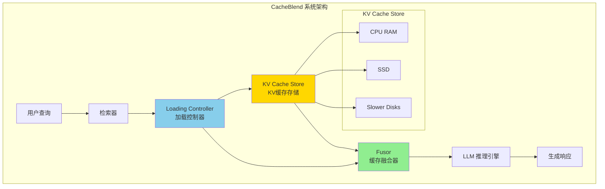
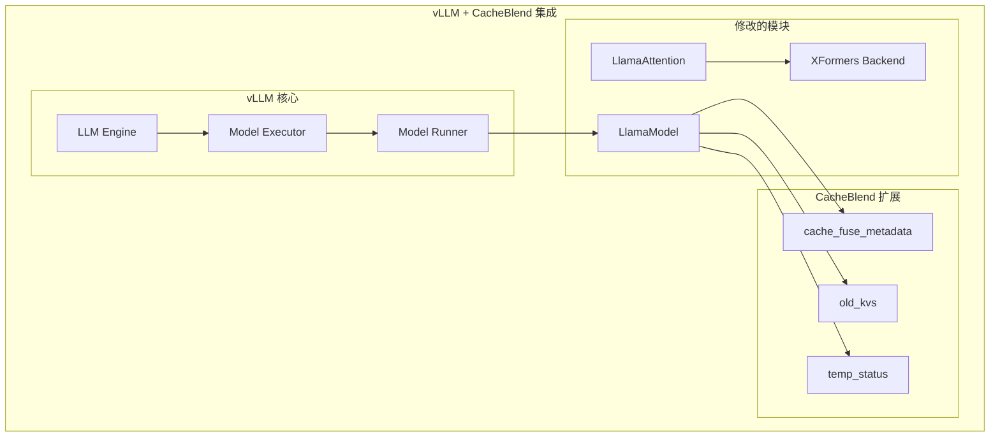

一条新提示到达时，系统先确定哪些文档已有 KV，再安排逐层读取。模型一边消费本层缓存，一边重算受新上下文影响较大的位置。

---

## 3.1.1 CacheBlend 系统组件

CacheBlend 系统由三个主要组件组成：

## 3.1.2 与 vLLM 的集成

CacheBlend 在 vLLM 之上实现，约 3000 行 Python 代码。集成点包括：

## 3.1.3 数据流与控制流


title: "检索到的两份文档如何进入模型"
actors: ["检索器", "控制器", "缓存存储", "Fusor", "模型"]
steps:
  - from: 0
    to: 1
    label: "返回文档"
    detail: "检索器按本次问题返回 M 与 R，控制器保留它们在提示中的顺序。"
  - from: 1
    to: 2
    label: "查询缓存"
    detail: "控制器查询哪份文档的 KV 可用，并安排逐层读取。"
  - from: 2
    to: 3
    label: "加载当前层"
    detail: "命中的数据先送给 Fusor，未命中的文档部分仍需计算。"
  - from: 3
    to: 4
    label: "拼出本层 KV"
    detail: "Fusor 结合复用与重算的位置，让模型继续这一层的注意力。"


---

**下一步**: [Loading Controller（加载控制器）](./02-loading-controller.md)
