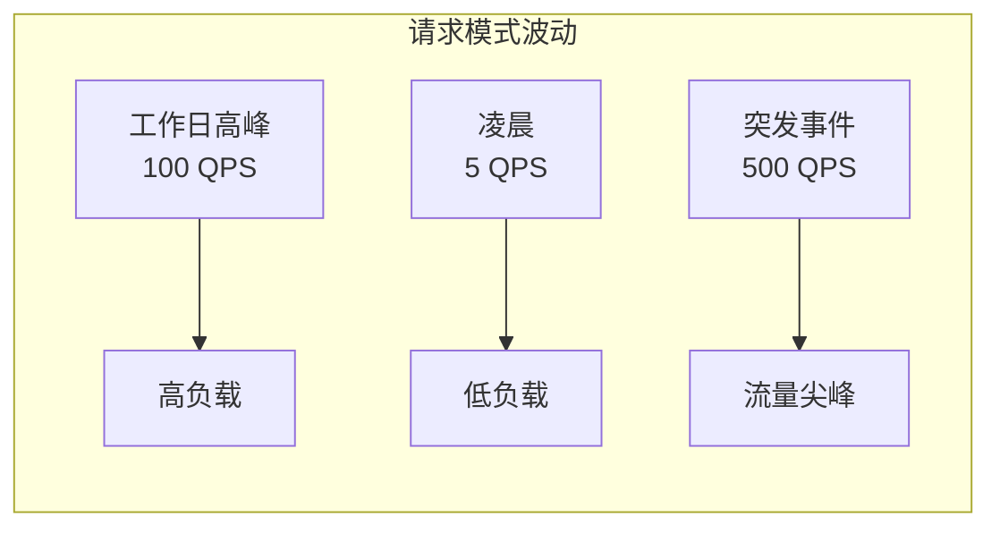
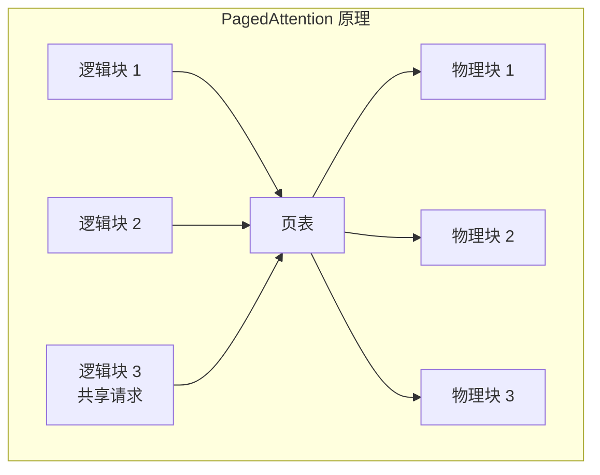
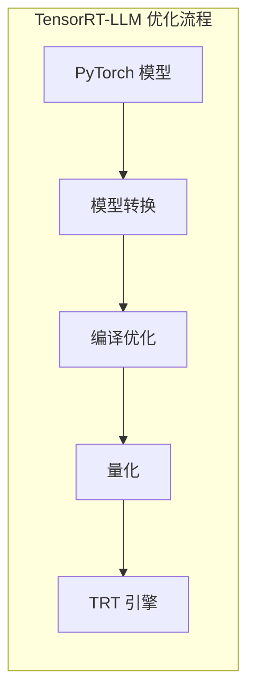
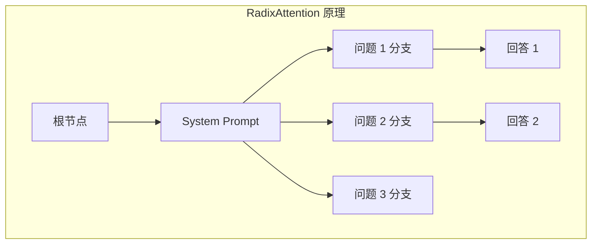
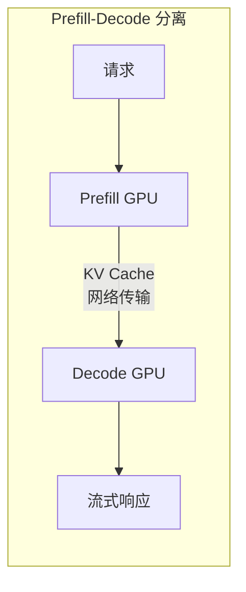
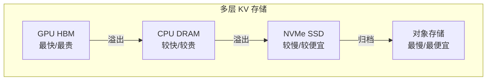

一条推理请求先处理提示词，再逐步生成输出。把这两段直接放到同一设备、分到不同 GPU，或让路由器选择已有缓存的副本，各自改变排队、计算、内存访问与传输的时间。应先找出限制当前负载的环节，再讨论部署方案。

## 1. 识别本次负载的瓶颈

### 1.1 计算、带宽和等待时间如何对齐

对某个模型算子，记一次执行需要 F 个浮点运算、从目标内存层实际搬运 M 字节。若该精度和操作的理论峰值是 P FLOP/s、带宽是 B byte/s，那么计算和搬运各需要至少 F/P 秒和 M/B 秒。两者完全重叠时的理想下界是 max(F/P, M/B)。这个式子给时间下界；要得到某个计数器定义的利用率，还需要时间线和对应硬件计数。

| 比较项 | 相同模型与请求下如何观察 |
|---|---|
| 长提示词 prefill | 同一轮可处理许多输入位置，矩阵计算通常更容易复用权重；注意力、并行通信与分块会改变瓶颈。 |
| 小批量 decode | 每条普通请求通常向前推进一个位置，但需要权重和历史 KV，实际带宽可能主导这一步。 |
| 增加请求批量 | 多请求可共同复用权重；同时要读取更多 KV，排队、显存和单步时延也可能变化。 |

在同一机器对同一请求轨迹采样，分别记录排队、prefill、逐 token 延迟与一轮 forward 的设备活动。TTFT 和 ITL 的目标应取自实际业务。一份负载观测到的阶段占比无法推给其他模型或并发。[Dynamo 1.6.2 对分离部署与执行特性的说明](https://github.com/ai-dynamo/dynamo/blob/v1.6.2/docs/fern/pages/developer-guide/knowledge-base/concepts/system-architecture/disaggregated-serving.md)

### 1.2 KV Cache 重复计算问题

#### 相同 Prefix 的请求

在实际应用中，很多请求具有相同的前缀：

```
# 系统提示词相同
请求1: [System Prompt] + "What is 2+2?"
请求2: [System Prompt] + "Tell me a joke"
请求3: [System Prompt] + "Translate to French: Hello"
```

如果每次都重新计算 System Prompt 的 KV Cache，将造成大量重复计算。

#### Multi-turn 对话场景

多轮对话中，历史对话需要重新计算：

```
轮次1: User: "Hi" → Assistant: "Hello!"
轮次2: User: "Hi" + "Hello!" + "How are you?" → Assistant: "I'm good!"
轮次3: User: [前两轮完整历史] + "What's the weather?" → ...
```

若各次调用均无缓存命中，旧历史的位置会被重复计算。


title: 三轮对话各要处理多少提示
rows: ["提示长度", "无命中", "前缀全留"]
steps:
  - title: "第 1 轮"
    detail: "第一条提示有 500 个 token，两个方案都要计算 500 个输入位置。"
    cells: [["500"], ["500"], ["500"]]
    focus: [[0, 0], [1, 0], [2, 0]]
  - title: "第 2 轮"
    detail: "输入增加 200 个 token。没有缓存时重算 700 个，有完好前缀时只算新增的 200 个。"
    cells: [["700"], ["700"], ["200"]]
    focus: [[1, 0], [2, 0]]
  - title: "第 3 轮"
    detail: "再次增加 200 个，三轮累计无命中为 2100 个输入位置，理想前缀复用为 900 个。"
    cells: [["900"], ["900"], ["200"]]
    focus: [[1, 0], [2, 0]]


#### 对话历史增加时怎样计算重复量

第一轮提示长 500 个 token，以后每轮追加 200，连续调用 10 次。每轮重算需要处理 500 + 700 + … + 2300 = 14,000 个输入位置；理想前缀复用只需处理 2,300 个，相差 11,700 个。页对齐、驱逐和路由目标会影响实际命中。要换算成时间，还需测这些位置在目标设备上的执行耗时。

### 1.3 对 KV 内存做量纲明确的估算

对存储完整历史的普通注意力层，单请求 KV 载荷可估为：

```text
字节数 = 层数 × 2 (K 与 V) × KV 头数 × 每头维度 × 已保存的 token 数 × 每元素字节数
```

例如假定 80 层、8 个 KV 头、头维度 128、每元素 2 字节，每 token 为 327,680 字节。4,096 个 token 合计 1.25 GiB，131,072 个 token 合计 40 GiB。这是全模型、单请求的理论有效载荷。GQA 要用 KV 头数而非 query 头数；滑动窗口、混合层、不同精度、TP 分片或复制、页尾填充与共享前缀都会改变每张卡的实际块数。

计算机器能容纳多少请求时，先测量加载指定权重、执行缓冲与通信进程后的可分配空间，再与引擎启动日志的 KV token 容量对照。例如，700 亿个 FP16 参数的权重约占 140 GB，同样数量的 INT8 参数约占 70 GB，量化元数据另外计算。

### 1.4 动态负载问题

#### 请求到达率的波动性

生产环境中的请求模式变化剧烈：



#### 静态资源分配的低效

- **按峰值配置**：成本高，平时浪费
- **按均值配置**：高峰时无法服务
- **手动扩缩容**：响应慢，不够敏捷

---

## 2. 业界解决方案综述

### 2.1 vLLM：PagedAttention 与连续批处理

vLLM 的通过 **PagedAttention** 管理 KV：

- 将 KV Cache 分成固定大小的"页"（类似操作系统虚拟内存）
- 使用页表管理物理块和逻辑块的映射
- 支持 Copy-on-Write，实现前缀共享



**连续批处理（Continuous Batching）**：
- 不再等待整个 batch 完成
- 请求完成后立即移出，新请求立即加入
- 提高 GPU 利用率

---

### 2.2 TensorRT-LLM：编译优化与量化

NVIDIA TensorRT-LLM 的优势：

- **编译时优化**：算子融合、内存规划
- **量化支持**：FP8/INT8/INT4，显著降低内存和计算需求
- **Inflight Batching**：类似连续批处理
- **深度 CUDA 优化**：针对 NVIDIA GPU 深度调优



---

### 2.3 SGLang：RadixAttention 与结构化生成

SGLang 的创新：

- **RadixAttention**：使用 Radix Tree 管理 KV Cache，高效处理前缀共享
- **结构化生成**：支持 JSON Schema、正则表达式约束输出
- **并行采样**：多个采样路径并行执行



---

### 2.4 DistServe：Prefill-Decode 分离

DistServe 的核心思想：

- 将 Prefill 和 Decode 部署在不同的 GPU 上
- Prefill GPU：优化算力利用
- Decode GPU：优化批处理和内存带宽
- 通过网络传输 KV Cache



---

### 2.5 Mooncake：分布式 KV Cache

Mooncake 的创新：

- 将 KV Cache 存储在分布式存储系统中
- 支持跨请求、跨节点的 KV Cache 共享
- 多层存储：GPU → CPU → SSD → 对象存储



---

## 3. 方案对比总结

| 方案 | 核心技术 | 解决的问题 | 局限性 |
|------|----------|------------|--------|
| vLLM | PagedAttention | 内存碎片 | 受每个实例可用 KV 容量和实际 attention 后端约束 |
| TensorRT-LLM | 编译优化 | 单卡性能 | 需要结合具体引擎与模型检查配置 |
| SGLang | RadixAttention | 前缀共享 | 命中取决于前缀和请求发往的实例 |
| DistServe | P/D 分离 | GPU 利用率 | KV 传输开销 |
| Mooncake | 分布式 KV | 长上下文 | 系统复杂度 |

Dynamo 的部署与路由机制可以与后端引擎的分页和批处理并用。端到端测试应分别确认后端版本、实际命中量与跨设备交接成本。

---

## 下一篇

继续阅读 [03-Dynamo 设计理念](03-dynamo-design-philosophy.md)，了解 Dynamo 如何解决这些行业痛点。
