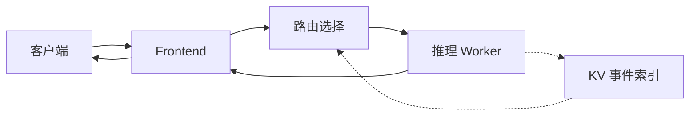
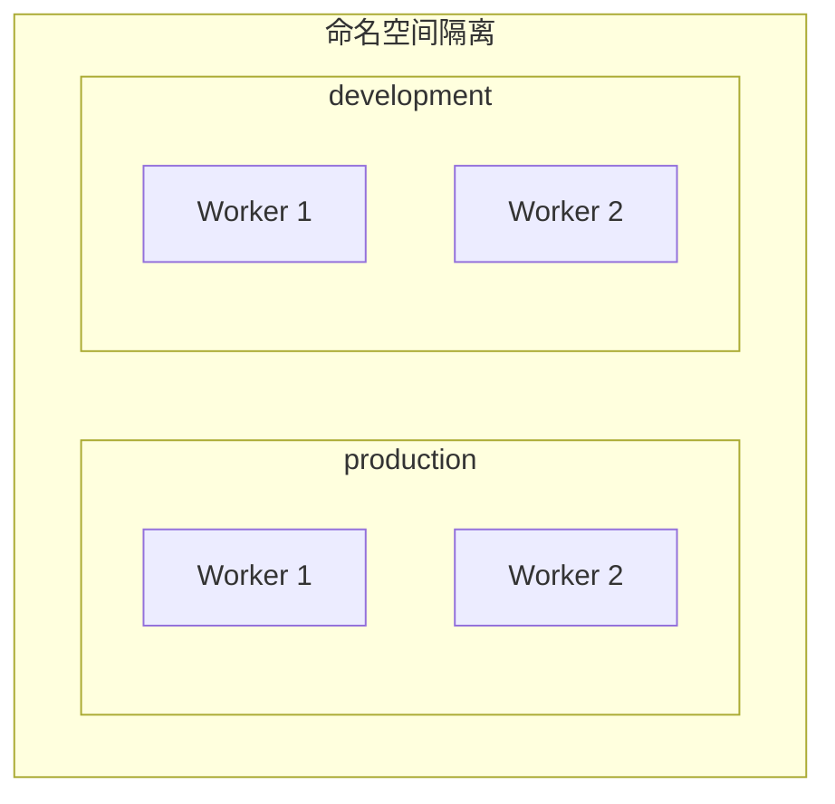
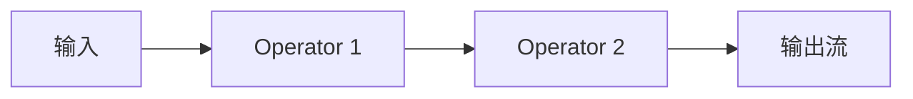

客户端只需知道前端 HTTP 地址。Frontend 将消息转换为后端可处理的输入；请求经过路由选择合适实例，worker 调用本地推理引擎产生结果，frontend 将令牌或文本组织成客户端所需的响应。运行时负责命名、发现和组件间通信。Planner 等可选组件执行独立的容量决策。

成员发现列出可用 worker，路由索引给出各实例的前缀重叠估计。请求抵达目标 worker 时，由引擎查询仍然可用的块。对照两处日志，可以看到期间新增或被驱逐的前缀。

## Namespace 和组件地址

命名空间隔开组件的逻辑成员集合。两个独立的服务即使都叫 backend.generate，若 namespace 不同，client 读到的实例也会不同。命名空间是服务发现范围，访问控制需要另行按部署配置。

## 流式管道的处理方向

组件在一次调用中可能依次做预处理、路由、推理和后处理。调试时并列记录请求方向和响应方向：一旦 worker 已生成，下一跳应检查前端的响应聚合和流写回。

[系统架构](https://github.com/ai-dynamo/dynamo/blob/v1.6.2/docs/fern/pages/developer-guide/knowledge-base/concepts/system-architecture/architecture.md) · [KV 路由](https://github.com/ai-dynamo/dynamo/blob/v1.6.2/docs/fern/pages/developer-guide/knowledge-base/concepts/system-architecture/kv-aware-routing.md)
