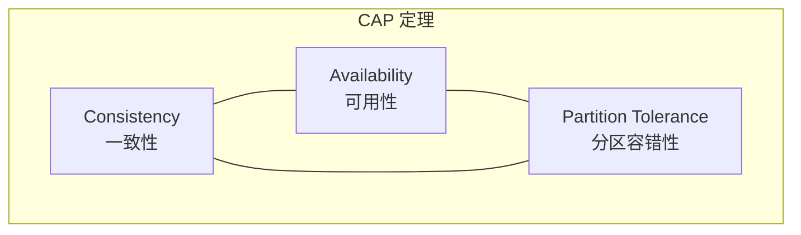
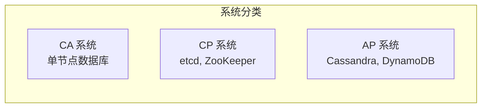
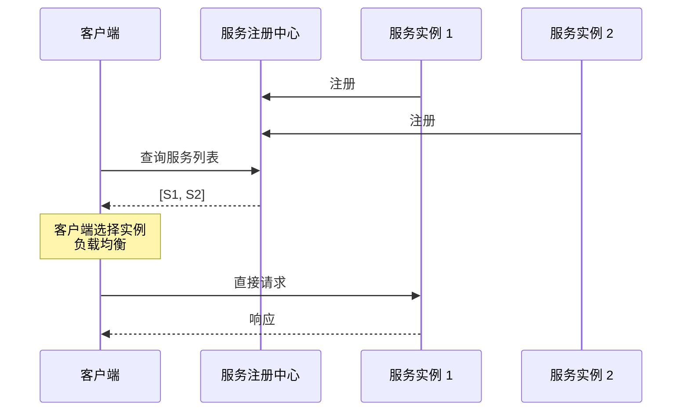
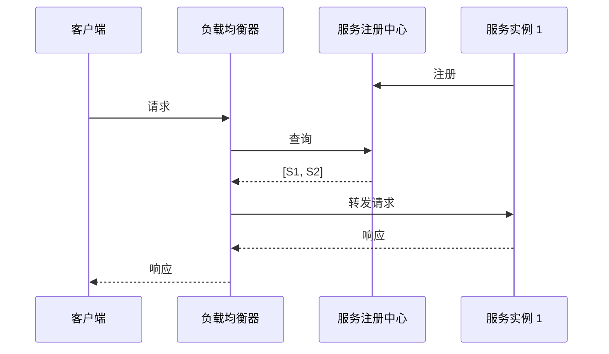
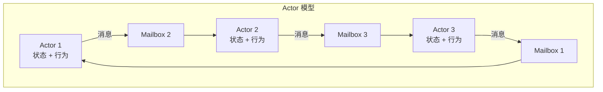
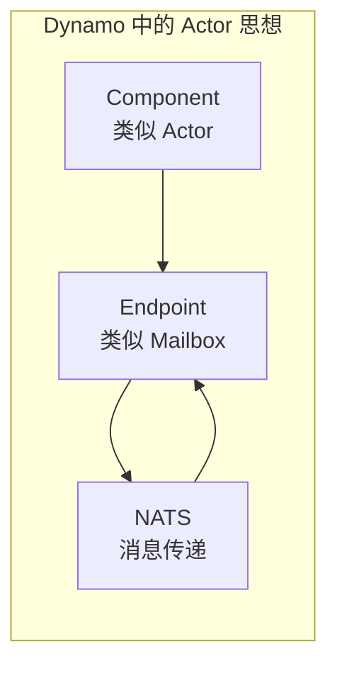
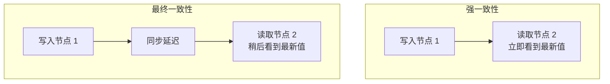

一个 worker 刚加入集群时，先要让其他进程找到它。worker 停止发送心跳后，发现服务还需要一段时间才会把这个实例移出候选集合。

---

## 1. CAP 定理

### 1.1 三个保证

分布式系统中，不可能同时满足以下三个保证：

| 保证 | 说明 |
|------|------|
| **Consistency** | 所有节点在同一时间看到相同的数据 |
| **Availability** | 每个请求都能收到响应（不保证是最新数据） |
| **Partition Tolerance** | 网络分区时系统仍能正常运行 |

### 1.2 系统分类

### 发现、事件和请求的要求

注册记录要反映当前成员，KV 事件用于近似追踪缓存状态，推理 RPC 则需要得到本次调用的响应。CAP 讨论适合分析副本在网络分区时提供的一致性保证；不能给所有流量或任意发布订阅系统简单贴上 CP/AP 标签。Dynamo 1.6.2 的三个运行时平面分别是发现、请求、事件，后端的 KV 大块复制另有传输契约。

## 2. 服务发现模式

### 2.1 客户端发现模式

客户端负责查询服务注册中心并选择实例：

**优点**：
- 客户端掌握完整的服务列表
- 可以实现复杂的负载均衡策略

**缺点**：
- 客户端逻辑复杂
- 需要为每种语言实现发现逻辑

### 2.2 服务端发现模式

由负载均衡器代理服务发现：

**优点**：
- 客户端逻辑简单
- 统一的服务发现接口

**缺点**：
- 增加网络延迟
- 负载均衡器成为单点

### 2.3 Dynamo 的选择

**Dynamo 使用客户端发现模式**：
- 在选定的发现后端维护注册信息（裸机可用 etcd，本机也可显式选 file）
- 客户端直接查询并选择服务实例
- 支持复杂的路由策略（如 KV-Aware 路由）

---

## 3. 心跳与租约机制

### 3.1 为什么需要心跳

服务实例需要证明自己仍然存活：
- 检测服务崩溃
- 检测网络分区
- 及时清理下线服务

### 3.2 Lease 租约机制

etcd 使用 Lease 机制管理服务健康：


title: 租约停止续期后发生什么
actors: ["Worker", "etcd", "订阅者"]
steps:
  - from: 0
    to: 1
    label: "申请租约"
    detail: "假设 TTL 为 10 秒，worker 取得一份租约并把端点记录绑定到它。"
  - from: 0
    to: 1
    label: "正常续租"
    detail: "进程存活期间续约，etcd 延长该租约的有效期。"
  - from: 0
    to: 0
    label: "进程失联"
    detail: "续约中断；此时订阅者可能仍持有这个端点。"
  - from: 1
    to: 1
    label: "租约到期"
    detail: "etcd 移除随租约过期的成员记录。"
  - from: 1
    to: 2
    label: "观察到删除"
    detail: "watch 事件到达后，订阅者更新本地候选集合。"


### 3.3 Lease 的优势

| 特性 | 说明 |
|------|------|
| **自动清理** | Lease 过期后自动删除绑定的 Key |
| **批量管理** | 多个 Key 可以绑定同一个 Lease |
| **原子性** | Lease 撤销时所有 Key 同时删除 |

---

## 4. Actor 模型

### 4.1 核心概念

Actor 模型是一种并发计算模型，每个 Actor 是独立的计算单元：

### 4.2 Actor 模型的特点

| 特点 | 说明 |
|------|------|
| **封装状态** | Actor 的状态只能通过消息修改，无共享内存 |
| **异步消息** | Actor 之间通过消息通信，消息是异步的 |
| **位置透明** | Actor 可以在本地或远程，通信方式相同 |

### 4.3 Dynamo 中的应用

虽然 Dynamo 没有使用传统的 Actor 框架（如 Actix），但其设计借鉴了 Actor 模型的思想：

| Dynamo 概念 | Actor 对应 |
|-------------|-----------|
| Component | Actor |
| Endpoint | Mailbox |
| NATS | 消息传递系统 |

---

## 5. 一致性模型

### 5.1 强一致性 vs 最终一致性

### 5.2 Dynamo 的一致性选择

| 场景 | 一致性模型 | 实现方式 |
|------|-----------|----------|
| 服务注册 | 强一致性 | etcd Raft 共识 |
| KV 索引 | 最终一致性 | NATS 事件传播 |
| 指标聚合 | 最终一致性 | 定期同步 |

---

## 下一篇

继续阅读 [03-Runtime 双层设计](03-runtime-design.md)，了解 Dynamo 的运行时架构。
