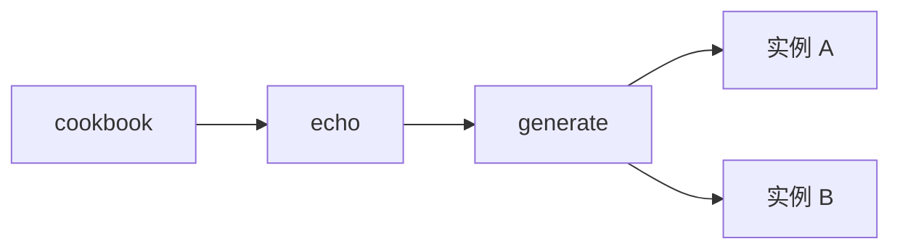

同一模型部署中，多个进程需要能给同一项能力命名。Dynamo 1.6.2 使用 namespace 限定逻辑范围、component 组织功能、endpoint 指定具体调用。runtime 通过发现层把这个逻辑地址解析成可用实例。对于自定义 worker，可以用一个不加载模型的字符串回显验证这三层。

## 在两个进程中使用同一个名字

在服务进程里创建 `runtime.endpoint("cookbook.echo.generate")` 并调用 `serve_endpoint` 服务异步 handler。在客户端创建相同逻辑名的 endpoint，通过 `await endpoint.client()` 获取 client，再等待实例出现。客户端不需要预先知道每个 worker 的 IP；发现、选择实例与建立请求通道由运行时接手。

| 修改了什么 | 读者可以观察到什么 |
|---|---|
| 两端组件名一致，后端已注册 | client 可以发现端点实例并调用它。 |
| client 改到另一个 namespace | 它看到的是另一个逻辑集合。 |
| 关闭后端进程 | 当前请求如何结束和发现层多久移除该实例，取决于正在使用的传输和发现模式。 |
| 增加同 endpoint 的另一个实例 | 路由策略可以在两个服务同一能力的实例之间选择。 |

## 从逻辑命名定位到实现

先看上游 hello-world 的服务端如何声明输入输出类型，再比较客户端传入的地址与数据类型。进入 Rust 运行时后，分别查 component 的命名、endpoint 的创建与 client 的选择调用。namespace 是服务发现范围，面向用户的 HTTP 鉴权应按实际入口配置。

使用具体示例可继续阅读[注册端点](/dynamo/06-python-sdk/03-service-decorators/)和[消费端点的响应流](/dynamo/06-python-sdk/04-dynamo-service-class/)。

[服务端](https://github.com/ai-dynamo/dynamo/blob/v1.6.2/examples/custom_backend/hello_world/hello_world.py) · [客户端](https://github.com/ai-dynamo/dynamo/blob/v1.6.2/examples/custom_backend/hello_world/client.py) · [Endpoint 实现](https://github.com/ai-dynamo/dynamo/blob/v1.6.2/lib/runtime/src/component/endpoint.rs)
