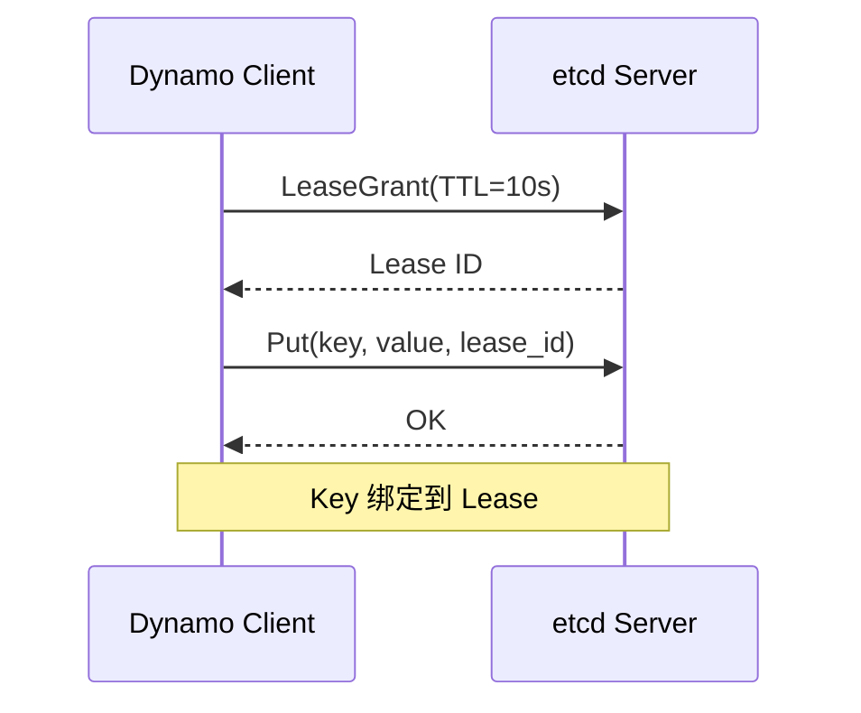

worker 启动后注册可服务的端点，client 查询并跟踪这个端点的成员集合。一个端点下可以有多个实例；发现负责让候选实例可见，具体某次请求选中谁还要经过路由。

单机快速开始用文件后端，可在同一主机演示注册、查找和退出。裸机常用 etcd，其租约与 keep-alive 用于清理消失的实例；在 Operator 部署中，Kubernetes 后端使用 DynamoWorkerMetadata 和 EndpointSlice。进入集群后应查看实际发现后端，etcd 专有的键和租约检查仅适用于选择了 etcd 的环境。

若两个实例都已启动但 frontend 看不到模型，顺序检查 worker 是否完成初始化、是否注册正确 namespace/endpoint、frontend 是否读取同一个发现后端。实例被发现后仍可能因执行或网络问题不能处理请求。

## 在 etcd 模式下追踪租约

## 客户端如何看到成员变化


title: 从完整名单接上成员变更
actors: ["Worker", "发现后端", "客户端"]
steps:
  - from: 1
    to: 2
    label: "取得快照"
    detail: "客户端首次读取可用实例，得到 P1 与相应的修订位置。"
  - from: 0
    to: 1
    label: "登记 P2"
    detail: "新成员 P2 完成注册。"
  - from: 1
    to: 2
    label: "收到新增事件"
    detail: "客户端从快照对应的位置继续观察，候选集合变为 P1、P2。"
  - from: 0
    to: 1
    label: "P1 下线"
    detail: "P1 注销或租约到期，发现后端删除其记录。"
  - from: 1
    to: 2
    label: "移出 P1"
    detail: "客户端应用删除事件；后续请求只从仍可用的成员中选择。"


在 etcd 模式，先读取已有成员，再持续从变更流更新集合；初始列表与后续变化必须在一致的修订边界接上。诊断一次 worker 消失时，把进程退出、租约删除和前端候选集合变化分开记录。改用文件或 Kubernetes 发现后，这个“当前集合加后续变化”的问题仍然存在，观察方法随存储后端变化。

## 对照一次 file 模式的真实调用

在同一容器内先启动 [echo 服务与客户端](/dynamo/06-python-sdk/03-service-decorators/)，保持 `DYN_DISCOVERY_BACKEND=file`。客户端的三个可观察位置分别是 `endpoint.client()` 返回、`wait_for_instances()` 完成、`client.generate()` 产生第一项。只把两侧的 component 名故意改成不同值，等待实例会停在第二步；如果能发现实例但处理函数抛出错误，就已越过第二步，应检查请求平面与 handler。

同一实验迁到两台主机时，要先确认二者是否能观察同一成员集合，并能访问服务实际公布的地址。本机文件发现避免了 etcd 依赖，但本地目录、容器网络与远端可达性是不同约束。

[部署与发现模式](https://github.com/ai-dynamo/dynamo/blob/v1.6.2/docs/fern/pages/developer-guide/knowledge-base/concepts/system-architecture/architecture.md) · [发现接口](https://github.com/ai-dynamo/dynamo/blob/v1.6.2/lib/runtime/src/discovery/mod.rs) · [本地文件发现](https://github.com/ai-dynamo/dynamo/blob/v1.6.2/docs/fern/pages/cli/getting-started/quickstart.mdx)
