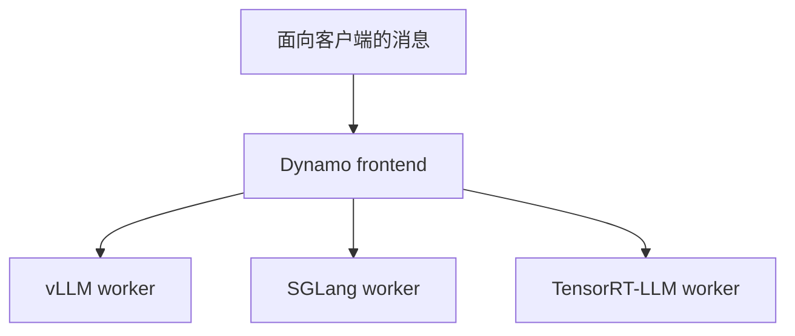

Dynamo frontend 对聊天请求提供统一的 HTTP 入口，worker 加载指定后端并负责模型执行。路由、发现与请求流可以复用。模型支持的采样功能、输入表示、KV 布局以及 P/D 交接协议仍由后端决定。

## 先核对镜像，再选择示例

| Dynamo 1.6.2 的 CUDA 13 运行时 | 复现时核对什么 |
|---|---|
| vLLM | 上游运行时镜像固定在 0.31.0。使用这个版本的参数、模型支持与 `NixlConnector` 交接协议。 |
| SGLang | 此版运行时采用 0.5.21。分离部署使用 SGLang bootstrap 等信息协调，时序与 vLLM 的同步 prefill 交接不同。 |
| TensorRT-LLM | 通过其 runtime 和适配层运行，P/D 传播后端自己的 opaque state。确认模型与硬件满足实际配方。 |

图表示可选部署方式。实际发出的请求只能交给已为该模型注册、当前能提供服务的 worker。

## 比较同一请求在三个边界的表示

对于带有系统指令的聊天消息，前端先按模型模板组织文本。路由器使用 token 或相应元信息选择实例，worker 再准备本地执行参数。模板一变，输入 ID 和可复用的前缀长度都可能改变。

P 完成预填充后，vLLM 后端会传递远端块与连接信息；SGLang 后端使用 bootstrap 信息来协调。两种后端的 D 都需要可读的 KV，开始等待和启动传输的时机各有不同。

## 自定义 worker 从什么接口开始

从自定义 endpoint 开始，可以先运行收发字符串的 echo 服务，用 client 观察注册与流式返回。接入 LLM frontend 时，还要实现对应的输入输出协议并注册模型。

[镜像版本](https://github.com/ai-dynamo/dynamo/blob/v1.6.2/container/context.yaml) · [后端交接协议](https://github.com/ai-dynamo/dynamo/blob/v1.6.2/docs/fern/pages/developer-guide/knowledge-base/concepts/system-architecture/disaggregated-serving.md) · [运行时自定义端点](https://github.com/ai-dynamo/dynamo/tree/v1.6.2/examples/custom_backend/hello_world)
