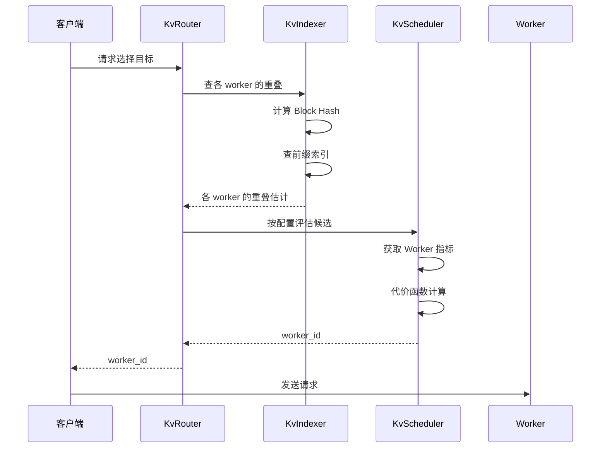

相同请求在不同 worker 上可能需要不同数量的预填充计算。路由器估算可复用前缀、剩余输入和活动负载，并从可用的候选实例中选择目标。索引中保存的是 worker 的缓存位置线索，实际 KV 仍归后端管理。



设两个 prefill worker 服务同一个模型，可用容量和负载相同。P1 持有请求前两个块，P2 都没有。其余评分条件相同时，P1 待计算的提示词更短，因此是较便宜的候选。若 P1 已积压多条长提示，选中 P2 也可能更快。动画中的相同负载是为了单独观察缓存重叠的作用。

分离部署里，选择 P 之后还要把交接信息带给 D。路由器选择目标、worker 在本地复用、连接器传输字节是三个独立步骤。没有 KV 事件时，应按配置区分基于路由历史的预测与只使用负载的评分，然后对照后端报告的实际命中。

## 路由一次需要哪些输入

Prefix overlap 反映节省的预填充，活动负载反映排队和执行成本。对相同的请求重复采样时，刚刚分配给 P1 的工作也可能影响下一次选择。

## 一个可以复算的例子

假设输入有 6 个同大小的块，P1 重叠 2 个，P2 重叠 0 个。忽略尾块对齐，这意味着两边还需计算 4 块和 6 块对应的 token。要估算耗时，还需要每块的计算时间，以及 P1、P2 正在处理的请求数。

[KV 路由代价与事件](https://github.com/ai-dynamo/dynamo/blob/v1.6.2/docs/fern/pages/developer-guide/knowledge-base/concepts/system-architecture/kv-aware-routing.md) · [参数与事件配置](https://github.com/ai-dynamo/dynamo/blob/v1.6.2/docs/fern/pages/developer-guide/knowledge-base/modular-components/router/configuration-and-tuning.md) · [P/D 请求路径](https://github.com/ai-dynamo/dynamo/blob/v1.6.2/docs/fern/pages/developer-guide/knowledge-base/concepts/system-architecture/disaggregated-serving.md)
