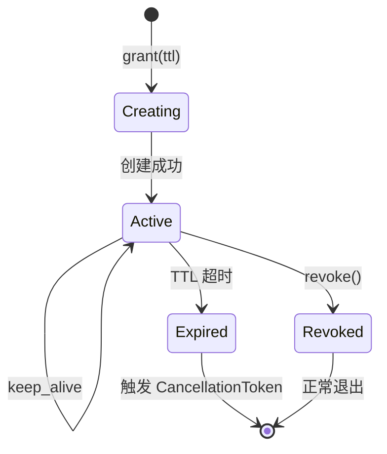

选用 etcd 作为发现后端时，Dynamo 用它维护成员记录。worker 注册端点、续租，client 观察记录变化。worker 正常关闭会清理注册；突然退出时，租约失效需要时间，因此客户端短时间还可能见到失联实例。

裸机环境应先核对 `ETCD_ENDPOINTS` 和命名空间，再看 worker 是否持续可续租、客户端是否看得到成员更新。在 Kubernetes Operator 或显式 file 发现环境，成员记录由对应后端维护，诊断应转到 Kubernetes 对象或共享发现目录。发现记录保存元信息，请求内容和模型 KV 张量沿各自路径传输。

## 租约如何从创建走向失效

## 把三个时间点分开记录

令 worker 在 t0 结束，t1 是最后一次成功续租，t2 是客户端消化删除事件。断开后如果 frontend 仍短时选到旧实例，可比较这三者的距离。不要将一次请求失败当成租约已经删除的证明，也不要以模型加载完成前的一次空查询断言注册失败。

[发现模式](https://github.com/ai-dynamo/dynamo/blob/v1.6.2/docs/fern/pages/developer-guide/knowledge-base/concepts/system-architecture/architecture.md) · [etcd 客户端](https://github.com/ai-dynamo/dynamo/blob/v1.6.2/lib/runtime/src/transports/etcd.rs) · [发现契约](https://github.com/ai-dynamo/dynamo/blob/v1.6.2/lib/runtime/src/discovery/mod.rs)
