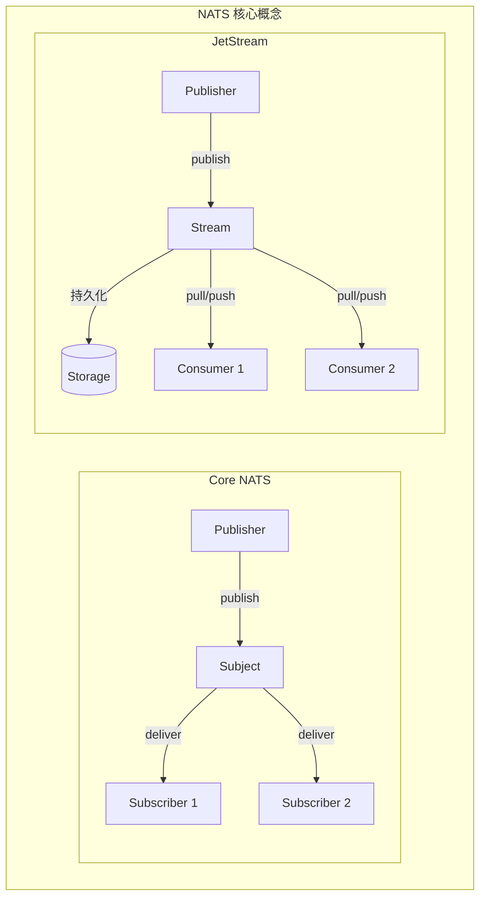

Dynamo 可以选用 NATS 承载请求或事件。1.6.2 的运行时默认请求传输为 TCP，默认事件传输为 ZMQ。若部署改用 NATS，应分别查 `DYN_REQUEST_PLANE` 与 `DYN_EVENT_PLANE`，确认 broker 所负责的流量。

例如部署保留 TCP 请求而通过 NATS 发布 KV 事件，broker 出现问题时模型请求仍可能通过 TCP 到达 worker，但路由器的缓存视图可能落后。应分别验证真实生成请求和事件订阅，并核对 frontend、worker 的 namespace 与 NATS 服务连接。需要回放事件时，核对发布者使用的 stream、保留策略和订阅方式。

## 事件发布订阅和持久化的区别

### Core NATS vs JetStream

| 特性 | Core NATS | JetStream |
|------|-----------|-----------|
| 持久化 | 否 | 是 |
| 消息重放 | 否 | 是 |
| 消息确认 | 否 | 是 |
| 消费者组 | 否 | 是 |
| 适用场景 | 实时事件 | 可靠队列 |

## 按实际订阅关系排查

先记录本部署请求与事件平面分别选了什么传输。接着确认发布和订阅两端处于同一 namespace，最后检查订阅建立前的消息是否按选定方式保留。若配置仅使用 Core NATS 的即时发布订阅，客户端重连可能需要重新建立状态。

[请求与事件传输配置](https://github.com/ai-dynamo/dynamo/blob/v1.6.2/docs/fern/pages/developer-guide/knowledge-base/concepts/system-architecture/architecture.md) · [NATS 客户端](https://github.com/ai-dynamo/dynamo/blob/v1.6.2/lib/runtime/src/transports/nats.rs) · [路由事件配置](https://github.com/ai-dynamo/dynamo/blob/v1.6.2/docs/fern/pages/developer-guide/knowledge-base/modular-components/router/configuration-and-tuning.md)
