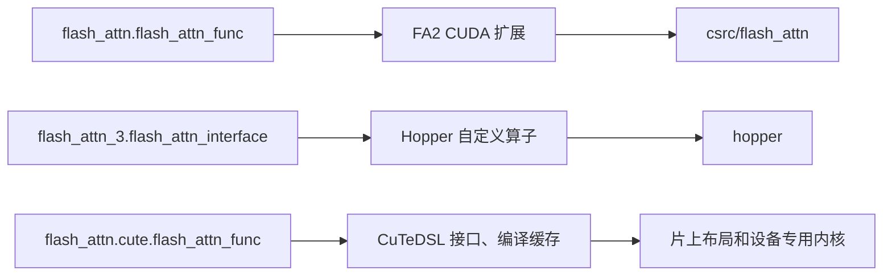

先看调用方的 `import`。同一块 Hopper 卡可以走不同软件包，Python 入口决定去哪个目录追踪。同一实现内部再按设备能力、头维度、掩码和输入形状选择具体内核。

## 对照一次稠密前向

| 路径 | 入口传下去的主要数据 | 从哪里追 |
|---|---|---|
| FA2，NVIDIA CUDA | Q/K/V 通常是 `[batch, sequence, heads, head_dim]`；Python 处理连续性、反向所需状态，把张量交给扩展 | [Python 接口](https://github.com/Dao-AILab/flash-attention/blob/v2.8.3.post2/flash_attn/flash_attn_interface.py) → [C++ 参数检查与分发](https://github.com/Dao-AILab/flash-attention/blob/v2.8.3.post2/csrc/flash_attn/flash_api.cpp) |
| FA3，Hopper | Python 调用注册到 PyTorch 的算子；Hopper 代码按 dtype、head dimension 等选择实现，producer 与 consumer 协同搬运、计算 | [Hopper 源码](https://github.com/Dao-AILab/flash-attention/tree/fa4-v4.0.0.beta39/hopper) |
| FA4，CuTeDSL | Python 接口根据设备和输入约束准备内核参数，编译并缓存相应配置的 GPU 程序；首次编译要与热态执行分开计时 | [CuTeDSL 接口](https://github.com/Dao-AILab/flash-attention/blob/fa4-v4.0.0.beta39/flash_attn/cute/interface.py) · [内核目录](https://github.com/Dao-AILab/flash-attention/tree/fa4-v4.0.0.beta39/flash_attn/cute) |

对比 SM80 和 SM90 的 C++ 走读时，先看章内源码目录。`csrc/flash_attn/src/` 和 `hopper/` 都含内核模板；出现在 `hopper/` 的 SM80 变体属于该目录的实现，要确定 Python 入口会调用哪个内核，沿对应扩展的注册和 dispatch 分支查找。ROCm 的构建与后端选择请按对应版本的说明单独核对。[FA2 平台支持](https://github.com/Dao-AILab/flash-attention/blob/v2.8.3.post2/README.md)

## FA4 的 CuTeDSL 调用如何变成 GPU 工作

以 SM100、普通稠密 FP16 输入为例。`flash_attn.cute.interface.flash_attn_func` 调用该模块内的 `FlashAttnFunc.apply`。进入 `_flash_attn_fwd` 后，先检查设备、dtype 和头维度等约束，决定 mask、GQA、split 等配置，再生成编译键。`_needs_compile` 在所选 key 没有可复用代码时触发编译；命中后直接带上本次张量和流启动已编译的 callable。换张量的数值通常不改变内核选择，换 head dimension、mask 或其他会改变特化的参数则可能得到另一份代码。[CuTeDSL 分发与缓存](https://github.com/Dao-AILab/flash-attention/blob/fa4-v4.0.0.beta39/flash_attn/cute/interface.py)

| 在 `FlashAttentionForwardSm100` 内查什么 | 一个 tile 经历的步骤 |
|---|---|
| `load`、`mma` | 搬运组准备 Q/K/V。矩阵乘计算 QK 的分数块，并按内核分配的 Tensor Memory（TMEM）布局保留中间结果。 |
| `softmax_loop` | softmax 组读取分数，在行内更新最大值与归一化量，将供下一次矩阵乘使用的权重写入对应阶段的缓冲。 |
| `correction_loop`、`correction_rescale` | 最大值改变时，旧的输出累加器须换算到新尺度；校正组与负责计算 PV 的组按阶段同步。 |
| `correction_epilogue`、`epilogue_s2g` | 归一化结果写回。源码中的 warp 角色、barrier 和 TMEM 偏移决定可重叠的区间。 |

这条路径仍遵守[两块 softmax 的合并公式](/flashattention/02-core-algorithm/01-online-softmax/)。SM100 的实现把分数、权重、输出累加器放在哪些片上位置，是论文面向 Blackwell 优化的关键。该 tag 还有 decode 专用和其他架构的分支；一次 profiler trace 应根据真实输入和命中的类解释。[SM100 前向实现](https://github.com/Dao-AILab/flash-attention/blob/fa4-v4.0.0.beta39/flash_attn/cute/flash_fwd_sm100.py) · [FA4 论文](https://arxiv.org/abs/2603.05451)

## 框架内调用

从 `torch.nn.functional.scaled_dot_product_attention` 进入时，输入通常使用 `[batch, heads, sequence, head_dim]`。设备、dtype、mask 等会影响 PyTorch 的后端选择。用 profiler 查看本次实际执行的 kernel，或用 `sdpa_kernel` 限定候选后端、检查其输入约束。[PyTorch 2.15 SDPA](https://docs.pytorch.org/docs/2.15/generated/torch.nn.functional.scaled_dot_product_attention.html)

## 从扩展深入内核

### FA2 的 C++ 内核

| 功能分类 | 文件路径 | 描述 |
|----------|----------|------|
| 数据结构 | `csrc/flash_attn/src/flash.h` | `Flash_fwd_params` / `Flash_bwd_params` 参数结构体 |
| 前向内核 | `csrc/flash_attn/src/flash_fwd_kernel.h` | 前向 attention 核心计算逻辑 |
| 反向内核 | `csrc/flash_attn/src/flash_bwd_kernel.h` | 反向 attention 核心计算逻辑 |
| 前向 Launch | `csrc/flash_attn/src/flash_fwd_launch_template.h` | 前向内核启动模板 |
| 反向 Launch | `csrc/flash_attn/src/flash_bwd_launch_template.h` | 反向内核启动模板 |
| Softmax | `csrc/flash_attn/src/softmax.h` | 在线 softmax 实现 |
| Mask | `csrc/flash_attn/src/mask.h` | Causal / sliding window mask |
| Rotary | `csrc/flash_attn/src/rotary.h` | Rotary Position Embedding 内核 |
| 内核特性 | `csrc/flash_attn/src/kernel_traits.h` | CUTLASS 内核配置 traits |
| 静态分发 | `csrc/flash_attn/src/static_switch.h` | 编译期模板参数分发宏 |
| Dropout | `csrc/flash_attn/src/dropout.h` | Dropout 随机数生成 |

### FA3 的 Hopper 实现

| 功能分类 | 文件路径 | 描述 |
|----------|----------|------|
| 数据结构 | `hopper/flash.h` | SM90 参数结构体 (扩展 FP8、PagedKV 等) |
| 前向主循环 | `hopper/mainloop_fwd_sm90_tma_gmma_ws.hpp` | TMA + GMMA + Warp Spec 前向流水线 |
| 反向主循环 | `hopper/mainloop_bwd_sm90_tma_gmma_ws.hpp` | TMA + GMMA + Warp Spec 反向流水线 |
| SM80 前向主循环 | `hopper/mainloop_fwd_sm80.hpp` | Hopper 包中的 SM80 前向回退实现 |
| SM80 反向主循环 | `hopper/mainloop_bwd_sm80.hpp` | Hopper 包中的 SM80 反向回退实现 |
| 前向内核 | `hopper/flash_fwd_kernel_sm90.h` | SM90 前向内核定义 |
| 反向内核 | `hopper/flash_bwd_kernel_sm90.h` | SM90 反向内核定义 |
| Tile 调度 | `hopper/tile_scheduler.hpp` | 工作分块调度器 |
| Softmax | `hopper/softmax.h` | 在线 softmax (SM90 优化) |
| Mask | `hopper/mask.h` | 注意力掩码 |
| Epilogue 前向 | `hopper/epilogue_fwd.hpp` | 前向计算后处理 |
| Epilogue 反向 | `hopper/epilogue_bwd.hpp` | 反向计算后处理 |
| Combine | `hopper/flash_fwd_combine_kernel.h` | Split Attention 结果合并 |
| 启发式 | `hopper/heuristics.h` | 自动选择 tile size 和 split 数量 |
| Paged KV | `hopper/paged_kv.h` | PagedAttention KV 缓存管理 |
