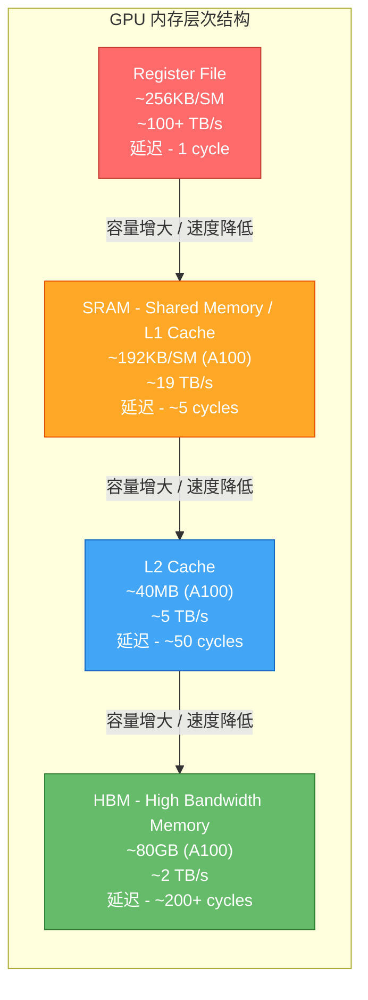
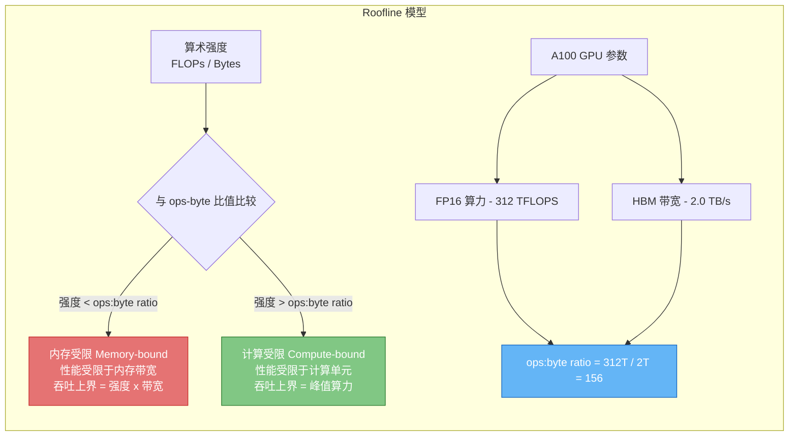

普通的三步实现把分数和概率矩阵写回显存；FlashAttention 分块计算并在片上消费它们。本章分别估算额外存储、内存传输量与两次矩阵乘的 FLOPs，说明三者如何随序列长度变化。

---

## 1. GPU 内存层次结构

现代 GPU 的内存系统是一个多级层次结构，不同层级在容量、带宽和延迟之间存在显著的权衡关系。理解这一层次结构是优化 GPU 程序的基础。

### 1.1 四级内存层次

#### Register File - 寄存器文件

- **容量**: 每个 SM (Streaming Multiprocessor) 约 256KB
- **带宽**: 理论上超过 100 TB/s（片上访问，无需经过互连）
- **延迟**: 1 个时钟周期
- **特点**: 每个线程拥有私有寄存器，是最快的存储资源。编译器负责寄存器分配，当寄存器用量超出限制时会发生 register spilling，数据被溢出到 local memory（实际位于 HBM），性能急剧下降

#### SRAM - 共享内存 / L1 Cache

- **容量**: A100 每个 SM 约 192KB（可配置 shared memory 与 L1 的比例）
- **带宽**: 约 19 TB/s（全芯片聚合带宽）
- **延迟**: 约 5 个时钟周期
- **特点**: 同一线程块 (thread block) 内的所有线程共享访问。程序员可以显式管理，是 CUDA 优化的核心资源。Flash Attention 的 tiling 策略正是围绕 SRAM 的大小来设计分块尺寸

#### L2 Cache

- **容量**: A100 约 40MB，H100 约 50MB
- **带宽**: 约 5 TB/s
- **延迟**: 约 50 个时钟周期
- **特点**: 全芯片共享，由硬件自动管理。对程序员透明，但可以通过访存模式间接影响其命中率

#### HBM - 高带宽内存

- **容量**: A100 约 80GB（HBM2e），H100 约 80GB（HBM3）
- **带宽**: A100 约 2.0 TB/s，H100 约 3.35 TB/s
- **延迟**: 200+ 个时钟周期
- **特点**: GPU 的主存，容量最大但相对最慢。所有模型参数、输入数据、中间结果默认存储在 HBM 中

### 1.2 分块工作集

一个线程块能使用的共享内存受所在 SM 和启动配置约束。整卡显存容量则由所有 SM 共享。选择 tile 时需要给 Q/K/V、部分结果和流水缓冲留出空间；真正被省掉的带宽来自同一 tile 在片上被消费，而不是把整卡的显存容量与单个 SM 的容量相除。

## 2. 计算强度与 Roofline 模型

### 2.1 算术强度

算术强度 (Arithmetic Intensity) 是衡量一个操作是计算密集型还是内存密集型的关键指标：

$$
\text{Arithmetic Intensity} = \frac{\text{FLOPs (浮点运算数)}}{\text{Bytes Transferred (内存传输字节数)}}
$$

单位为 FLOPs/Byte。这个比值决定了操作的性能瓶颈在哪里。

### 2.2 Roofline 模型

Roofline 模型是分析 GPU 程序性能上界的经典方法。其核心思想是：每个操作的实际吞吐量受限于两个上界中较低的那个。

以下 Roofline 估算采用 A100 80 GB SXM 的近似带宽和 FP16 稠密 Tensor Core 峰值。[A100 规格](https://www.nvidia.com/en-us/data-center/a100/)

- **FP16 峰值算力**: 312 TFLOPS
- **HBM 带宽**: 2.0 TB/s
- **ops:byte ratio**: $\frac{312 \times 10^{12}}{2 \times 10^{12}} \approx 156$ FLOPs/Byte

这意味着：
- 当一个操作的算术强度 **< 156** 时，该模型给出的上界由 HBM 带宽决定
- 当一个操作的算术强度 **> 156** 时，该模型给出的上界由峰值算力决定

### 2.3 标准 Attention 各操作的算术强度分析

设序列长度为 $N$，注意力头维度为 $d$（通常 $d = 64$ 或 $128$）。

#### 操作 1 - $S = QK^T$ (矩阵乘法)

- **FLOPs**: $O(N^2 \cdot d)$ — 对于 $N \times d$ 和 $d \times N$ 矩阵相乘
- **内存访问**: 读取 $Q$（$N \times d$）和 $K$（$N \times d$），写出 $S$（$N \times N$），共 $O(N \cdot d + N^2)$ 元素
- **算术强度**: $\frac{N^2 \cdot d}{N \cdot d + N^2} \approx d$（当 $N \gg d$ 时）

以 $d = 128$ 为例，算术强度约为 128，**小于** A100 的 ops:byte ratio (156)。即便是矩阵乘法，在 Attention 场景下也接近内存受限！

#### 操作 2 - $P = \text{softmax}(S)$ (逐元素操作)

- **FLOPs**: $O(N^2)$ — 指数运算 + 归一化
- **内存访问**: 读取 $S$（$N \times N$），写出 $P$（$N \times N$），共 $O(N^2)$ 元素
- **算术强度**: $\frac{N^2}{N^2} = 1$

算术强度仅为 **1**，远低于 156 的阈值。Softmax 是极度内存受限的操作！

#### 操作 3 - $O = PV$ (矩阵乘法)

- **FLOPs**: $O(N^2 \cdot d)$
- **内存访问**: 读取 $P$（$N \times N$）和 $V$（$N \times d$），写出 $O$（$N \times d$），共 $O(N^2 + N \cdot d)$ 元素
- **算术强度**: $\frac{N^2 \cdot d}{N^2 + N \cdot d} \approx d$（当 $N \gg d$ 时）

#### 强度汇总

| 操作 | FLOPs | 内存访问 | 算术强度 | 瓶颈类型 |
|------|-------|---------|---------|---------|
| $S = QK^T$ | $O(N^2 d)$ | $O(Nd + N^2)$ | $\approx d$ (~128) | 接近内存受限 |
| $P = \text{softmax}(S)$ | $O(N^2)$ | $O(N^2)$ | $\approx 1$ | **极度内存受限** |
| $O = PV$ | $O(N^2 d)$ | $O(N^2 + Nd)$ | $\approx d$ (~128) | 接近内存受限 |

> 关键发现: 在这个逐算子实现中，softmax 要单独读写分数矩阵。两次矩阵乘是否受带宽限制，还取决于实际的头维度、尺寸和设备的算力带宽比。

---

## 3. 标准 Attention 的 IO 瓶颈分析

### 3.1 逐步内存访问分析

标准 Attention 的计算按照三个独立的 kernel 依次执行，每个 kernel 都需要从 HBM 读取输入并将结果写回 HBM。


title: "三次操作怎样读写中间矩阵"
actors: ["HBM", "QK 乘法", "softmax", "PV 乘法"]
steps:
  - from: 0
    to: 1
    label: "读 Q 和 K"
    detail: "显式实现先计算一张 N×N 的完整分数矩阵 S。"
  - from: 1
    to: 0
    label: "写回 S"
    detail: "分数需要留给下一次独立调用读取。"
  - from: 0
    to: 2
    label: "读取 S"
    detail: "softmax 按行求归一化概率。"
  - from: 2
    to: 0
    label: "写回 P"
    detail: "概率矩阵 P 再占一次全矩阵写入。"
  - from: 0
    to: 3
    label: "读取 P 和 V"
    detail: "最后一个矩阵乘使用 P 和 V，输出大小为 N×d。"
  - from: 3
    to: 0
    label: "写回 O"
    detail: "整条路径上 S、P 分别写一次、读一次。"


### 3.2 详细 IO 统计

以 FP16（每个元素 2 字节）为例，详细统计每一步的 HBM 访问量：

**Step 1: $S = QK^T$**

| 方向 | 数据 | 元素数 | 字节数 |
|------|------|--------|--------|
| 读取 | $Q$ | $N \times d$ | $2Nd$ |
| 读取 | $K$ | $N \times d$ | $2Nd$ |
| 写回 | $S$ | $N \times N$ | $2N^2$ |
| **合计** | | | $4Nd + 2N^2$ |

**Step 2: $P = \text{softmax}(S)$**

| 方向 | 数据 | 元素数 | 字节数 |
|------|------|--------|--------|
| 读取 | $S$ | $N \times N$ | $2N^2$ |
| 写回 | $P$ | $N \times N$ | $2N^2$ |
| **合计** | | | $4N^2$ |

**Step 3: $O = PV$**

| 方向 | 数据 | 元素数 | 字节数 |
|------|------|--------|--------|
| 读取 | $P$ | $N \times N$ | $2N^2$ |
| 读取 | $V$ | $N \times d$ | $2Nd$ |
| 写回 | $O$ | $N \times d$ | $2Nd$ |
| **合计** | | | $2N^2 + 4Nd$ |

**总 HBM 访问量**:

$$
\text{Total IO} = (4Nd + 2N^2) + 4N^2 + (2N^2 + 4Nd) = 8Nd + 8N^2 \text{ bytes}
$$

当 $N \gg d$ 时，$N^2$ 项占主导地位：

$$
\text{Total IO} \approx 8N^2 \text{ bytes}
$$

### 3.3 数值实例

取单头、单条序列 `N=4096`、`d=128`，所有输入、输出与 S/P 均按 FP16 计算。此处按三步算子各自读写一次必要数组计数，未模拟 cache 或 kernel 的实际访存事务。

| 数据 | 单个数组 | 逻辑读写量 |
|---|---:|---:|
| Q、K、V、O | 每个 1 MiB | 三次读入，一次写回，共 4 MiB |
| S、P | 每个 32 MiB | 每个数组各一次写入、一次读回，共 128 MiB |
| 合计 | | 132 MiB，即 138,412,032 字节 |

若把这些字节全部按十进制 2 TB/s 从 HBM 传输，需要约 0.069 ms；两次矩阵乘约为 8.59 GFLOPs，按 312 TFLOPs/s 计算约 0.028 ms。这两个商是在给定假设下估算的时间尺度。实际延迟还取决于缓存命中、启动开销、并行度与各步能达到的吞吐。

### 3.4 中间矩阵 - 问题的根源

标准 Attention 的核心问题在于 $N \times N$ 的中间矩阵 $S$ 和 $P$：

1. **内存占用**: 当 $N = 8192$ 时，单个注意力头的 $S$ 矩阵就需要 $8192^2 \times 2 = 128$ MiB。多头注意力下（如 32 个头），仅这一类中间矩阵就需要 4 GiB
2. **HBM 往返**: $S$ 和 $P$ 各自需要一次写入和一次读取，贡献了总 IO 的大部分
3. **二次增长**: 随着序列长度增长，IO 量以 $O(N^2)$ 的速度增加，而有效计算（最终输出 $O$）仅需 $O(Nd)$ 的存储

---

## 4. Flash Attention 的 IO 优化思路

### 4.1 核心思想

Flash Attention 的核心思想可以用一句话概括：

> **永远不要在 HBM 中物化完整的 $N \times N$ 注意力矩阵。**

取而代之的是，将计算分块 (tiling) 到 SRAM 中完成，每个分块的大小恰好能放入 SRAM，通过在线算法 (online algorithm) 逐块累积最终结果。

### 4.2 分块策略

将 $Q$、$K$、$V$ 沿序列维度分块：

- $Q$ 分成 $T_r = \lceil N / B_r \rceil$ 个块，每块大小 $B_r \times d$
- $K, V$ 分成 $T_c = \lceil N / B_c \rceil$ 个块，每块大小 $B_c \times d$

分块时，Q、K、V、局部分数和输出累加器所需的空间共同决定可用块大小。论文用可存储的标量个数表示片上容量 $M$；实际内核还需按对应 dtype 的字节数、流水级数与线程布局计算。

### 4.3 IO 复杂度对比


title: "固定一个 Q 行块时，谁读写 HBM"
actors: ["HBM", "共享内存", "计算组", "输出"]
steps:
  - from: 0
    to: 1
    label: "装入 Q 与 KV0"
    detail: "示意 Q-outer 稠密前向，当前 Q 行块在这一任务中反复使用。"
  - from: 1
    to: 2
    label: "消费第一块"
    detail: "局部分数与指数权重在片上转换为行统计和输出累加量。"
  - from: 0
    to: 1
    label: "读取 KV1"
    detail: "下一对 K/V 块占用可用 stage，先前的分数块已经消费。"
  - from: 2
    to: 3
    label: "写回最终行块"
    detail: "所有可见块处理完，写回归一化后的 O。完整 S、P 不写回 HBM。"


### 4.4 论文中的访问次数

在 FA1 论文的两级存储模型中，以元素数为单位，序列长度为 $N$，head dimension 为 $d$，片上容量满足 $d \le M \le Nd$。显式三步前向需要 $\Theta(Nd+N^2)$ 次 HBM 元素访问。论文算法选择 $B_c=\Theta(M/d)$，依次处理 K/V 块；每个 K/V 块只载入一次，但每一轮都要扫描 Q 和部分输出，因此总访问量为 $\Theta(Nd+Nd\lceil N/B_c\rceil)=\Theta(N^2 d^2/M)$。[FA1 论文定理 2 及其证明](https://arxiv.org/abs/2205.14135)

完整 S/P 矩阵消失，使额外驻留显存随行数线性增长；经 HBM 搬运的累计数据还包含反复扫描的块。只有当 $M$ 与整个 $N \times d$ 矩阵同阶时，上式才退化到 $\Theta(Nd)$。仅给出 $N=4096,d=128$ 无法推出实测流量和加速倍数。比较实际内核用 profiler 的 DRAM 读写字节与端到端时间，分别记录两项。

### 4.6 为什么 IO 减少不影响计算正确性

Flash Attention 的数学输出与标准 Attention 在实数算术中一致（bit-exact，排除浮点重结合误差）。它减少的仅仅是不必要的 HBM 往返：

1. 中间矩阵 $S$ 和 $P$ 从未完整写入 HBM，而是在 SRAM 中即时计算、即时使用
2. 通过在线 softmax 算法（详见下一篇），每个分块的局部 softmax 统计量可以正确地合并为全局结果
3. 最终输出 $O$ 与标准算法完全相同

---

## 5. A100 vs H100 内存参数对比

不同代际 GPU 的内存层次结构差异直接影响 Flash Attention 的实现策略和性能表现。

### 5.1 硬件参数对比

| 参数 | A100 (SM80) | H100 (SM90) | 变化 |
|------|-------------|-------------|------|
| HBM 容量 | 80 GB (HBM2e) | 80 GB (HBM3) | - |
| HBM 带宽 | 2.0 TB/s | 3.35 TB/s | +67.5% |
| L2 Cache | 40 MB | 50 MB | +25% |
| Shared Memory / SM | 192 KB | 228 KB | +18.75% |
| Register File / SM | 256 KB | 256 KB | - |
| SM 数量 | 108 | 132 | +22.2% |
| FP16 Tensor Core 算力 | 312 TFLOPS | 990 TFLOPS | +217% |
| ops:byte ratio | ~156 | ~296 | +90% |
| TMA (Tensor Memory Accelerator) | 不支持 | 支持 | 新增 |

### 5.2 对 Flash Attention 的影响

**HBM 带宽提升 (2.0 -> 3.35 TB/s)**:
- 标准 Attention 在 H100 上因为带宽增加而变快，但 IO 瓶颈的本质不变
- Flash Attention 的 IO 优化在 H100 上依然关键，因为 ops:byte ratio 从 156 增长到 296，意味着更多操作变成了内存受限

**SRAM 增大 (192KB -> 228KB)**:
- Flash Attention 可以使用更大的分块尺寸 $B_r, B_c$
- 更大的分块意味着更少的 HBM 访问次数: $T_r \times T_c$ 减小
- 但分块尺寸增长有限 (约 18.75%)，实际 IO 改进不显著

**TMA (Tensor Memory Accelerator)**:
- H100 引入的专用硬件单元，用于高效的多维数据搬运
- 支持异步拷贝，计算与数据搬运可以完全重叠 (overlap)
- Flash Attention 3 (针对 H100 的版本) 充分利用 TMA 实现了更高效的数据流水线
- 无需手动计算地址偏移，由硬件处理复杂的地址映射

**算力大幅提升 (312 -> 990 TFLOPS)**:
- ops:byte ratio 几乎翻倍，意味着更多操作变得内存受限
- Flash Attention 的 IO 优化在 H100 上的收益反而更大
- 减少的每一字节 HBM 传输在 H100 上都更加珍贵

### 5.3 Roofline 对比

在 A100 上，$d=128$ 的矩阵乘法算术强度为 128，距离 ops:byte ratio (156) 不远，处于过渡区域。

在 H100 上，同样的操作算术强度仍为 128，但 ops:byte ratio 增至 296，该操作更加深入内存受限区域。这意味着：

$$
\text{H100 上的 IO 优化收益} > \text{A100 上的 IO 优化收益}
$$

比较指定 SKU、dtype 与峰值口径时，Roofline 拐点可用于判断值得测量的资源。跨硬件的实际结果还需要相同 shape 的 kernel 计数器和延迟。

---

## 回到一次前向

把额外存储、IO 复杂度和实测时间分开看：分块不需要将完整 S/P 存入 HBM；tile 能留在片上的时间决定了还要重复搬运哪些输入；kernel 的持续时间同时受内存、计算和同步限制。用[两块在线 softmax](/flashattention/02-core-algorithm/01-online-softmax/)可单独验证数学结果。

## 参考文献

1. Dao, T. (2022). *FlashAttention: Fast and Memory-Efficient Exact Attention with IO-Awareness*. NeurIPS 2022.
2. Dao, T. (2023). *FlashAttention-2: Faster Attention with Better Parallelism and Work Partitioning*.
3. Williams, S., Waterman, A., & Patterson, D. (2009). *Roofline: An Insightful Visual Performance Model for Multicore Architectures*. Communications of the ACM.
4. NVIDIA. (2022). *NVIDIA A100 Tensor Core GPU Architecture Whitepaper*.
5. NVIDIA. (2023). *NVIDIA H100 Tensor Core GPU Architecture Whitepaper*.

---

## 导航

- 上一篇：[Standard Attention 数学推导](/flashattention/01-theory/01-standard-attention/)
- 下一篇：[Flash Attention 理论推导](/flashattention/01-theory/03-flash-attention-theory/)
- [返回目录](/flashattention/00-overview/overview/)
