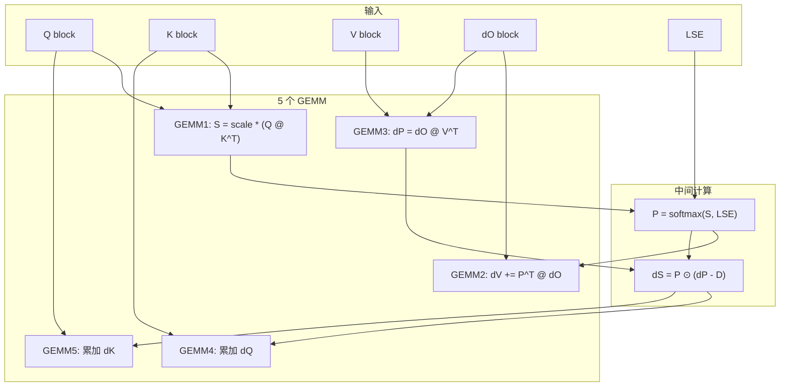

FA2 的 CUDA 路径中，Autograd 在上游产生 `dO` 时调用 `FlashAttnFunc.backward`。前向保存 Q、K、V、O、行 log-sum-exp 和必要的 RNG 状态；反向重算当前分块的注意力权重，不必从显存读回整张概率矩阵。[FA2 Autograd 入口](https://github.com/Dao-AILab/flash-attention/blob/v2.8.3.post2/flash_attn/flash_attn_interface.py)

## 从一个头的一行看梯度

设 $P=\operatorname{softmax}(S)$、$O=PV$，其中 $S=QK^T/\sqrt{d}$。没有 dropout 时，`dV = Pᵀ @ dO`，`dP = dO @ Vᵀ`。对一行 softmax，`dS = P * (dP - sum(dP * P))`。等价的行标量 `sum(dO * O)` 已能从输出得到，免去一次完整的概率矩阵访问。再乘入原有缩放，得到 Q、K 的梯度。


title: "一次反向怎样填满三份梯度"
actors: ["Autograd", "FA2 包装", "CUDA 扩展", "梯度缓冲"]
steps:
  - from: 0
    to: 1
    label: "传入 dO"
    detail: "前向保存的 Q、K、V、O 和 LSE 随 context 取回。"
  - from: 1
    to: 3
    label: "准备三个输出"
    detail: "Python 包装按 padding 后的形状分配 dQ、dK、dV。"
  - from: 1
    to: 2
    label: "调用反向"
    detail: "扩展校验条件并分发内核，按块重算概率，累加三种梯度。"
  - from: 2
    to: 3
    label: "写入结果"
    detail: "内核把数据写入已分配缓冲；GQA 的共享 KV 头要汇合相应梯度。"
  - from: 3
    to: 0
    label: "恢复原始头维"
    detail: "包装去掉可能存在的额外 padding，把输入梯度返回给 autograd。"


`csrc/flash_attn/flash_api.cpp` 的 `mha_bwd` 检查反向输入并准备参数，`run_mha_bwd` 分发到 FA2 的反向模板。启用 dropout 时须重放对应前向的 mask；GQA 中多个 Q 头共享 KV 头，相应的 dK、dV 必须归并。`deterministic` 会影响可选的反向实现。`flash_attn_with_kvcache` 是推理接口，没有对应的反向保证。[FA2 绑定](https://github.com/Dao-AILab/flash-attention/blob/v2.8.3.post2/csrc/flash_attn/flash_api.cpp) · [FA2 反向内核](https://github.com/Dao-AILab/flash-attention/blob/v2.8.3.post2/csrc/flash_attn/src/flash_bwd_kernel.h)

## FA2 的梯度缓冲区与 GQA 归并

以下为简化源码，省略无关分支。

### FlashAttnFunc.backward

当 Autograd 引擎到达 Flash Attention 节点时，调用 `FlashAttnFunc.backward()`（`flash_attn/flash_attn_interface.py`）：

```python
@staticmethod
def backward(ctx, dout, *args):
    # 步骤 1: 恢复前向保存的张量
    q, k, v, out, softmax_lse, rng_state = ctx.saved_tensors
    # 注意：q, k, v 是 padding 后的版本

    # 步骤 2: 预分配梯度张量
    dq, dk, dv = torch.empty_like(q), torch.empty_like(k), torch.empty_like(v)

    # 步骤 3: dout padding
    head_size_og = dout.size(3)
    dout_padded = dout
    if head_size_og % 8 != 0:
        dout_padded = torch.nn.functional.pad(dout, [0, 8 - head_size_og % 8])

    # 步骤 4: 调用 CUDA 反向
    _wrapped_flash_attn_backward(
        dout_padded, q, k, v, out, softmax_lse,
        dq, dk, dv,                    # 原地写入
        ctx.dropout_p, ctx.softmax_scale,
        ctx.causal, ctx.window_size[0], ctx.window_size[1],
        ctx.softcap, ctx.alibi_slopes, ctx.deterministic,
        rng_state=rng_state,
    )

    # 步骤 5: 裁剪 padding
    dq = dq[..., :head_size_og]
    dk = dk[..., :head_size_og]
    dv = dv[..., :head_size_og]

    return dq, dk, dv, None, None, None, None, None, None, None, None, None
```

**与前向的关键区别**：
- 梯度张量 `dq, dk, dv` 在 Python 层预分配，以 `empty_like` 创建
- CUDA 反向内核直接原地写入这些缓冲区
- 返回 12 个值（对应 `forward()` 的 12 个参数），其中 9 个为 `None`

### Custom Op 层

```python
# flash_attn/flash_attn_interface.py
@_torch_custom_op_wrapper(
    "flash_attn::_flash_attn_backward",
    mutates_args=("dq", "dk", "dv"),  # 声明原地修改
    device_types="cuda"
)
def _flash_attn_backward(
    dout, q, k, v, out, softmax_lse,
    dq, dk, dv,                       # 这些会被原地修改
    dropout_p, softmax_scale, causal,
    window_size_left, window_size_right, softcap,
    alibi_slopes, deterministic,
    rng_state=None,
):
    dout, q, k, v, out = [maybe_contiguous(x) for x in (dout, q, k, v, out)]
    dq, dk, dv, softmax_d = flash_attn_gpu.bwd(
        dout, q, k, v, out, softmax_lse,
        dq, dk, dv,
        alibi_slopes,
        dropout_p, softmax_scale, causal,
        window_size_left, window_size_right, softcap,
        deterministic, None, rng_state,
    )
    return softmax_d  # 返回行归一化因子（调试用）
```

`mutates_args=("dq", "dk", "dv")` 告知 `torch.compile` 这三个张量会被原地修改，编译器据此处理别名和内存规划。

---

### 参数验证与分配

```cpp
// csrc/flash_attn/flash_api.cpp

// 梯度张量分配（如果 Python 层没有传入）
at::Tensor dq, dk, dv;
if (dq_.has_value()) { dq = dq_.value(); }
else { dq = torch::empty_like(q); }

// GQA 时 dk, dv 需要扩展维度
if (num_heads_k != num_heads) {
    dk = torch::empty({batch_size, seqlen_k, num_heads, head_size}, ...);
    dv = torch::empty({batch_size, seqlen_k, num_heads, head_size}, ...);
    // 后面会归约: (B, S, H, D) → (B, S, Hk, D)
}

// softmax_d: 反向中间结果
auto softmax_d = torch::empty(
    {batch_size, num_heads, seqlen_q_rounded},
    opts.dtype(at::kFloat)
);

// dq_accum: dQ 累加缓冲（FP32）
auto dq_accum = torch::empty(
    {batch_size, seqlen_q_rounded, num_heads, head_size_rounded},
    opts.dtype(at::kFloat)
);
```

### set_params_dgrad

`set_params_dgrad()`（`csrc/flash_attn/flash_api.cpp`）首先调用 `set_params_fprop()` 设置前向参数，然后添加反向特有的字段：

```cpp
void set_params_dgrad(Flash_bwd_params &params, ...) {
    // 复用前向参数设置
    set_params_fprop(params, batch_size, seqlen_q, seqlen_k,
                     seqlen_q_rounded, seqlen_k_rounded,
                     num_heads, num_heads_k, head_size, head_size_rounded,
                     q, k, v, out, ...);

    // 反向特有指针
    params.do_ptr = dout.data_ptr();       // 上游梯度
    params.dq_ptr = dq.data_ptr();         // Q 梯度
    params.dk_ptr = dk.data_ptr();         // K 梯度
    params.dv_ptr = dv.data_ptr();         // V 梯度

    // 步长设置
    params.do_row_stride = dout.stride(-3);
    params.dq_row_stride = dq.stride(-3);
    params.dk_row_stride = dk.stride(-3);
    params.dv_row_stride = dv.stride(-3);

    // 累加缓冲
    params.dq_accum_ptr = dq_accum.data_ptr();
    params.dsoftmax_sum = softmax_d.data_ptr();  // Σ(dout · out) 行和

    // 确定性标志
    params.deterministic = deterministic;
}
```

**反向额外的参数**：

| 字段 | 类型 | 用途 |
|------|------|------|
| `do_ptr` | `void*` | 上游梯度 dOut |
| `dq_ptr` | `void*` | Q 梯度输出 |
| `dk_ptr` | `void*` | K 梯度输出 |
| `dv_ptr` | `void*` | V 梯度输出 |
| `dq_accum_ptr` | `void*` | dQ FP32 累加缓冲 |
| `dsoftmax_sum` | `void*` | $D_i = \sum_j dO_{ij} \cdot O_{ij}$ |
| `deterministic` | `bool` | 确定性模式 |

### RNG 状态恢复

```cpp
// csrc/flash_attn/flash_api.cpp
if (rng_state.has_value()) {
    // 使用前向保存的 RNG 状态
    params.rng_state = reinterpret_cast<uint64_t*>(rng_state.value().data_ptr());
}
```

这确保反向传播时能重放与前向完全相同的 Dropout mask。

### 问题

在 GQA 中，`num_heads > num_heads_k`。前向时多个 Q 头共享一个 KV 头；反向时需要将这些 Q 头产生的 dK/dV 梯度归约到对应的 KV 头。

### C++ 层归约

```cpp
// csrc/flash_attn/flash_api.cpp
if (num_heads_k != num_heads) {
    // dk_expanded: (B, S, H, D) → reshape → (B, S, Hk, H/Hk, D)
    at::sum_out(dk,
        at::reshape(dk_expanded, {batch_size, seqlen_k, num_heads_k,
                                   num_heads / num_heads_k, head_size}),
        {3}  // 在 group 维度求和
    );
    at::sum_out(dv,
        at::reshape(dv_expanded, {batch_size, seqlen_k, num_heads_k,
                                   num_heads / num_heads_k, head_size}),
        {3}
    );
}
```

内核计算时 dK/dV 按完整头数分配（`num_heads` 个头），每个 Q 头独立计算对应 KV 头的梯度贡献。计算完成后，C++ 层将同一 KV 头对应的所有 Q 头梯度求和。

FA3 的 SM90 实现把准备、主循环和结果回写组织在 `hopper/` 中；如要分析这个实现的争用与并行度，可接着读[Hopper 反向内核](/flashattention/03-cuda-kernel/04-backward-kernel-impl/)。FA4 的反向在 `flash_attn/cute/` 调用 CuTeDSL 路径；功能和 dtype 应以所选架构及 tag 的条件为准。[FA4 接口与反向实现](https://github.com/Dao-AILab/flash-attention/blob/fa4-v4.0.0.beta39/flash_attn/cute/interface.py)

## 对照 FA3 的 Hopper 循环

以下示意不含 dropout 的密集路径。FA3 的内核调度是这里的观察对象。

### N-outer Q-inner 循环

反向采用与前向相反的循环顺序——外层遍历 K/V 块（N 维度），内层遍历 Q 块：

```
for each (n_block, bidh, bidb) from Scheduler:
    加载 K[n_block], V[n_block]  // 一次性加载
    初始化 dK_accum = 0, dV_accum = 0

    for m_block in Q_blocks:    // 内层遍历 Q
        加载 Q[m_block], dO[m_block], LSE[m_block]
        bwd_step():
            S = scale * (Q @ K^T)           // 重计算 QK^T
            P = softmax(S, LSE)   // 使用保存的 LSE 重计算 P
            dV += P^T @ dO        // 累加 dV
            dP = dO @ V^T
            dS = P ⊙ (dP - D)    // D = rowsum(dO ⊙ O)
            dQ += scale * (dS @ K)          // 累加 dQ（写回 HBM）
            dK += scale * (dS^T @ Q)        // 累加 dK（寄存器）

    写出 dK[n_block], dV[n_block]  // 内层结束后写出
```

### bwd_step 的 5 个 GEMM

每次 `bwd_step()` 包含 5 个矩阵乘法操作：


