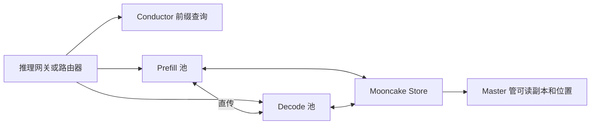
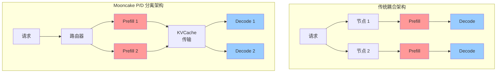
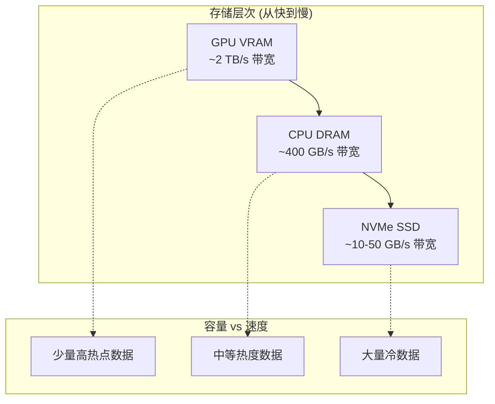
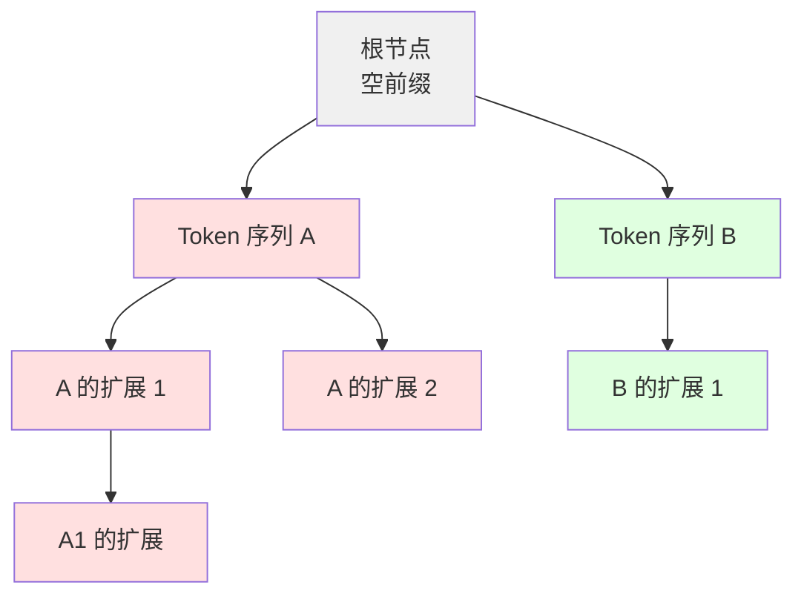
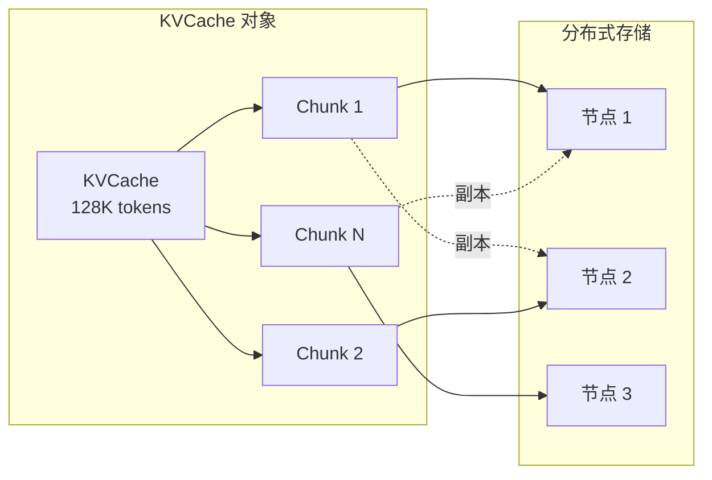
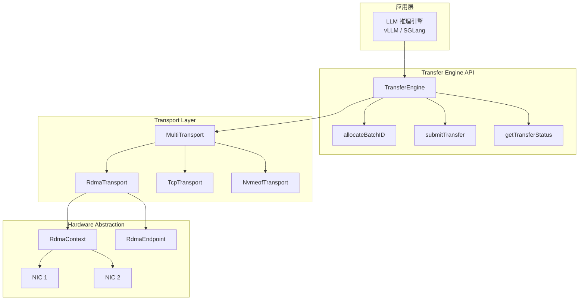

### 3.1 架构总览

Mooncake 提供负责索引、存储和传输的组件。v0.3.14 的开源 Conductor 持有各实例的前缀命中信息，接收请求和分配 P/D 的逻辑在上层路由器。Transfer Engine 根据配置搬运字节；使用共享存储时，Store Master 管理对象和副本位置。



[当前架构](https://github.com/kvcache-ai/Mooncake/blob/v0.3.14/docs/source/design/architecture.md) · [FAST 论文](https://www.usenix.org/conference/fast25/presentation/qin)

### 3.2 P/D 分离架构详解

#### 3.2.1 分离架构的核心思想

P/D（Prefill/Decode）分离是 Mooncake 架构的核心设计决策。与传统的将两个阶段耦合在同一节点的方案不同，Mooncake 将它们部署在独立的节点池中：



#### 3.2.2 分离带来的优势

**1. 消除阶段干扰**

在耦合架构中，长 Prefill 请求会阻塞同节点上的 Decode 请求，导致 TBT 超时。分离后：
- Prefill 节点可以专注于处理计算密集型任务
- Decode 节点不受 Prefill 干扰，TBT 稳定可控

**2. 独立资源配置**

| 阶段 | 资源需求 | 优化方向 |
|------|----------|----------|
| Prefill | 高计算能力、中等内存 | 最大化 MFU |
| Decode | 高内存带宽、大 batch size | 最大化并发请求数 |

分离后可以针对不同阶段优化配置：
- Prefill 节点可以使用计算更强的 GPU
- Decode 节点可以配置更大的显存和 batch size

**3. 弹性伸缩**

可以根据工作负载特征独立调整 P/D 节点比例：
- 长上下文场景：增加 Prefill 节点
- 高并发场景：增加 Decode 节点

#### 3.2.3 分离带来的挑战：KVCache 传输

P/D 分离的代价是需要在 Prefill 完成后将 KVCache 传输到 Decode 节点。这引入了额外的网络开销：

**传输量估算**（以 LLaMA3-70B 为例）：

| 上下文长度 | KVCache 大小 | 100GB/s 网络传输时间 |
|------------|--------------|---------------------|
| 4K tokens | 1.28 GB | ~13 ms |
| 32K tokens | 10.24 GB | ~100 ms |
| 128K tokens | 40.96 GB | ~400 ms |

**关键洞察**：Mooncake 通过以下机制将传输开销最小化：

1. **Prefix Caching**：如果目标 Decode 节点已有部分 KVCache 缓存，只需传输差异部分
2. **并行传输**：利用多网卡聚合带宽
3. **流水线**：KVCache 可以边生成边传输

### 3.3 Mooncake Store 设计概览

Mooncake Store 是系统的核心组件，实现了分布式 KVCache 存储池。

#### 3.3.1 存储层次结构



Mooncake Store 利用集群中所有节点的多级存储资源：

| 存储层 | 介质 | 典型带宽 | 典型容量 (8 节点) |
|--------|------|----------|------------------|
| L1 | GPU VRAM | 2-3 TB/s | 640 GB - 1.28 TB |
| L2 | CPU DRAM | 400 GB/s | 8-16 TB |
| L3 | NVMe SSD | 10-50 GB/s | 数十 TB |

#### 3.3.2 KVCache 对象模型

Mooncake Store 将 KVCache 组织为树形结构：



**Radix Tree 结构特点**：
- 公共前缀共享存储空间
- 支持快速前缀匹配
- 天然支持 Prefix Caching

#### 3.3.3 分片与复制策略

KVCache 被分成固定大小的 **Chunk**（通常 4KB-64KB），每个 Chunk 可以：
- 存储在不同节点上
- 拥有多个副本（用于热点数据）
- 在不同存储层之间迁移



### 3.4 Transfer Engine 设计概览

Transfer Engine 是 Mooncake 的高性能数据传输层，负责在节点间高效传输 KVCache 数据。

#### 3.4.1 核心设计目标

1. **高带宽**：充分利用多 RDMA 网卡的聚合带宽
2. **低延迟**：最小化传输开销
3. **拓扑感知**：自动选择最优传输路径
4. **协议抽象**：统一 API 支持多种传输协议

#### 3.4.2 架构分层



#### 3.4.3 关键代码结构

从 `transfer_engine.h` 中可以看到 Transfer Engine 的核心 API：

```cpp
class TransferEngine {
public:
    // 初始化引擎
    int init(const std::string& metadata_conn_string,
             const std::string& local_server_name,
             const std::string& ip_or_host_name,
             uint64_t rpc_port);

    // 安装传输协议
    Transport* installTransport(const std::string& proto, void** args);

    // 注册本地内存区域 (用于 RDMA)
    int registerLocalMemory(void* addr, size_t length,
                           const std::string& location,
                           bool remote_accessible,
                           bool update_metadata = true);

    // 分配 Batch ID (用于批量传输)
    BatchID allocateBatchID(size_t batch_size);

    // 提交传输请求
    Status submitTransfer(BatchID batch_id,
                         const std::vector<TransferRequest>& entries);

    // 获取传输状态
    Status getTransferStatus(BatchID batch_id, size_t task_id,
                            TransferStatus& status);

    // 打开远程 Segment
    SegmentHandle openSegment(const std::string& segment_name);
};
```

**核心数据结构**（来自 `transport.h`）：

```cpp
struct TransferRequest {
    enum OpCode { READ, WRITE };

    OpCode opcode;           // 读或写操作
    void* source;            // 本地地址
    SegmentID target_id;     // 目标 Segment
    uint64_t target_offset;  // 目标偏移
    size_t length;           // 传输长度
};

enum TransferStatusEnum {
    WAITING,     // 等待执行
    PENDING,     // 执行中
    COMPLETED,   // 完成
    FAILED,      // 失败
    TIMEOUT      // 超时
};
```

### 3.5 缓存位置与路由

路由器将提示 token 和模型、租户等条件传给 Conductor。后者根据引擎和 Store 的缓存事件回答各实例与存储层的前缀覆盖情况。路由器才会把命中与等待队列、可用设备及 SLO 一起考虑。[索引的调用顺序](../12-code-walkthrough/05-conductor-scheduling-trace.md)

### 3.6 两种元数据

Store Master 持有对象副本与放置信息。Transfer Engine 则需交换 peer、segment 等连接信息；`P2PHANDSHAKE` 可直接交换，也可按部署选 HTTP 等元数据后端。Master 高可用的选主与快照又有自己的部署要求。用本地 TCP 验证时可以只启动 Store Master 和客户端。[官方部署说明](https://github.com/kvcache-ai/Mooncake/blob/v0.3.14/docs/source/deployment/mooncake-store-deployment-guide.md)
