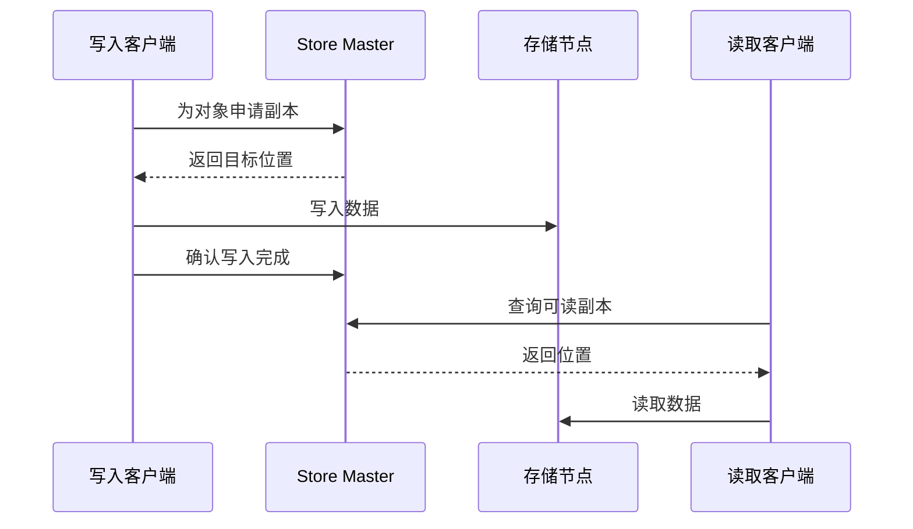

写入 `manual/42` 时，Master 根据对象长度、租户、可用 segment 和副本策略选择位置。客户端拿到目标描述后搬运字节，写入结束再报告完成。读者查询该 key 时获得可用副本，随后直接从相应的数据路径读取。Master 持有位置和生命周期信息，KV 字节驻留在提供存储的节点上。[存储设计](https://github.com/kvcache-ai/Mooncake/blob/v0.3.14/docs/source/design/store/mooncake-store.md) · [Master 实现](https://github.com/kvcache-ai/Mooncake/blob/v0.3.14/mooncake-store/src/master_service.cpp)



对象是否存在、是否有可读副本、是否仍有有效读取租约，是不同的问题。排查请求时要同时看 Master 中的对象状态和客户端的实际返回结果。v0.3.14 对租户元数据、配额和驱逐进行了更新；单个租户触及配额时，即使集群总量还有余量，其写入也可能受限。[租户与配额](https://github.com/kvcache-ai/Mooncake/blob/v0.3.14/docs/source/deployment/multi-tenancy.md) · [本版变更](https://github.com/kvcache-ai/Mooncake/releases/tag/v0.3.14)

## 三个能在源码里跟踪的关口

`PutStart` 调用 `PrepareWriteStart`，检查请求并决定目标副本。`PutEnd` 要确认发起写入的客户端与元数据一致，随后推进副本的完成状态。若写到了数据缓冲却没有走到成功结束，读取方就可能发现对象还没有可读副本。

`GetReplicaList` 的读取路径进入 `ReadReplicaList`。所有副本都已移除时可以得到 `OBJECT_NOT_FOUND`；尚有对象但没有可读副本时可能得到 `REPLICA_IS_NOT_READY`。成功查询会授予读租约，避免对象在该读取窗口中被回收。管理用只读查询和普通读查询有不同副作用，诊断命令应选择正确入口。[读路径源码](https://github.com/kvcache-ai/Mooncake/blob/v0.3.14/mooncake-store/src/master_service.cpp)

```bash
rg -n 'MasterService::(PrepareWriteStart|PutStart|PutEnd|PutRevoke|ReadReplicaList)' mooncake-store/src/master_service.cpp
```

把写方的 key、租户、客户端 ID 与读方返回值一起记录。一个失败发生在分配、字节传输还是发布可读副本，此时可以在同一条时间线上区分。

## 元数据按租户组织，锁落在 key 上

`NamespaceTable` 先按租户找到 namespace；`ObjectRoute` 用 key 的哈希在 1,024 个 stripe 中定位 `KeySlot`。stripe 的锁只保护 slot 的查找、创建与删除，随后由 key 自己的锁保护对象记录。写不同 key 的客户端即使落在同一个 stripe，也无需在整个数据传输期间共享一把锁。

`MetadataAccessorRO`、`MetadataAccessorRW` 在作用域内持有该 key；遍历和稍后执行的回调用 `ObjectRef` 的 generation 区别同名对象的不同发布。如果扫描器记下旧对象，释放锁后写方删掉并重新发布同一个 key，扫描器只能操作自己看到的那一代。这正是这里不宜用一张“哈希桶加互斥锁”的简图代替实现细节的原因。[元数据结构与访问器](https://github.com/kvcache-ai/Mooncake/blob/v0.3.14/docs/source/design/store/metadata-management.md)

## 写到一半失败，谁可以撤销

`PutStart` 为需要的副本预分配空间并登记 `PROCESSING`。同名对象已有完成副本或仍处在有效写窗口内，再次 start 可能返回 `OBJECT_ALREADY_EXISTS`。数据传输失败时，原写入者可用 `PutRevoke` 撤回指定类型的未完成副本。另一个 client ID 不能替它结束或撤销；已经结束的写入也不能通过 revoke 变成普通删除。


title: "完成与撤销走向两个不同结局"
rows: ["写入 A", "写入 B", "可读副本"]
steps:
  - title: "两次分配"
    detail: "两个不同的 key 都完成了 PutStart，数据尚未发布。"
    cells:
      - ["处理中"]
      - ["处理中"]
      - ["空"]
    focus: [[0, 0], [1, 0]]
  - title: "A 传输成功"
    detail: "A 的写者提交 PutEnd，Master 发布 A。"
    cells:
      - ["已完成"]
      - ["处理中"]
      - ["A"]
    focus: [[0, 0], [2, 0]]
  - title: "B 传输失败"
    detail: "B 的写者调用 PutRevoke 撤销未完成的写入。A 依然可以读取。"
    cells:
      - ["已完成"]
      - ["已撤销"]
      - ["A"]
    focus: [[1, 0], [2, 0]]


同一个 `PutEnd` 再到来时，代码还会检查目标副本类型及它们是否已经完成。恢复测试值得检查两个边界：写入者掉线之后另一个客户端能否看到残缺数据；重试一次成功结束是否会重复发布。验证用 [Master 并发场景测试](https://github.com/kvcache-ai/Mooncake/blob/v0.3.14/mooncake-store/tests/master_service_concurrent_scenario_test.cpp)和实际 tag 的 `PutEnd`、`PutRevoke` 分支。

## 读取租约和驱逐互相制约

Master 返回位置和租约后，客户端可能仍在搬运。回收内存要同时考虑租约、软或硬 pin、对象是否仍有进行中的任务，以及后端是否保有其他副本。内存占用上升会触发 `EvictionThreadFunc`；`EvictNamespaceMemory` 可以针对一个 namespace 工作。开启 SSD offload 时，回收候选还可能进入后台落盘，`offload_on_evict` 决定是否推迟到驱逐时才写 SSD。只把驱逐描述成 LRU 会漏掉“此刻允许删吗”和“删哪一层”两个判断。[驱逐执行](https://github.com/kvcache-ai/Mooncake/blob/v0.3.14/mooncake-store/src/eviction/evictor.cpp) · [分层参数](https://github.com/kvcache-ai/Mooncake/blob/v0.3.14/docs/source/deployment/mooncake-store-deployment-guide.md)

## 客户端失联后，哪些引用必须清理

客户端挂载 segment 后参与心跳。`ClientMonitorFunc` 取出各客户端的存活记录，由 `EvaluateAndRetire` 根据活跃和怀疑超时判断是否退出服务。退场任务交给 `ProcessClientOffboardingJob`；清理不能只删客户端名称，还要使该节点上失效的副本不再进入读取结果。诊断时分别检查“对象仍存在”“某个句柄已失效”“另一份副本仍可读”。持有全部数据的客户端失联与单纯重启 Master 是两个不同的故障场景。[客户端退场](https://github.com/kvcache-ai/Mooncake/blob/v0.3.14/mooncake-store/src/client_offboarding.cpp) · [Master 代码](https://github.com/kvcache-ai/Mooncake/blob/v0.3.14/mooncake-store/src/master_service.cpp)
