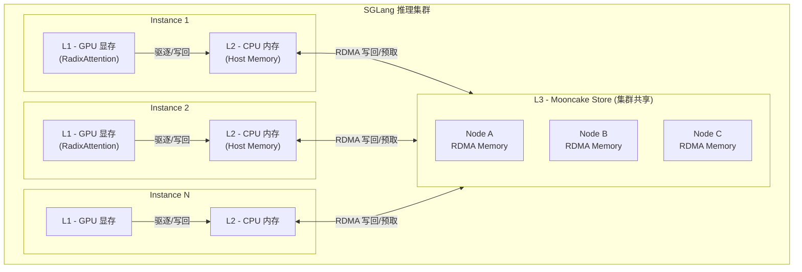

SGLang 用 Mooncake 提供两种能力。P/D 部署在两个实例之间交接当前请求的 KV；HiCache 用 Mooncake Store 作为外部缓存层，使后来的请求能复用已经离开本地设备的块。

|场景|SGLang 入口|运行时看什么|
|---|---|---|
|P/D 直传|prefill / decode 的 `--disaggregation-mode`，Mooncake transfer backend|bootstrap 成功、两端关联同一请求、有实际 KV 传输|
|HiCache L3|`--enable-hierarchical-cache --hicache-storage-backend mooncake`|Store 可访问，数据实际写入 L3，后来又读回|

下图以多个实例通过 RDMA 接入同一 L3 池为例，展示 GPU、主机和共享池的相对位置。



## 接入已有 Store

启动能提供给该集成使用的 Master，并检查本机或远端是否贡献了足够的 segment。以下是上游单机配置的入口，`MODEL_PATH` 指向已下载模型；容量、页大小和模型/设备匹配。

```bash
mooncake_master --enable_http_metadata_server=true
```

```bash
MOONCAKE_MASTER=127.0.0.1:50051 MOONCAKE_GLOBAL_SEGMENT_SIZE=8gb \
python -m sglang.launch_server --model-path "$MODEL_PATH" --page-size 64 \
  --enable-hierarchical-cache --hicache-storage-backend mooncake \
  --hicache-storage-prefetch-policy timeout
```

`timeout` 控制为 L3 预取等待多久。热缓存实验应区分显存命中、Host 缓存命中与 Store 命中。P/D 的启动与路由步骤另见上游双实例示例。[HiCache 快速入门](https://github.com/kvcache-ai/Mooncake/blob/v0.3.14/docs/source/deployment/integrations/sglang/hicache-quick-start.md) · [P/D 直传部署](https://github.com/kvcache-ai/Mooncake/blob/v0.3.14/docs/source/deployment/integrations/sglang/pd-disaggregation.md)
