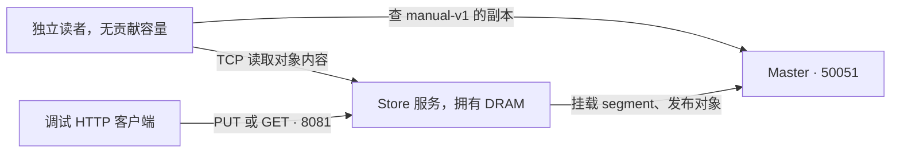

这条部署路径先在一台 Linux 主机上验证三个进程：Master 管对象名与副本信息，Store 服务贡献 DRAM 并提供调试 HTTP 入口，独立 Python 读者只读，自己不贡献空间。三者先用 TCP。把相同配置迁到两台机器时，能分别定位控制面不可达、数据面不可达和内容不一致。

## 安装与启动

非 CUDA 的 Python wheel 足以执行下面的 CPU 实验。新建虚拟环境，按[快速开始](/mooncake/00-beginner-guide/03-quick-start-tutorial/)安装系统依赖，随后在三个终端分别激活同一环境。安装 `aiohttp` 供调试 HTTP 服务使用。GPU 部署要另选匹配的包；上游提供 `kvcacheai/mooncake:0.3.14-cuda12` 和 `0.3.14-cuda13` 镜像。轮子的 Python、平台和运行库约束分别以目标变体为准。[官方安装矩阵](https://github.com/kvcache-ai/Mooncake/blob/v0.3.14/docs/source/getting_started/quick-start.md)

```bash
python -m pip install 'mooncake-transfer-engine-non-cuda==0.3.14' aiohttp
mooncake_master --rpc_port=50051 --metrics_port=9003
```

第二个终端启动贡献容量的服务。`--port=8081` 属于此 Python 进程。Master 仍在 50051；使用 `P2PHANDSHAKE` 时不需要另起 HTTP 元数据服务。

```bash
MOONCAKE_MASTER=127.0.0.1:50051 \
MOONCAKE_LOCAL_HOSTNAME=127.0.0.1 \
MOONCAKE_TE_META_DATA_SERVER=P2PHANDSHAKE \
MOONCAKE_PROTOCOL=tcp \
MOONCAKE_GLOBAL_SEGMENT_SIZE=128mb \
MOONCAKE_LOCAL_BUFFER_SIZE=64mb \
python -m mooncake.mooncake_store_service --port=8081
```

第三个终端先检查 Master，再发一组实际的 PUT/GET。REST 测试入口接收 JSON 中的文本，GET 返回原始字节；二进制 tensor 建议走[注册缓冲的 Python 接口](/mooncake/08-integration/03-python-api-overview/)。

```bash
curl -fsS http://127.0.0.1:9003/metrics/summary
curl -fsS -X PUT 'http://127.0.0.1:8081/api/put' \
  -H 'Content-Type: application/json' \
  -d '{"key":"manual-v1","value":"shared-manual"}'
curl -fsS http://127.0.0.1:8081/api/get/manual-v1
```

预期最后一条输出 `shared-manual`。再用独立 Python 进程从同一个 Master 查这个 key。把 `global_segment_size` 设为 0，让该进程只提供自己的传输缓冲，不成为存储节点。启动时设置 `MC_STORE_MEMCPY=0` 并指定 `protocol="tcp"`，以此次读回验证同机跨进程 TCP。以下脚本保存为 `read_manual.py`，用 `MC_STORE_MEMCPY=0 python read_manual.py` 执行。

```python
from mooncake.store import MooncakeDistributedStore

store = MooncakeDistributedStore()
try:
    status = store.setup(
        local_hostname="127.0.0.1", metadata_server="P2PHANDSHAKE",
        global_segment_size=0, local_buffer_size=64 * 1024**2,
        protocol="tcp", rdma_devices="", master_server_addr="127.0.0.1:50051",
    )
    assert status == 0, status
    assert store.get("manual-v1") == b"shared-manual"
    print("reader verified 13 bytes")
finally:
    store.close()
```

以上命令在 Linux amd64、Python 3.12.11 和 Mooncake 非 CUDA wheel 0.3.14 下完成验证。REST 实际返回 `shared-manual`，独立 reader 输出 `reader verified 13 bytes`。两端运行在同一容器，此验证覆盖跨进程 TCP，未测量物理网卡与 RDMA。

## 三个进程怎样连起来



切换为跨机时，writer 和 reader 的 `local_hostname` 都应是对端可以实际访问的网卡地址，Master 地址也要改为双方可达的地址。`P2PHANDSHAKE` 表示点对点元数据交换，同样可以用于跨机；仍需要对端可达的数据端口。先在 A 上写入，保持 A 的贡献进程运行，在 B 上用零贡献 reader 校对内容，再更换 RDMA 协议。涉及 RDMA 时另核对 NIC、权限、内存注册和流量计数器。[部署与网络配置](https://github.com/kvcache-ai/Mooncake/blob/v0.3.14/docs/source/deployment/mooncake-store-deployment-guide.md)

| 观察结果 | 下一项检查 |
|---|---|
| Master 的 metrics 可达，写入失败 | 是否存在已挂载且有可用空间的 segment，服务进程的 setup 是否成功。 |
| HTTP GET 成功，独立 reader 失败 | reader 的 Master/tenant 是否一致，Store 节点公布的网络地址能否从 reader 访问。 |
| 增加存储节点之后仍有旧数据丢失 | 增容只新增可放置容量。移除旧节点前确认原对象有其他可读副本或已完成持久化。 |
| Store 字节能读通，引擎没有缓存收益 | 查 vLLM 的外部前缀查找与加载完成，或 SGLang 的 HiCache 实际层级命中，再检查是否发出了同一 token 前缀。 |

部署推理引擎前，先决定是否需要按 key 共享对象。vLLM 的 `MooncakeStoreConnector` 使用共享 Store；`MooncakeConnector` 用 P/D 直接交接已注册的设备块，要额外部署遵循 transfer ID 协议的代理。[vLLM 接入](/mooncake/08-integration/01-vllm-integration/) · [Store 和直传的生命周期](/mooncake/12-code-walkthrough/03-kvcache-lifecycle/)

实验结束时先停读者与发请求的服务，再停贡献 segment 的进程，最后停 Master。以上实验使用 DRAM，重启全部进程后需要重新写入。希望保留数据或验证故障转移时，按具体副本策略和 [HA/SSD 部署流程](https://github.com/kvcache-ai/Mooncake/blob/v0.3.14/docs/source/deployment/mooncake-store-deployment-guide.md)另做恢复测试。
