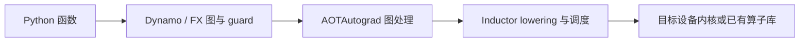

`torch.compile(f)` 返回一个可调用对象。第一次以某组输入调用时，TorchDynamo 从 Python 帧捕获可追踪的张量计算，产生 FX 图和保证图可复用的条件（guard）。后续调用先检查已有缓存条目。所有条目都不匹配且仍允许编译时，Dynamo 才会捕获新的图。[PyTorch 2.15 接口](https://docs.pytorch.org/docs/2.15/generated/torch.compile.html)

## 三次调用，何时复用

让 `f(x) = x.sin() + 1` 在静态形状下依次接收长度 4、4、8 的 CPU 张量。第一次捕获图，第二次输入值变了但形状、dtype 等条件一致，第三次尺寸变化触发新的专门化。编译计数应为 1、1、2。



```python
import torch

captures = []
def observe(graph, example_inputs):
    captures.append(graph)
    return graph.forward

def f(x):
    return x.sin() + 1

compiled = torch.compile(f, backend=observe, dynamic=False)
for length in (4, 4, 8):
    x = torch.randn(length)
    torch.testing.assert_close(compiled(x), f(x))
    print(length, len(captures))
assert len(captures) == 2
```

自定义 backend 返回 `graph.forward`，所以计数表示 Dynamo 产生了几张图。要观察 Inductor 生成的代码，去掉 `backend=observe`，并在启动 Python 前设置 `TORCH_LOGS="recompiles,output_code"`。`dynamic=None` 是默认策略；形状变化可能让 Dynamo 生成适用于一组尺寸的符号图，结果与本例显式设置 `dynamic=False` 时不同。

## 图捕获、求导、代码生成



Dynamo 的图捕获与后端代码生成是两个接口。常用的 Inductor 路线通过 AOTAutograd 处理图与需要的梯度，在训练路径构造前向、反向图。Inductor 决定能融合哪些算子，再按设备与操作选择实现。CPU 可用 C++，GPU 可用 Triton，也可调库或选择特定模板；2.15 还在相应 Blackwell 量化 GEMM 路径中使用 NVGEMM。[Inductor 源码](https://github.com/pytorch/pytorch/tree/v2.15.0/torch/_inductor) · [2.15 发布说明](https://pytorch.org/blog/pytorch-2-15-release-blog/)

### 从 FX 到一次内核调用

对 `f(x) = x.sin() + 1`，FX 图记录了对相同数据区域的逐元素运算。观测 backend 收到的 `graph.graph` 能直接打印各节点及输入关系，节点上的元数据帮助后端推断目标设备与布局。Inductor 做 lowering 后，若两次运算都能使用相同迭代空间、没有对中间张量可见的别名或额外使用，可以在同一内核里先算正弦再加一；这样只读取一次输入，写回最终输出。查看生成代码里的循环或内核，能确认这次融合实际发生在哪里。

| 查看位置 | 可以回答的问题 |
|---|---|
| `torch/_dynamo/convert_frame.py` | 是哪个 Python frame 触发捕获？ |
| `torch/fx/graph.py` | 某个中间结果被几个节点使用？ |
| `torch/_inductor/lowering.py`、`scheduler.py` | 运算怎样降为 IR，调度器为何允许或拒绝融合？ |
| `TORCH_LOGS=output_code` | 在当前输入和设备上实际生成了哪些调用？ |

使用默认后端检查数值时仍与 eager 进行比较；由于浮点运算顺序或融合发生变化，要用与 dtype 相配的容差。[FX](https://docs.pytorch.org/docs/2.15/fx.html) · [Inductor 源码](https://github.com/pytorch/pytorch/tree/v2.15.0/torch/_inductor)

## 区分 graph break、重编译和性能

- Graph break 发生在一次捕获中：默认配置下 Dynamo 可运行捕获的片段，交回 Python 处理边界，再继续捕获。要求整图可用 `fullgraph=True` 暴露第一个不支持的位置。
- 重编译发生在后续调用：已有 guard 未覆盖新输入，生成另一条专门化。用 `TORCH_LOGS="graph_breaks,recompiles"` 确认是哪种情况。
- 计时分别记录首次调用和预热后的重复调用。相同 shape、dtype、设备和同步策略下比较 eager 与默认 Inductor；上面的观测 backend 用于验证缓存行为。

[FX 图](/pytorch/05-advanced-topics/02-fx-tutorial/) · [Guard 的检查过程](/pytorch/05-advanced-topics/06-guard-mechanism/) · [Inductor 实现](/pytorch/05-advanced-topics/07-inductor-overview/)
