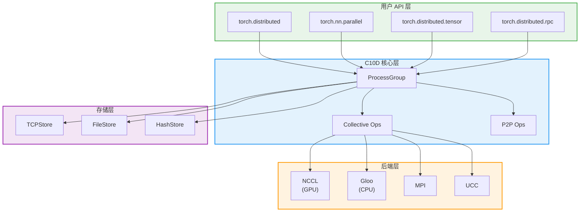
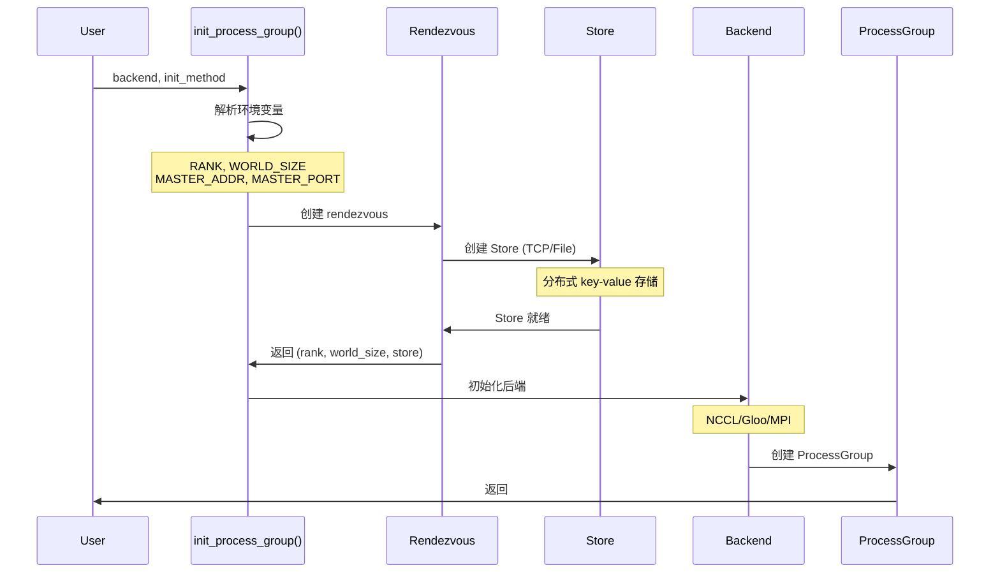
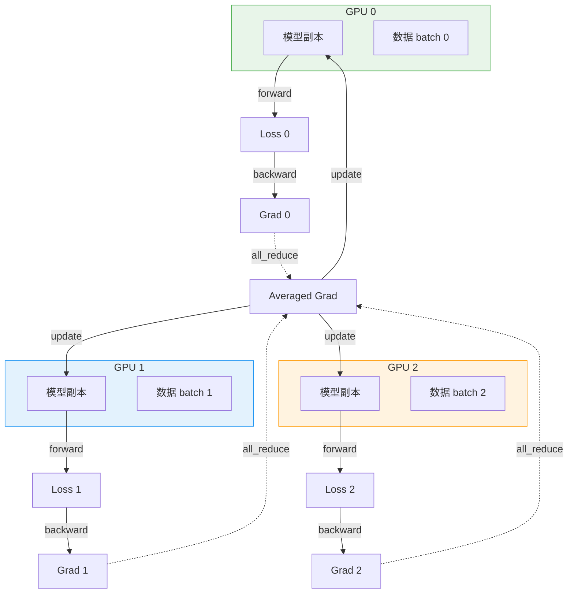
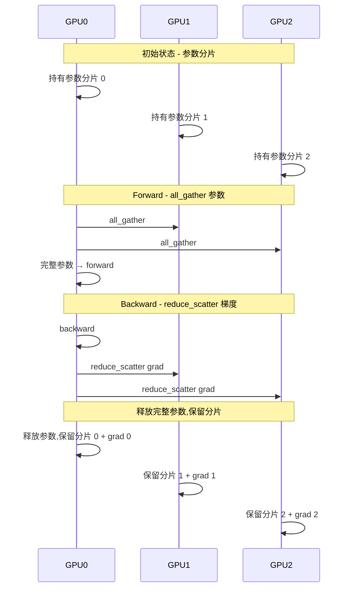

> PyTorch 分布式训练的完整架构与核心组件导航

---

## 1. 为什么需要分布式训练

### 训练挑战

| 挑战 | 问题 | 分布式解决方案 |
|------|------|---------------|
| **模型过大** | 单卡放不下 | 模型并行、流水线并行 |
| **数据量大** | 训练时间长 | 数据并行 |
| **显存不足** | OOM | FSDP 参数分片 |
| **通信瓶颈** | 梯度同步慢 | 梯度压缩、Ring AllReduce |

### 并行策略对比

```mermaid
flowchart TD
    subgraph dp["数据并行 (Data Parallel)"]
        D1["GPU 0<br/>模型副本"]
        D2["GPU 1<br/>模型副本"]
        D3["GPU 2<br/>模型副本"]
    end

    subgraph mp["模型并行 (Model Parallel)"]
        M1["GPU 0<br/>Layer 1-5"]
        M2["GPU 1<br/>Layer 6-10"]
        M3["GPU 2<br/>Layer 11-15"]
    end

    subgraph tp["张量并行 (Tensor Parallel)"]
        T1["GPU 0<br/>权重分片 0"]
        T2["GPU 1<br/>权重分片 1"]
        T3["GPU 2<br/>权重分片 2"]
    end

    subgraph pp["流水线并行 (Pipeline Parallel)"]
        P1["GPU 0<br/>Stage 0"]
        P2["GPU 1<br/>Stage 1"]
        P3["GPU 2<br/>Stage 2"]
    end

    D1 -.梯度同步.-> D2
    D2 -.梯度同步.-> D3

    M1 -->|激活传递| M2
    M2 -->|激活传递| M3

    T1 -.部分计算.-> T2
    T2 -.部分计算.-> T3

    P1 -->|Micro-batch| P2
    P2 -->|Micro-batch| P3

    style dp fill:#e8f5e9,stroke:#4caf50
    style mp fill:#e3f2fd,stroke:#2196f3
    style tp fill:#fff3e0,stroke:#ff9800
    style pp fill:#f3e5f5,stroke:#9c27b0
```



---

## 2. PyTorch 分布式架构

### 整体架构



---

## 3. 目录结构详解

### 核心目录

```text
torch/distributed/distributed_c10d.py            进程组、后端注册与集合通信 API
torch/csrc/distributed/c10d/nccl2/              2.15 默认 NCCL C++ 后端
torch/nn/parallel/distributed.py               DDP Python 模块
torch/csrc/distributed/c10d/reducer.cpp        DDP 梯度 bucket
torch/distributed/fsdp/                        FSDP1 与 FSDP2 的公开入口
torch/distributed/fsdp/_fully_shard/           FSDP2 参数组、hook 和通信实现
torch/distributed/device_mesh.py               DeviceMesh 入口
torch/distributed/tensor/                      DTensor 与重分布
torch/distributed/tensor/parallel/             张量并行策略
torch/distributed/rpc/                         RPC 接口
```

---

## 4. 核心概念

### 4.1 ProcessGroup

**ProcessGroup** 是分布式通信的核心抽象:

```python
# torch/distributed/distributed_c10d.py
class ProcessGroup:
    """进程组抽象"""

    def __init__(self, rank: int, size: int):
        self.rank = rank  # 当前进程在组内的 rank
        self.size = size  # 组内总进程数

    # 集合通信
    def allreduce(self, tensors, op=ReduceOp.SUM):
        """全局归约"""

    def broadcast(self, tensors, src=0):
        """广播"""

    def all_gather(self, output_tensors, input_tensor):
        """全局收集"""
```

### 4.2 Backend 类型

```python
# 支持的后端
class Backend:
    NCCL = "nccl"      # NVIDIA GPU (推荐)
    GLOO = "gloo"      # CPU 和 GPU
    MPI = "mpi"        # 通用 MPI
    UCC = "ucc"        # Unified Collective Communication
```

2.15 中，`init_process_group("nccl")` 默认进入重写的 NCCL 后端。追踪默认实现应从 `torch/csrc/distributed/c10d/nccl2/` 开始；显式 `nccl-legacy` 或将 `TORCH_DIST_USE_NCCL2` 设为 `0` 对应旧路径。Gloo 等其他后端单独选择。[2.15 发布说明](https://pytorch.org/blog/pytorch-2-15-release-blog/) · [后端注册](https://github.com/pytorch/pytorch/blob/v2.15.0/torch/distributed/distributed_c10d.py)

### 按设备选择通信后端

CPU 进程可以用 Gloo，NVIDIA GPU 上训练通常用 NCCL。MPI 需要构建时启用，其他后端是否可用取决于安装包与设备。分别用 `dist.is_gloo_available()`、`dist.is_nccl_available()`、`dist.is_mpi_available()` 查看本机能力。[2.15 后端说明](https://docs.pytorch.org/docs/2.15/distributed.html#backends)

## 5. 启动方式

### 5.1 torchrun

下面是两台四卡主机使用固定 rendezvous 的写法。两台节点分别设置 `NODE_RANK=0` 和 `NODE_RANK=1`，`MASTER_ADDR` 设置为双方可达的第一台主机地址；执行相同的命令。

```bash
torchrun --nnodes=2 --nproc-per-node=4 --node-rank="$NODE_RANK" --master-addr="$MASTER_ADDR" --master-port=29500 train.py
```

`train.py` 内用本机设备号选卡、用全局 rank 确定数据分片。例如：

```python
import os
import torch
import torch.distributed as dist

local_rank = int(os.environ["LOCAL_RANK"])
torch.cuda.set_device(local_rank)
dist.init_process_group("nccl")
try:
    model = torch.nn.Linear(8, 4).to(torch.device("cuda", local_rank))
    wrapped = torch.nn.parallel.DistributedDataParallel(model, device_ids=[local_rank])
    print(dist.get_rank(), dist.get_world_size(), local_rank)
finally:
    dist.destroy_process_group()
```

### 5.2 torch.distributed.launch (已弃用)

```bash
# 旧的启动方式(不推荐)
python -m torch.distributed.launch \
    --nproc_per_node=4 \
    train.py
```

### 5.3 手动启动

```python
import os
import torch.distributed as dist

# 手动设置环境变量
os.environ["MASTER_ADDR"] = "localhost"
os.environ["MASTER_PORT"] = "29500"
os.environ["RANK"] = "0"
os.environ["WORLD_SIZE"] = "4"

# 初始化
dist.init_process_group(backend="nccl")
```

---

## 6. 初始化流程

### init_process_group 流程



---

## 7. 集合通信操作

### 六种基本操作


title: "DDP 把本地梯度规约为平均值"
rows: ["rank 0", "rank 1", "共同权重"]
steps:
  - title: "两份模型同一起点"
    detail: "考虑一个无 bias 的标量线性层，两边权重都为 1，局部损失取各自的输出。"
    cells: [["输入 1", "·"], ["输入 2", "·"], ["1", "1"]]
    focus: [[0, 0], [1, 0]]
  - title: "本地反向"
    detail: "rank 0 的局部梯度为 1，rank 1 为 2；默认 DDP 跨两个 rank 规约。"
    cells: [["梯度", "1"], ["梯度", "2"], ["1", "1"]]
    focus: [[0, 1], [1, 1]]
  - title: "两边获得平均梯度"
    detail: "每个 rank 都收到 1.5。用学习率 0.1 的普通 SGD 更新，两份权重都变为 0.85。"
    cells: [["梯度", "1.5"], ["梯度", "1.5"], ["0.85", "0.85"]]
    focus: [[2, 0], [2, 1]]


**使用示例**:
```python
import torch.distributed as dist

# 1. all_reduce - 所有进程归约并广播
tensor = torch.tensor([rank + 1])
dist.all_reduce(tensor, op=dist.ReduceOp.SUM)
# 结果: tensor = [1+2+3+4] = [10] (所有进程)

# 2. broadcast - 广播
tensor = torch.tensor([rank], dtype=torch.int64)
dist.broadcast(tensor, src=0)
# 结果: tensor = [0] (所有进程)

# 3. all_gather - 收集到所有进程
tensor = torch.tensor([rank])
tensor_list = [torch.empty_like(tensor) for _ in range(world_size)]
dist.all_gather(tensor_list, tensor)
# 结果: tensor_list = [[0], [1], [2], [3]] (所有进程)

# 4. reduce - 归约到指定进程
tensor = torch.tensor([rank + 1])
dist.reduce(tensor, dst=0, op=dist.ReduceOp.SUM)
# 结果: rank 0: tensor = [10], 其他: 不变

# 5. scatter - 分发
if rank == 0:
    scatter_list = [torch.tensor([i]) for i in range(world_size)]
else:
    scatter_list = None
tensor = torch.zeros(1)
dist.scatter(tensor, scatter_list, src=0)
# 结果: rank i: tensor = [i]

# 6. gather - 收集到指定进程
tensor = torch.tensor([rank])
if rank == 0:
    gather_list = [torch.zeros(1) for _ in range(world_size)]
else:
    gather_list = None
dist.gather(tensor, gather_list, dst=0)
# 结果: rank 0: gather_list = [[0], [1], [2], [3]]
```

---

## 8. DDP vs FSDP

### 对比

| 特性 | DDP | FSDP |
|------|-----|------|
| **原理** | 每个进程完整副本 | 参数分片 |
| **内存占用** | 高(N 个副本) | 低(分片) |
| **通信开销** | 梯度 all_reduce | 参数 all_gather + 梯度 reduce_scatter |
| **适用场景** | 模型较小 | 大模型(LLM) |
| **最大模型** | 单卡可放下 | 超过单卡 |

### DDP 原理



### FSDP 原理



---

## 9. DTensor 概述

### Placement 类型

```python
# torch/distributed/tensor/placement_types.py
class Placement:
    """张量放置策略"""
    pass

class Replicate(Placement):
    """副本复制 - 所有设备持有完整副本"""
    pass

class Shard(Placement):
    """分片 - 沿指定维度分片"""
    def __init__(self, dim: int):
        self.dim = dim

class Partial(Placement):
    """部分归约 - 未完全同步的中间状态"""
    def __init__(self, reduce_op: ReduceOp = ReduceOp.SUM):
        self.reduce_op = reduce_op
```

**示例**:
```python
from torch.distributed.tensor import DTensor, DeviceMesh, Shard, Replicate

# 1. 创建设备网格
device_mesh = DeviceMesh("cuda", list(range(4)))

# 2. 创建分片张量
# 在维度 0 上分片,其他维度复制
tensor = torch.randn(8, 4)
dtensor = DTensor.from_local(
    tensor,
    device_mesh,
    placements=[Shard(0)],
)

# 3. 重分布
# 从 Shard(0) 转换为 Replicate
dtensor_replicated = dtensor.redistribute(
    device_mesh,
    placements=[Replicate()],
)
```

---

## 10. 两个 CPU 进程观察梯度规约

将下面的代码保存为 `ddp_cpu.py`，在支持 Gloo 的 PyTorch 环境运行 `torchrun --master-addr=127.0.0.1 --master-port=29500 --nproc-per-node=2 ddp_cpu.py`。两个 rank 各有一个权重相同、无 bias 的线性层；本地输入分别为 1 和 2。输出对权重的局部梯度刚好等于输入，因此两边第一次反向后应都看到 1.5。

```python
import torch
import torch.distributed as dist
from torch.nn.parallel import DistributedDataParallel

dist.init_process_group("gloo")
try:
    assert dist.get_world_size() == 2
    layer = torch.nn.Linear(1, 1, bias=False)
    model = DistributedDataParallel(layer)
    x = torch.tensor([[float(dist.get_rank() + 1)]])
    model(x).sum().backward()
    torch.testing.assert_close(layer.weight.grad, torch.tensor([[1.5]]))
    print(dist.get_rank(), layer.weight.grad.item())
finally:
    dist.destroy_process_group()
```

多机多 GPU 训练使用启动器提供的 `LOCAL_RANK` 绑定进程设备；全局 `RANK` 用于标识进程和协调通信，不能直接当作每台主机内的 GPU 编号。[两卡 FSDP 示例](/pytorch/05-advanced-topics/10-ddp-fsdp/)

## 11. 下一步

- **[C10D 后端](https://docs.pytorch.org/docs/2.15/distributed.html#backends)**: ProcessGroup 与后端实现
- **[集合通信](https://docs.pytorch.org/docs/2.15/distributed.html#collective-functions)**: 通信操作详解
- **[DDP 与 FSDP](/pytorch/05-advanced-topics/10-ddp-fsdp/)**: 数据并行详解
- **[DTensor](https://docs.pytorch.org/docs/2.15/distributed.tensor.html)**: 分布式张量抽象
- **[RPC 框架](https://docs.pytorch.org/docs/2.15/rpc.html)**: 远程过程调用
- **[分布式调试](https://docs.pytorch.org/docs/2.15/distributed.html#debugging-torch-distributed-applications)**: 调试技巧

---

## 12. 总结

| 组件 | 职责 | 关键文件 |
|------|------|---------|
| **C10D** | 核心通信层 | `distributed_c10d.py` |
| **ProcessGroup** | 进程组抽象 | `ProcessGroup` 类 |
| **Backend** | 通信后端 | NCCL/Gloo/MPI |
| **DDP** | 数据并行 | `torch/nn/parallel/distributed.py` |
| **FSDP** | 全分片数据并行 | `fsdp/` |
| **DTensor** | 分布式张量 | `tensor/` |
| **RPC** | 远程调用 | `rpc/` |

PyTorch 分布式系统提供了从底层通信到高层并行策略的完整解决方案,支持从小规模到超大规模的训练需求。
