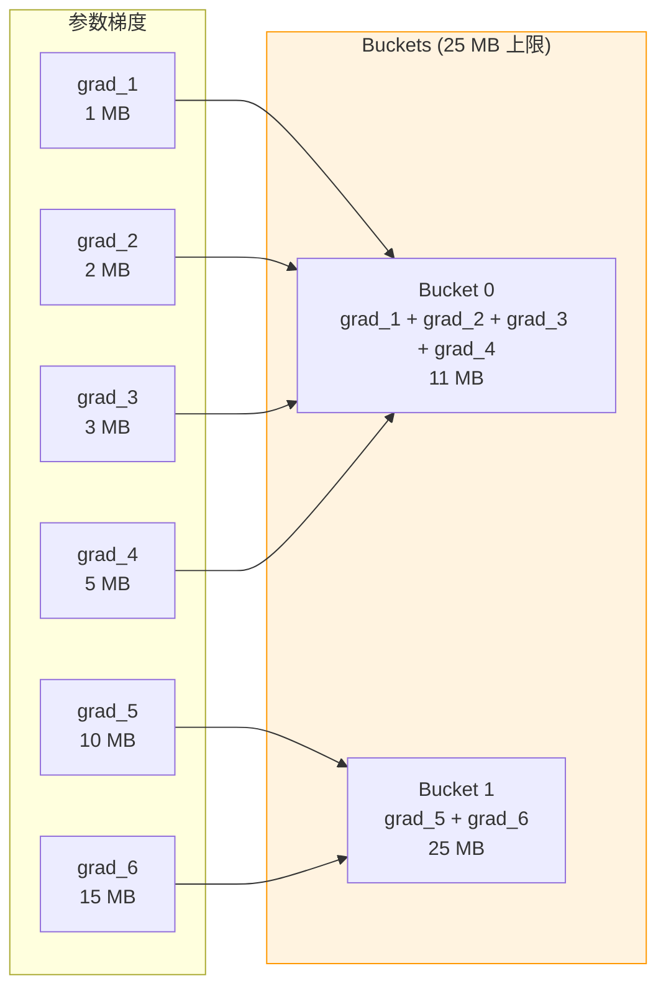

一次训练 step 中，DDP 的每个 rank 保存完整模型与优化器状态。不同 rank 处理不同样本，反向时由 DDP 的 reducer 按 bucket 规约梯度，每个进程再做相同的更新。参数、梯度与优化器状态占用过大时，FSDP 可以把它们切分到多个 rank。[DDP 接口](https://docs.pytorch.org/docs/2.15/generated/torch.nn.parallel.DistributedDataParallel.html)

## 两条训练路径

| 阶段 | DDP | FSDP2 |
|---|---|---|
| 包装模型 | 每个 rank 建立完整副本 | `fully_shard` 原地改变模块与参数的表示，按参数切为 DTensor |
| 前向 | 使用本地权重 | hook 在所管辖模块计算前 all-gather；按策略在前向后释放未分片副本 |
| 反向 | 梯度 ready 后按 bucket 发起通信，默认用 all-reduce | 按需要重新 all-gather，再对梯度执行 reduce-scatter |
| 优化器 | 每个 rank 对完整副本更新 | 每个 rank 在本地分片上更新；优化器在分片完成后构建 |

同一模型若只有根模块被 `fully_shard`，一次 all-gather 可能要聚合整个模型。由内向外给重复层分组，可以在计算一层时为下一层预取，并限制单次展开的权重数量。分组过细又会产生更多小规模通信。[FSDP2 公共契约](https://docs.pytorch.org/docs/2.15/distributed.fsdp.fully_shard.html)

## DDP 的就绪顺序与通信

下面以一个 25 MB 的 bucket 容量说明分组；真实分配还受到 dtype、设备、参数顺序等影响。每个参数的梯度 ready 后，autograd hook 通知 reducer。某些梯度产生得晚时，同桶的通信也要等。所有 rank 必须以兼容的次序发起规约；单个参数的 ready 次序并不直接决定 collective 的次序。



要从源码验证重叠，先在 `Reducer::autograd_hook` 观察参数索引，向 `mark_variable_ready` 和 `mark_bucket_ready` 追踪，再看 `all_reduce_bucket` 怎样准备通信。最后的 `finalize_backward` 完成该轮梯度状态的收尾。只看 CUDA 通信占用时间会丢掉它与计算重叠的部分，分析 step 延迟需要同时看两条时间线。[Reducer 源码](https://github.com/pytorch/pytorch/blob/v2.15.0/torch/csrc/distributed/c10d/reducer.cpp)

### FSDP 在通信与计算之间展开权重

三个 rank 分别保存 A、B、C 三片权重。这个模块显式设置 `reshard_after_forward=True`，前向后各 rank 释放临时展开的权重，反向前再次收集。

**FSDP Forward 流程**:


title: "FSDP 按需展开一组参数"
rows: ["rank 0", "rank 1", "rank 2"]
steps:
  - title: "只保存分片"
    detail: "把同一组权重分为 A、B、C 三片，每个 rank 长期持有一片。"
    cells: [["A", "·", "·"], ["·", "B", "·"], ["·", "·", "C"]]
    focus: [[0, 0], [1, 1], [2, 2]]
  - title: "前向前收集"
    detail: "三个 rank 参与 all-gather，各自临时获得本组完整权重。"
    cells: [["A", "B", "C"], ["A", "B", "C"], ["A", "B", "C"]]
    focus: [[0, 1], [0, 2], [1, 0], [1, 2], [2, 0], [2, 1]]
  - title: "计算后重新分片"
    detail: "该模块设置 reshard_after_forward=True。前向结束后释放展开的权重，保留原处分片。"
    cells: [["A", "·", "·"], ["·", "B", "·"], ["·", "·", "C"]]
    focus: [[0, 0], [1, 1], [2, 2]]


**FSDP Backward 流程**:


title: "反向把梯度交回参数持有者"
rows: ["rank 0", "rank 1", "rank 2"]
steps:
  - title: "重新取得参数"
    detail: "前向已重新分片，反向需要的完整权重通过 all-gather 展开。"
    cells: [["A", "B", "C"], ["A", "B", "C"], ["A", "B", "C"]]
    focus: [[0, 0], [1, 1], [2, 2]]
  - title: "各自计算贡献"
    detail: "g0A 表示 rank 0 的样本对参数片 A 的梯度贡献，其余记号同理。"
    cells: [["g0A", "g0B", "g0C"], ["g1A", "g1B", "g1C"], ["g2A", "g2B", "g2C"]]
    focus: [[0, 0], [0, 1], [0, 2]]
  - title: "规约后分片"
    detail: "reduce-scatter 让持有 A 的 rank 0 得到该片的规约梯度；B、C 依次交给另外两个 rank。"
    cells: [["gA", "·", "·"], ["·", "gB", "·"], ["·", "·", "gC"]]
    focus: [[0, 0], [1, 1], [2, 2]]


### 输入不均与自定义规约

若 rank 0 有十批数据而 rank 1 只有八批，普通 DDP 的后两次反向会缺少通信参与者。对于只含 DDP 所管理 collectives 的训练循环，可用 `with ddp_model.join():` 包住循环，由先结束的 rank 补齐对应通信。如果 forward 自己执行其他 collective，应让各 rank 协调结束，例如使用 `throw_on_early_termination=True` 报告提前退出。

注册通信 hook 时，回调要显式实现期望的梯度归约语义。若希望保留默认均值梯度，可直接使用 PyTorch 提供的 `default_hooks.allreduce_hook`；简单把 `all_reduce(SUM)` 的结果返回给优化器会放大梯度。[通信 hook](https://docs.pytorch.org/docs/2.15/ddp_comm_hooks.html) · [Join 说明](https://docs.pytorch.org/docs/2.15/distributed.algorithms.join.html)

### 不均匀输入下完成本轮迭代

下面接在已经创建的 DDP 模型 `ddp_model` 后。rank 0 多训练一批，先耗尽输入的 rank 继续配合 DDP 的通信。使用普通 SGD、无动量，便于看到模型同步行为。

```python
from torch.distributed.algorithms.ddp_comm_hooks import default_hooks

ddp_model.register_comm_hook(dist.group.WORLD, default_hooks.allreduce_hook)
optimizer = torch.optim.SGD(ddp_model.parameters(), lr=0.01)
local_steps = 2 if dist.get_rank() == 0 else 1
with ddp_model.join():
    for _ in range(local_steps):
        optimizer.zero_grad()
        loss = ddp_model(x).square().mean()
        loss.backward()
        optimizer.step()
```

`join` 退出时同步最终模型；每个进程的优化器、scheduler 和数据迭代位置仍由训练循环管理。若使用 Adam 等有状态优化器，后续重新进入同步训练时还需让各 rank 的优化器状态与选定的模型步相符。DDP 自带的梯度缩放与用户注册的通信 hook 分属两条路径：上例的 hook 除以进程组总大小，不能假设改动 `join` 的除数选项也会自动重写自定义 hook。[DDP.join](https://docs.pytorch.org/docs/2.15/generated/torch.nn.parallel.DistributedDataParallel.html#torch.nn.parallel.DistributedDataParallel.join) · [默认规约 hook 实现](https://github.com/pytorch/pytorch/blob/v2.15.0/torch/distributed/algorithms/ddp_comm_hooks/default_hooks.py)

## 两卡运行一个训练 step

保存为 `train.py` 后，用 `torchrun --standalone --nproc-per-node=2 train.py` 在两个可用的 NVIDIA GPU 上启动。每个进程先选择自己的 GPU，初始化通信后，对模型从子模块到根模块分片。

```python
import os
import torch
import torch.distributed as dist
from torch import nn
from torch.distributed.fsdp import fully_shard

local_rank = int(os.environ["LOCAL_RANK"])
device = torch.device("cuda", local_rank)
torch.cuda.set_device(device)
dist.init_process_group("nccl")
try:
    torch.manual_seed(0)
    model = nn.Sequential(nn.Linear(64, 64), nn.ReLU(), nn.Linear(64, 16)).to(device)
    fully_shard(model[0])
    fully_shard(model[2])
    fully_shard(model)
    optimizer = torch.optim.AdamW(model.parameters(), lr=1e-3)
    x = torch.randn(8, 64, device=device) + dist.get_rank()
    loss = model(x).square().mean()
    loss.backward()
    optimizer.step()
    if dist.get_rank() == 0:
        print(loss.detach().item())
finally:
    dist.destroy_process_group()
```

在相同启动方式下，改为 DDP 时用 `DistributedDataParallel(model, device_ids=[local_rank])` 包装未分片的模型，并用包装后的模型运行前向。训练数据的拆分由数据加载方负责；DDP 不会自动给不同 rank 选择不同样本。

## 读旧项目中的 FSDP1

`FullyShardedDataParallel` 是 FSDP1 的包装式接口，源码会出现 `FlatParameter`、`ShardingStrategy` 和与 FSDP1 配套的 state dict API。FSDP2 使用 `from torch.distributed.fsdp import fully_shard`，暴露按参数的 DTensor，`reshard_after_forward` 控制前向后是否还原分片。检查点恢复须选择与保存格式相配的接口。[FSDP1](https://docs.pytorch.org/docs/2.15/fsdp.html) · [FSDP2 源码](https://github.com/pytorch/pytorch/tree/v2.15.0/torch/distributed/fsdp/_fully_shard)

### FSDP1 中多个参数如何存入 FlatParameter

旧实现把管理组中的参数展平，保存各参数形状和偏移，使 all-gather 后能还原出模块所需的视图。FSDP2 把每个原始参数表示成各自的 DTensor，对分组中参数进行打包用于通信。两者的通信分组都可能涵盖多块权重，但优化器看到的参数表示不同。

同一个 FSDP1 包装单元中的两个参数，可以在展平后跨越 rank 的分片边界。



[FlatParameter 实现](https://github.com/pytorch/pytorch/blob/v2.15.0/torch/distributed/fsdp/_flat_param.py)

## 分片边界、混合精度与 CPU offload

FSDP1 的 `auto_wrap_policy` 递归决定哪些子模块各自成为包装单元。FSDP2 通过显式的 `fully_shard(block)` 建立通信组：对 Transformer 常按 block 自下而上处理，最后处理根模块剩余的参数。下面示意如何让各层共用策略；应在构造优化器之前执行，并把 `blocks` 替换为模型真正的 block 序列。

```python
from torch.distributed.fsdp import CPUOffloadPolicy, MixedPrecisionPolicy, fully_shard

precision = MixedPrecisionPolicy(param_dtype=torch.bfloat16, reduce_dtype=torch.float32)
# 需要把分片参数、梯度及优化器状态放在 CPU 时使用。
offload = CPUOffloadPolicy()
for block in model.blocks:
    fully_shard(block, mp_policy=precision, offload_policy=offload)
fully_shard(model, mp_policy=precision, offload_policy=offload)
optimizer = torch.optim.AdamW(model.parameters(), lr=1e-3)
```

`param_dtype` 控制展开权重以及前反向计算时采用的精度；优化器更新本地分片时使用其原始 dtype。`reduce_dtype` 单独控制归约精度。2.15 中将 `reduce_dtype=None` 保持默认时，会遵循参数梯度的 dtype 策略；例如原始 FP32 权重启用 BF16 计算，默认梯度归约可以是 FP32。若需要延续早期版本的 BF16 通信，应显式写出。CPU offload 将一部分设备显存压力转移到主机内存，并引入主机与设备间拷贝；训练瓶颈是通信或主机带宽时需单独测量。[FSDP2 精度与 offload 契约](https://docs.pytorch.org/docs/2.15/distributed.fsdp.fully_shard.html) · [2.15 策略实现](https://github.com/pytorch/pytorch/blob/v2.15.0/torch/distributed/fsdp/_fully_shard/_fsdp_api.py)

## 用检查点恢复模型和优化器

仅保存权重可以继续推理，恢复 AdamW 训练还需要动量、二阶矩和步数。PyTorch Distributed Checkpoint（DCP）提供统一的 `get_state_dict` / `set_state_dict`，以参数全名协调模型与优化器状态。下例在进程组已初始化、所有 rank 已完成同一个训练 step 时使用；多机下各 rank 的 `directory` 应指向同一份共享检查点。

```python
import torch.distributed.checkpoint as dcp
from torch.distributed.checkpoint.state_dict import get_state_dict, set_state_dict

def training_state(model, optimizer, step):
    weights, optim_state = get_state_dict(model, optimizer)
    return {"model": weights, "optimizer": optim_state, "step": step}

def save_training(model, optimizer, step, directory):
    state = training_state(model, optimizer, step)
    dcp.save(state, checkpoint_id=directory)

def restore_training(model, optimizer, directory):
    state = training_state(model, optimizer, 0)
    dcp.load(state, checkpoint_id=directory)
    set_state_dict(
        model, optimizer,
        model_state_dict=state["model"],
        optim_state_dict=state["optimizer"],
    )
    return state["step"]
```

重新启动后先建立逻辑结构相同的模型、应用分片策略、创建优化器，再在各 rank 调用 `restore_training`。DCP 按目标分片读取；若训练还使用学习率 scheduler、GradScaler 或需要精确复现的数据采样器和各 rank 随机状态，也要保存并按其归属恢复。旧 FSDP1 的完整 state dict、分片 state dict 和 DCP 目录是不同的保存契约；恢复旧模型时先识别原格式，再使用相应接口。[DCP 与 state dict API](https://docs.pytorch.org/docs/2.15/distributed.checkpoint.html) · [FSDP1 state dict 类型](https://docs.pytorch.org/docs/2.15/fsdp.html)

## 怎样估算显存

十亿个 FP32 参数为 4 GB（十进制）。若梯度也是 FP32，Adam 的两个状态各占 4 GB，仅这些长期驻留张量便有 16 GB。四个 rank 完全均匀分片时每 rank 在此口径下约为 4 GB。峰值还包含激活、临时展开的权重、通信缓冲和分配器开销，分片并不能保证真实峰值等比例下降。比较两个实现时固定模型、batch、dtype 与通信拓扑，再记录峰值和训练 step 时间。
