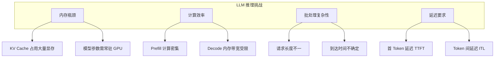
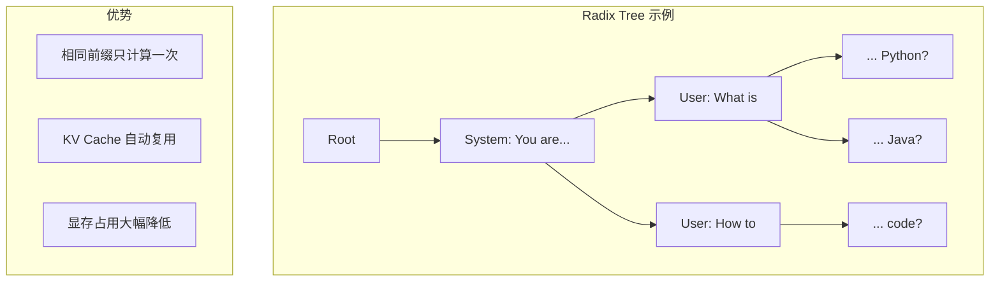

用户 A 和 B 都把同一篇文档放在问题前面，A 问摘要，B 问出处。模型处理到两个问题开始分叉之前，输入 token 完全相同。只要 A 的前缀 KV 还在可用缓存中，运行时就可以让 B 复用那一段历史，B 仍需计算自己的问题并生成回答。把共有文档放在两个随机会话标记之后，会改变可匹配的连续前缀。

SGLang 以连续批处理把不同请求的当前工作送入模型，同时照看每条请求的内存索引、结束条件与输出流。前缀复用主要省下重复的预填充计算；生成中的每一步还要读取上下文并执行模型。因此评估时应分别记录首 token 延迟、输出 token 间隔及输入中可复用的比例。

先[跑通单卡服务](/sglang/01-getting-started/02-quick-start/)，再把两条共享前缀的请求代入[前缀树示例](/sglang/03-memory-cache/10-radix-attention/)。想了解推理代码的读者可沿[请求链路](/sglang/02-core-architecture/04-request-lifecycle/)找到 scheduler 与 worker 的交接点。

## 推理服务面对哪几种压力

长文档增加单次 prefill 的计算，长输出延长 KV 的占用时间；混合并发时，同一批中请求的剩余工作量不同。选取优化技术要看是哪一种资源先到瓶颈。

## 什么时候能共用一个系统提示

图上每一条边表示连续的输入片段；同一系统提示之后，两个用户输入不同，模型会分别计算两条后缀。比较运行结果时记录输入 token ID 和最长公共前缀长度，仅比较字符数不足以确定实际能复用多少。

[公开 API](https://github.com/sgl-project/sglang/blob/v0.5.23/docs/docs/get-started/quickstart.mdx) · [前缀树实现](https://github.com/sgl-project/sglang/blob/v0.5.23/python/sglang/srt/mem_cache/radix_cache.py)
