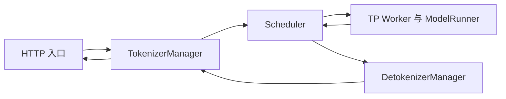
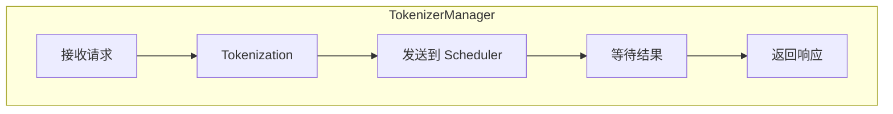
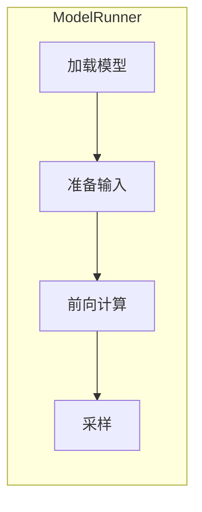

单机普通自回归服务可以从三类职责来读。TokenizerManager 接收和校验输入、处理分词并管理调用者的异步响应；Scheduler 维护等待与运行的请求，决定下个批次；DetokenizerManager 把已生成的 token 增量转为可以发送的文本。TP、DP、多 tokenizer worker 与分离部署会改变进程数。

例如两次聊天请求的前缀相同，前端各自持有请求状态，调度侧可以在各自处理输入时查同一前缀树。GPU 执行按批次进行；反分词和 HTTP 返回按请求分流。如果入口要求直接传 token ID 或工作模式跳过 tokenizer，数据通路相应变化。

## 各进程之间传什么

### ZeroMQ 通信

SGLang 使用 ZeroMQ (ZMQ) 进行进程间通信：


title: R7 如何穿过三个进程
actors: ["分词管理器", "调度器", "反分词器"]
steps:
  - from: 0
    to: 1
    label: "投递 R7"
    detail: "分词管理器把 R7 的输入 token 和采样参数写入 IPC 通道。"
  - from: 1
    to: 2
    label: "返回 token ID"
    detail: "执行完的批次带回 R7 新生成的 ID，还可能包含同批其他请求的输出。"
  - from: 2
    to: 0
    label: "送出文本"
    detail: "反分词器按请求保存解码进度，把能显示的字符串送回分词管理器。"
  - from: 0
    to: 0
    label: "唤醒 R7"
    detail: "分词管理器找到 R7 的等待者，其他连接继续等待各自的响应。"


### 消息类型

| 消息 | 方向 | 内容 |
|------|------|------|
| `TokenizedGenerateReqInput` | TM → Scheduler | Token IDs, 采样参数 |
| `BatchTokenIDOut` | Scheduler → DT | 生成的 Token IDs |
| `BatchStrOut` | DT → TM | 解码后的文本 |

## 前端处理与设备批次

一个请求可以有数百个输入 token，前端按请求接收数据，设备模型按批次读取 token、位置及缓存索引。因此同一时间两个 HTTP 连接的进度可能不同，即便它们参与了同一轮模型执行。

## 从架构图定位进程

从 HTTP 入口沿请求 ID 找到分词结果，再到调度进程看该请求入了哪个批次。若某个 TP rank 正在等 collective，就去其他 rank 上查这一轮最早停在哪里。

[输入与输出管理](https://github.com/sgl-project/sglang/blob/v0.5.23/python/sglang/srt/managers/tokenizer_manager.py) · [调度器](https://github.com/sgl-project/sglang/blob/v0.5.23/python/sglang/srt/managers/scheduler.py) · [反分词](https://github.com/sgl-project/sglang/blob/v0.5.23/python/sglang/srt/managers/detokenizer_manager.py)
