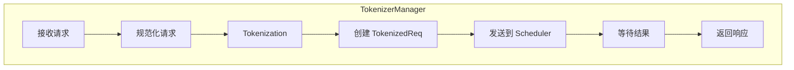

以聊天 API 设置 `stream: true` 为例，一条请求穿过多个进程，但在各处都能通过请求标识和输入 token 数关联起来。

| 阶段 | 状态如何变化 |
|---|---|
| HTTP 与分词 | 模板把消息序列化成模型输入。TokenizerManager 保存本次调用的响应状态，将 token、采样参数和请求标识交给调度器。 |
| 等待与前缀匹配 | Scheduler 接收请求，建立请求对象。选中该请求时，已缓存的前缀减少此次 extend 需要执行的输入，内存与预算共同决定本轮可处理多少。 |
| 执行 | 批次被送入 worker 的模型执行路径。生成 token 后，scheduler 更新请求进度与停止条件，仍需生成的请求可进入后续轮次。 |
| 输出 | 反分词把可解码部分还原为增量文本，前端按请求交给对应 HTTP 流。结束或取消后，运行中的槽位与引用应被归还。 |

若首个事件到达很慢，可把相同提示发送两次，同时记录缓存命中的 token 数和等待时间。第二轮也会受内核预热影响。若 token 生成很快但客户端迟迟看不到文本，应检查流式参数、代理缓冲和解码边界。

## 从分词结果到运行批次

### 关键数据结构

| 阶段 | 数据结构 | 说明 |
|------|----------|------|
| HTTP 层 | `GenerateReqInput` | 用户请求 |
| Tokenizer | `TokenizedGenerateReqInput` | 内部请求 |
| Scheduler | `Req` | 调度请求 |
| Scheduler | `ScheduleBatch` | 调度批次 |
| ModelRunner | `ForwardBatch` | 前向批次 |
| Scheduler | `BatchTokenIDOut` | Token 输出 |
| Detokenizer | `BatchStrOut` | 文本输出 |

## 客户端如何收到文本


title: 两次增量如何回到连接
actors: ["调度器", "反分词器", "前端", "客户端"]
steps:
  - from: 0
    to: 1
    label: "第一批 ID"
    detail: "R7 已得到可反分词的第一个 token。"
  - from: 1
    to: 2
    label: "首段文本"
    detail: "反分词器为 R7 形成第一段可发送的文本。"
  - from: 2
    to: 3
    label: "发送首个事件"
    detail: "前端把该增量交给 R7 的 SSE 流。"
  - from: 0
    to: 1
    label: "下一批 ID"
    detail: "下一轮 R7 又得到一个 token，沿用同一份解码状态。"
  - from: 2
    to: 3
    label: "发出结尾"
    detail: "前端输出后续增量和结束标记，客户端按事件拼接文本。"


使用 OpenAI 兼容的 chat/completions 时，SSE 事件包含增量 choices；原生 /generate 返回的是其自身响应格式。在客户端按 SSE 事件解析，避免把单次 TCP read 当成一个完整事件。

## 一次流式排错

先用相同消息请求非流式结果，再执行带 `stream: true` 的 HTTP 请求并关闭客户端输出缓冲。若只有后一条出现延迟，分别检查首个 token 产生和首个增量到达的时间；若两者都卡在相同处，则回到调度和内存状态。

[TokenizerManager](https://github.com/sgl-project/sglang/blob/v0.5.23/python/sglang/srt/managers/tokenizer_manager.py) · [Scheduler](https://github.com/sgl-project/sglang/blob/v0.5.23/python/sglang/srt/managers/scheduler.py) · [DetokenizerManager](https://github.com/sgl-project/sglang/blob/v0.5.23/python/sglang/srt/managers/detokenizer_manager.py)
