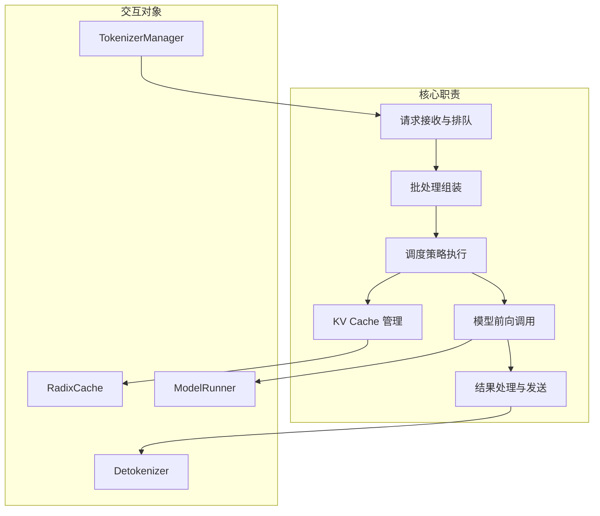

普通文本路径里，scheduler 持有等待队列、当前 running batch 和上一轮结果。`event_loop_normal` 的一轮先接收输入，再由 `get_next_batch_to_run` 给出本轮计划。如果有批次，`run_batch` 提交模型工作，`process_batch_result` 处理结果并推进各请求。模块中还有重叠调度、流水线并行、分离式 prefill/decode 的专用循环。

A 正在逐 token 解码，B 带着一份已缓存的文档进入队列。B 的前缀命中缩短了待处理输入；它进入哪一轮，还取决于排序、请求槽位和 KV 预算。选中 B 后，worker 收到本轮新增 token 及其缓存位置。

## 普通调度和重叠调度

普通循环把本轮执行和收取结果依次写在一起，适合追代码。重叠循环维护待处理结果，将 CPU 上的准备与设备执行交错。分析某轮日志时，应先确认启动参数选中的循环，再比较批次创建、设备工作和结果返回的时间；相邻日志行可能属于不同批次。

## 接收、选批、结果处理

## 两轮工作如何重叠


title: CPU 如何利用设备执行的空档
rows: ["CPU", "GPU"]
steps:
  - title: "准备批次 A"
    detail: "调度侧为 A 准备输入，随后提交设备执行。"
    cells: [["准备 A"], ["待提交"]]
    focus: [[0, 0]]
  - title: "A 执行期间"
    detail: "设备在算 A；CPU 可以准备下一批的独立工作。"
    cells: [["准备 B"], ["执行 A"]]
    focus: [[0, 0], [1, 0]]
  - title: "交错取回结果"
    detail: "提交 B 后，CPU 收取 A 的完成结果。"
    cells: [["收取 A"], ["执行 B"]]
    focus: [[0, 0], [1, 0]]
  - title: "更新进度"
    detail: "A 的结果回到请求状态，B 完成后也按自己的批次处理。"
    cells: [["收取 B"], ["已完成"]]
    focus: [[0, 0]]


A 的模型结果进入队列后，CPU 可以收取 A 的状态，同时 GPU 执行已就绪的 B。下一轮若需要 A 刚采样出的 token，就得等 A 的结果可用。

## 读一次选批结果

普通事件循环中的三个值可直接在固定版本源码追踪：

| 值 | 检查的问题 |
|---|---|
| `running_batch` | 上一阶段有哪些未完成请求？ |
| `plan.batch_to_run` | 选批函数是否真的返回本轮执行的批，或因约束返回空？ |
| `last_batch` | 上次提交的批次和本次 `process_batch_result` 处理的对象是否相同？ |

在同一模型上送入短提示、长提示与短输出请求。记录每轮候选数、入选请求和新增 token 数；若 B 排在前面却一直没进批，就去查准入器的剩余预算。

## 一条候选怎样通过 PrefillAdder

用 B 来追一遍普通文本请求。设页粒度为 1、没有分层缓存或投机，B 的输入是 `[11, 12, 21, 22]`，而此前 A 已留下 `[11, 12, 13, 14]` 的可用前缀。B 排进等待队列时四个输入位置都属于其请求；设备已经有前两个位置的 KV，本轮新增 extend 的候选长度为 2。调度器还要为这两个位置留出本轮预算和可用槽位。

1. 在 `_get_new_batch_prefill_raw` 中，先检查还有没有可分配的请求槽位。随后 `self.policy.calc_priority` 排列等待队列。启用 LPM 时，匹配较长可以让 B 提前；这一步只改变候选顺序。[排序策略与 LPM 例子](/sglang/04-batching-scheduling/15-schedule-policy/)
2. 调度器创建 `PrefillAdder`，传入页大小、树缓存、KV 分配器和预算等状态。对每个候选，`req.init_next_round_input(self.tree_cache)` 得到本轮前缀与待扩输入。启用 HiCache 时，这里还可能因数据预取未就绪而跳过该请求。[设备和主机命中](/sglang/03-memory-cache/10-radix-attention/)
3. `add_one_req` 将新增输入、预估输出需求、页对齐以及相应模型的额外槽位纳入预算。即便 B 只需计算两个输入位置，输出预留或请求槽位约束仍可能阻止准入。源码中 `can_run_list` 才是准备执行的请求集合；返回的 CONTINUE、NO_TOKEN、OTHER 指示调用方是否继续扫描候选，两者不可互换。
4. 已接纳的候选进入 `ScheduleBatch.init_new`。若长输入只能接纳一部分，`new_chunked_req` 会保留跨轮进度。找不到可运行 prefill 批时，普通调度路径可以改为推进已有 decode 请求。[分块输入如何跨轮处理](/sglang/04-batching-scheduling/14-chunked-prefill/)


title: B 为何还要经过准入
actors: ["队列", "前缀树", "准入器", "执行批"]
steps:
  - from: 0
    to: 1
    label: "匹配 B"
    detail: "B 的输入是 11、12、21、22，树上已有前两个位置的 KV。"
  - from: 1
    to: 0
    label: "返回长度 2"
    detail: "B 的输入还需计算 21 与 22，队列可以按实际策略参与排序。"
  - from: 0
    to: 2
    label: "核算剩余"
    detail: "PrefillAdder 检查新增输入、输出预留、页和请求槽位。"
  - from: 2
    to: 3
    label: "接纳 B"
    detail: "示例中容量足够，B 进入 can_run_list，随后组成实际的执行批。"


## 模型运行和流式输出之间有两次决策

`run_batch` 把本轮工作交给执行侧；`process_batch_result` 根据 `batch.forward_mode` 分发结果。普通 extend 进入 `BatchResultProcessor.process_batch_result_prefill`，decode 则进入 `process_batch_result_decode`。分离式 prefill、prebuilt 与 idle 有各自的分支。把一个分块请求的中间 prefill 当成“已生成首个用户 token”，会把 TTFT 测得过小。[结果处理源码](https://github.com/sgl-project/sglang/blob/v0.5.23/python/sglang/srt/managers/scheduler_components/batch_result_processor.py)

结果处理会更新请求的输出、结束状态和资源，并调用 `OutputStreamer.stream_output`。发送端根据请求是否启用流式、是否已经完成、尚未发送的 token 数以及 stream interval 等条件选择要送出的内容。即使 GPU 已完成一步，也可能尚未形成一个客户端可见的文本事件。[流式发送条件](https://github.com/sgl-project/sglang/blob/v0.5.23/python/sglang/srt/managers/scheduler_components/output_streamer.py) · [反分词与 HTTP 输出](/sglang/02-core-architecture/07-detokenizer/)

## 一张可以在断点处填写的跟踪表

下表给出以上 B 的教学输入与应观察的分支。工作负载越复杂，越应沿同一个请求标识定位，而非用所有请求的均值替代。

| 观察位置 | 记录的值 | 该值回答的问题 |
|---|---|---|
| 排序前后 | B 在 `waiting_queue` 中的相对位置 | 是否因为优先级而推迟？ |
| 匹配后 | `req.prefix_len`，例中应为 2；主机和设备各命中多少 | 前缀相同是否真的变为设备上可复用的缓存？ |
| 准入完成 | B 是否在 `can_run_list`，是否留下跨轮 chunk | 排序之后是否获得了本轮资源？ |
| 设备工作返回 | `batch.forward_mode`、新增输出 token 和请求是否结束 | 本轮是在补输入、解码，还是收尾？ |
| 发送前 | 已累计但未发送的 token 数、stream interval | 应该等下一轮，还是检查反分词与客户端缓冲？ |

普通循环适合建立这个心智模型。切到 overlap 模式后，将设备批次与 CPU 收取上一轮结果的记录对齐。[0.5.23 的 PrefillAdder 准入实现](https://github.com/sgl-project/sglang/blob/v0.5.23/python/sglang/srt/managers/schedule_policy.py#L1395) · [实际选批与执行路径](https://github.com/sgl-project/sglang/blob/v0.5.23/python/sglang/srt/managers/scheduler.py#L4079)

[调度主循环](https://github.com/sgl-project/sglang/blob/v0.5.23/python/sglang/srt/managers/scheduler.py) · [队列策略](https://github.com/sgl-project/sglang/blob/v0.5.23/python/sglang/srt/managers/schedule_policy.py) · [批次状态](https://github.com/sgl-project/sglang/blob/v0.5.23/python/sglang/srt/managers/schedule_batch.py)
