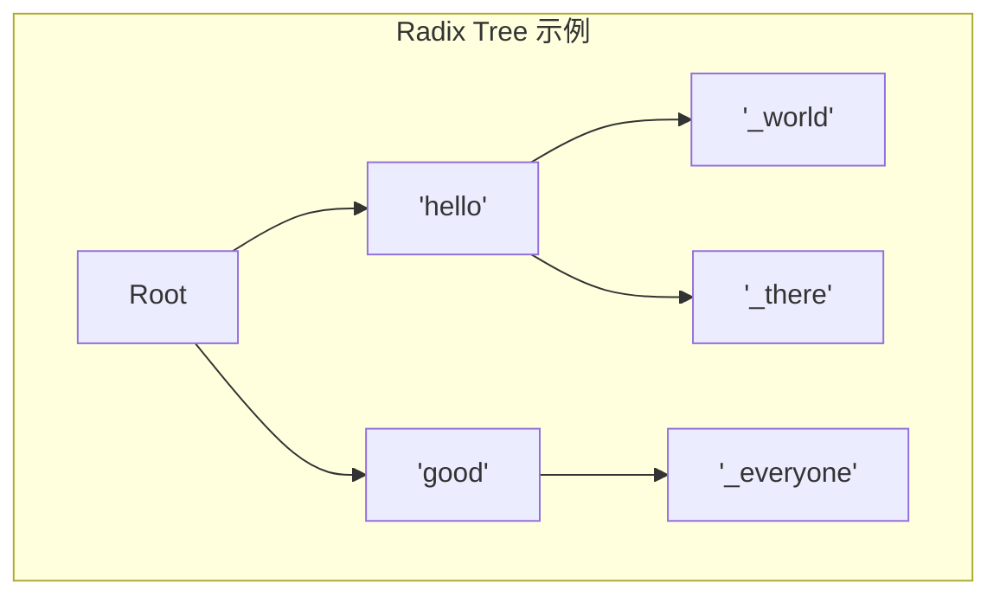
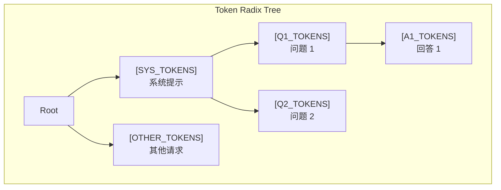

前缀树的每条边可以编码一段连续 token。查询从根开始，一旦下一个 token 不同，后续节点上的 KV 就不能当作该请求的连续前缀。以下用页粒度为 1 的普通全注意力缓存说明分叉。



先把 A 的输入 `[11, 12, 13, 14]` 对应的 KV 保留在树上。再来 B `[11, 12, 21, 22]`，前两个 token 相同，因此 B 可以沿相同路径复用相应设备索引，后两个 token 需要执行。压缩边可以在分叉处分裂，产生共享前缀和两条独立后缀。若缓存页更大，命中还受页对齐约束。

## 读懂一次匹配

0.5.23 的 `match_prefix(MatchPrefixParams)` 返回 `MatchResult`。其中 `device_prefix_len` 是设备已命中长度，另外还记录设备节点和主机命中信息。运行请求借用这段 KV 时会保护相应节点，放开锁后叶子可重新进入驱逐候选。

## 接入 HiCache 后改变了什么

设备内存是 L1，主机内存是 L2，还可配置 L3 存储。L2 上命中要把所需 KV 搬回设备；L3 预取还取决于存储后端、策略和请求时机。观察模型跳过了多少预填充计算时，应把实际使用的前缀与单纯查到的主机或存储命中区分开。

## 阅读压缩树的结构


### 什么是 Radix Tree

Radix Tree（基数树）是一种压缩的 Trie 树，用于高效存储和查找字符串：



**特点**：
- 公共前缀只存储一次
- 边可以存储多个字符
- 查找时间 O(m)，m 为字符串长度

### Token 序列的 Radix Tree

在 SGLang 中，Radix Tree 存储 Token 序列：




## 在纸上检查最长公共前缀

先用 Python 计算两条输入从头开始相同的 token 数：

```python
a = [11, 12, 13, 14]
b = [11, 12, 21, 22]
common = next((i for i, (x, y) in enumerate(zip(a, b)) if x != y), min(len(a), len(b)))
assert a[:common] == [11, 12]
assert b[common:] == [21, 22]
```

接下来给每段标注设备 KV 是否存在、是否处于锁定状态和页粒度。这个纸面算法只给出 token 相等的上限。读取 `MatchResult.device_prefix_len` 再判断真正可以跳过的计算长度；使用分层缓存时继续检查 `host_hit_length` 和 `best_match_node`。

一棵树回答当前 worker 缓存了哪些前缀。服务有多个 worker 时，请求发给谁也会影响命中。[Dynamo 的两名 worker 示例](/dynamo/04-kv-cache-system/03-kv-aware-router/) 讲的是路由层的这个选择。

[匹配参数与结果](https://github.com/sgl-project/sglang/blob/v0.5.23/python/sglang/srt/mem_cache/base_prefix_cache.py) · [树匹配与节点保护](https://github.com/sgl-project/sglang/blob/v0.5.23/python/sglang/srt/mem_cache/radix_cache.py) · [HiCache 设计](https://github.com/sgl-project/sglang/blob/v0.5.23/docs/docs/advanced_features/hicache_design.mdx)
