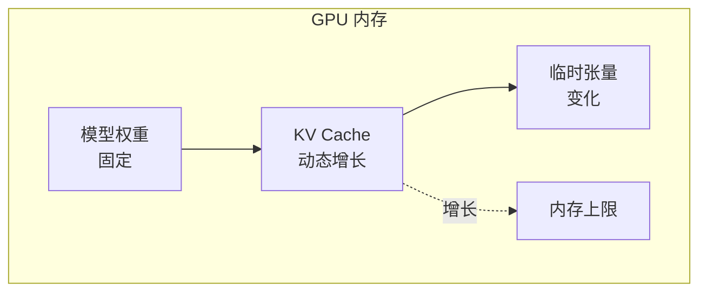

缓存分配器需要空间时，树先找 KV 仍在、当前没有请求锁住且没有有效子节点占用的叶子。根不会成为候选。选出一个叶子并释放它之后，父节点才有可能进入下一轮候选。

以 A/B 共用 `[11,12]` 的例子说明。如果 B 正在使用公共前缀，删除 A 已经空闲的后缀可以释放空间，B 引用的前缀必须保留。两条请求都结束后，哪些空闲叶子先让位由策略选择。

| 参数或状态 | 作用 |
|---|---|
| `--radix-eviction-policy lru` | 此版默认策略，从可驱逐候选中优先回收最久未使用的前缀。 |
| `lfu`、`slru`、`priority` 等 | 改变候选的排序依据，实际取舍要结合命中频率、负载与请求优先级。 |
| 活动请求的锁 | 控制该节点是否可被驱逐。改变策略不能提前释放仍受保护的节点。 |

等待队列的服务顺序由 `--schedule-policy` 选择。缓存驱逐解决容量回收问题，与先给哪条请求分配执行机会是两项独立决策。

## 缓存池为什么需要腾出空位

## 读一遍 LRU 的候选排序


title: LRU 先筛叶子，再比较时间
rows: ["叶子", "最近使用", "可驱逐"]
steps:
  - title: "查看四个叶子"
    detail: "访问时刻由新到旧为 A=10、B=8、C=5、D=2。"
    cells: [["A", "B", "C", "D"], ["10", "8", "5", "2"], ["是", "是", "是", "是"]]
    focus: [[1, 3]]
  - title: "D 空闲"
    detail: "所有叶子都能驱逐时，最久未用的 D 先让出空间。"
    cells: [["A", "B", "C", "D"], ["10", "8", "5", "2"], ["是", "是", "是", "选 D"]]
    focus: [[2, 3]]
  - title: "若 D 仍被引用"
    detail: "另一次选择里 D 被运行请求锁住，候选中时间最早的是 C。"
    cells: [["A", "B", "C", "D"], ["10", "8", "5", "2"], ["是", "是", "选 C", "锁住"]]
    focus: [[2, 2], [2, 3]]


四个叶子都已解锁时，LRU 选最近使用时间最早的 D。若 D 被请求锁住，则在 A、B、C 中选 C。LFU 也在可驱逐叶子中选择，但排序时优先比较访问次数。

## 从请求结束跟到实际回收

请求结束时，先观察解锁后可驱逐的 KV 数。随后让新请求触发分配，记录实际选中的叶子、归还的槽位，以及哪些父节点变成新的叶子。这两个时刻分别对应解除保护和回收内存。

[驱逐策略与候选条件](https://github.com/sgl-project/sglang/blob/v0.5.23/docs/docs/advanced_features/radix_eviction_policy.mdx) · [驱逐与锁实现](https://github.com/sgl-project/sglang/blob/v0.5.23/python/sglang/srt/mem_cache/radix_cache.py)
