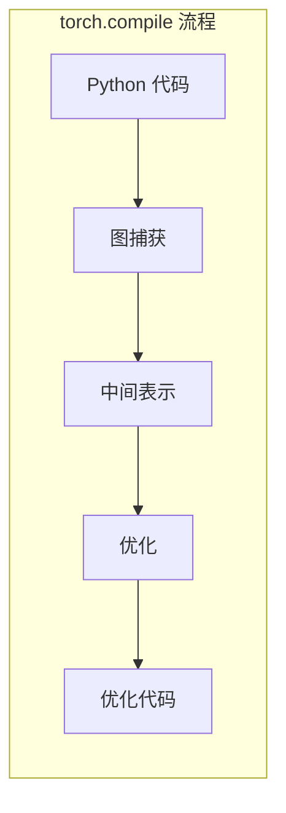
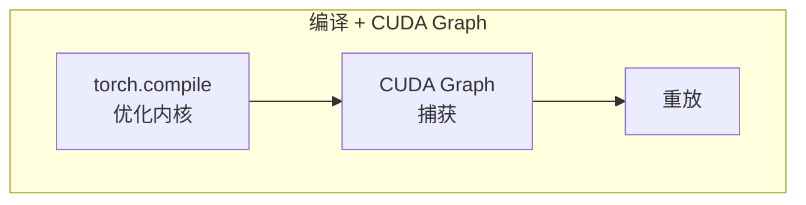

## 第一次编译与稳定请求如何计时

同一模型先冷启动，再用相同形状重复运行。将图生成、编译缓存命中及预热后的单步执行分别计时，才能判断端到端延迟变化的原因。PyTorch 编译缓存和 CUDA Graph 重放保存的是不同对象。 [0.5.23 编译缓存说明](https://github.com/sgl-project/sglang/blob/v0.5.23/docs/docs/references/torch_compile_cache.mdx)

## torch.compile 简介

### 什么是 torch.compile

PyTorch 2.0 引入的编译优化，将 Python 代码转换为优化的机器码：



### 主要优化

| 优化类型 | 说明 |
|----------|------|
| 内核融合 | 合并多个小操作 |
| 算子选择 | 选择最优实现 |
| 内存优化 | 减少中间张量 |
| 并行化 | 自动并行执行 |

---

## 哪些解码批次进入编译

0.5.23 的 CUDA 解码运行器先由 `get_batch_sizes_to_capture` 得到两组批大小：`capture_bs` 用于图捕获，`compile_bs` 是其中参与编译的批大小。开启 `--enable-torch-compile` 并指定 `--torch-compile-max-bs 8` 后，捕获列表中超过 8 的批大小仍可以有 CUDA Graph，编译覆盖哪些批要看 `compile_bs`。判断某次请求有没有用到编译结果，先找它匹配的解码批大小，再查捕获阶段走了哪条分支。[批大小选择](https://github.com/sgl-project/sglang/blob/v0.5.23/python/sglang/srt/model_executor/runner/base_cuda_graph_runner.py) · [解码图捕获](https://github.com/sgl-project/sglang/blob/v0.5.23/python/sglang/srt/model_executor/runner/decode_cuda_graph_runner.py)

## 内核融合

### 观察中间张量的读写


title: 两个逐元素算子共用一份中间值
rows: ["原始输入", "中间值", "最终输出"]
steps:
  - title: "给定 x=2"
    detail: "计算 y=(x+1)×3，这里以单一元素显示一次读写。"
    cells: [["2"], ["·"], ["·"]]
    focus: [[0, 0]]
  - title: "分成两个 kernel"
    detail: "第一个操作算出 3，并将中间张量写回设备内存。"
    cells: [["2"], ["3"], ["·"]]
    focus: [[1, 0]]
  - title: "第二个 kernel"
    detail: "读取刚保存的中间值，再乘 3，得到 9。"
    cells: [["2"], ["3"], ["9"]]
    focus: [[2, 0]]
  - title: "若融合成功"
    detail: "同一 kernel 将中间值保留在寄存器，直接写 9，省去中间张量的显存往返。"
    cells: [["2"], ["寄存器"], ["9"]]
    focus: [[1, 0], [2, 0]]


### 融合示例

```python
# 原始代码
def mlp_forward(x, w1, w2):
    h = F.linear(x, w1)
    h = F.silu(h)
    h = F.linear(h, w2)
    return h

# torch.compile 自动融合
compiled_mlp = torch.compile(mlp_forward)
# 融合为更少的内核调用
```

---

## 与 CUDA Graph 配合

### 组合使用



### 实现

```python
def capture_one_batch_size(self, bs: int):
    # 1. 应用 torch.compile
    if bs in self.compile_bs:
        with patch_model(self.model, compile=True):
            forward = self.model.forward
    else:
        forward = self.model.forward

    # 2. 捕获 CUDA Graph
    graph = torch.cuda.CUDAGraph()
    with torch.cuda.graph(graph):
        output = forward(input_ids, positions, forward_batch)

    return graph, output
```

---

## 编译优化技术

### 1. Triton 后端

```python
# 使用 Triton 生成高效内核
@torch.compile(backend="inductor")
def attention_forward(q, k, v):
    return F.scaled_dot_product_attention(q, k, v)
```

### 2. 动态形状支持

```python
# 启用动态形状
model = torch.compile(
    model,
    dynamic=True,  # 支持动态形状
)
```

### 3. 选择性编译

```python
# 只编译关键部分
class Model(nn.Module):
    def __init__(self):
        self.mlp = torch.compile(MLP())
        self.attention = Attention()  # 不编译

    def forward(self, x):
        h = self.attention(x)
        return self.mlp(h)
```

---

## 分开测量编译和推理

单独记录首次启动的编译耗时、第二次使用相同缓存的启动耗时，以及预热后的设备步时。更换批形状、后端或编译选项可能需要生成新的代码，混在一组汇总延迟里会掩盖差别。指定同一模型与提示长度，开启编译和关闭编译各保留一条时间线，比较融合内核的数量与内存访问，再验证端到端变化。

## 配置参数

| 参数 | 作用 |
|---|---|
| `--enable-torch-compile` | 对支持的执行路径开启 torch.compile。 |
| `--torch-compile-max-bs` | 限制参与编译的批大小，便于比较编译开销与覆盖范围。 |

### 启动命令

```bash
# 启用 torch.compile
python -m sglang.launch_server \
    --model-path meta-llama/Llama-3.1-8B-Instruct \
    --enable-torch-compile

# 限制参与编译的 batch size
python -m sglang.launch_server \
    --model-path meta-llama/Llama-3.1-8B-Instruct \
    --enable-torch-compile \
    --torch-compile-max-bs 8
```

---

## 调试与监控

### 查看编译日志

```python
import torch._dynamo
torch._dynamo.config.verbose = True
torch._dynamo.config.log_level = "DEBUG"
```

### 编译统计

```python
# 获取编译统计
import torch._dynamo as dynamo

# 重置计数器
dynamo.reset()

# 运行模型
output = model(input)

# 查看统计
print(dynamo.utils.counters)
```

### 性能分析

```python
with torch.profiler.profile(
    activities=[
        torch.profiler.ProfilerActivity.CPU,
        torch.profiler.ProfilerActivity.CUDA,
    ],
    with_stack=True,
) as prof:
    output = compiled_model(input)

print(prof.key_averages().table(sort_by="cuda_time_total"))
```

---

## 常见问题

### 1. 编译失败

```python
# 问题：动态控制流
if x.sum() > 0:  # 数据依赖的控制流
    return x
else:
    return -x

# 解决：使用 torch.where
return torch.where(x.sum() > 0, x, -x)
```

### 2. 性能退化

```python
# 问题：频繁重编译
# 原因：输入形状频繁变化

# 解决：设置动态维度
import torch._dynamo as dynamo
dynamo.mark_dynamic(tensor, dim=0)  # 标记动态维度
```

### 3. 内存增加

```python
# 问题：编译增加内存使用
# 解决：调整编译配置
torch._inductor.config.memory_planning = True
torch._inductor.config.reorder_for_locality = True
```

---

## 最佳实践

### 1. 渐进式编译

```python
# 先验证功能正确性
output_eager = model(input)

# 再启用编译
compiled_model = torch.compile(model)
output_compiled = compiled_model(input)

# 验证结果一致
torch.testing.assert_close(output_eager, output_compiled)
```

### 2. 预热

```python
# 预热编译
for _ in range(3):
    _ = compiled_model(warmup_input)

# 实际运行
output = compiled_model(real_input)
```

### 3. 缓存编译结果

```python
import torch._dynamo
torch._dynamo.config.cache_size_limit = 256  # 增加缓存
```

---
