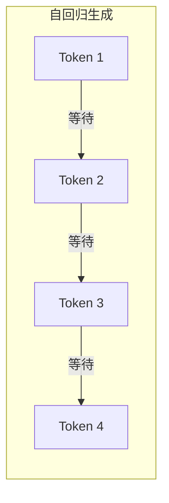
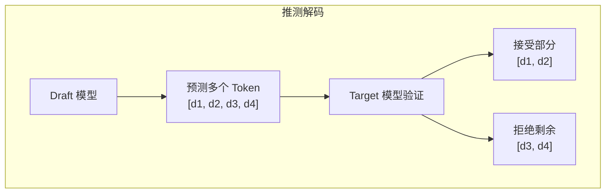
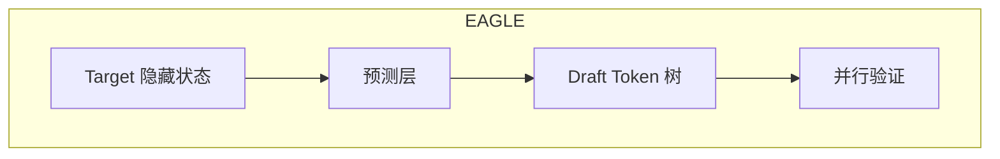
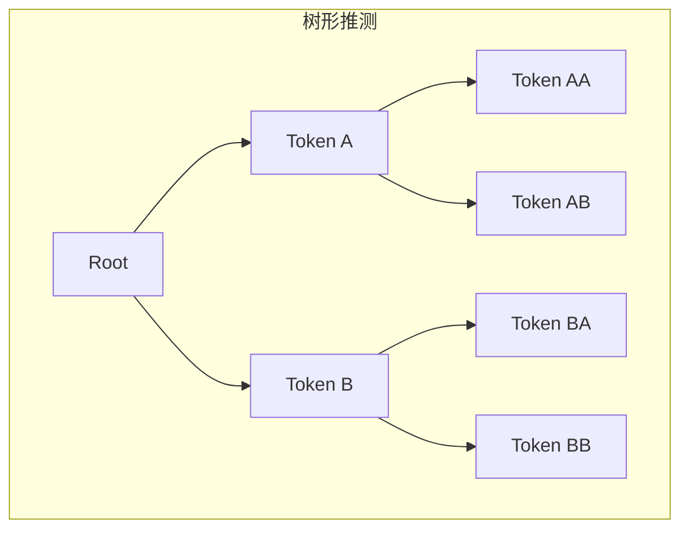
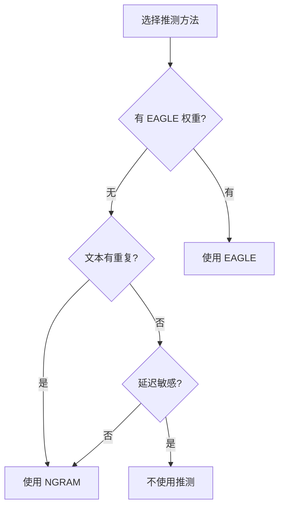

## 草稿与目标模型各做什么

目标模型负责验证候选并提交输出，草稿质量与每轮验证开销共同决定速度。EAGLE 部署需要选与目标模型匹配的草稿权重，然后记录实际提交长度；仅看到草稿模型成功加载还不足以解释加速。 [草稿算法与参数](https://github.com/sgl-project/sglang/blob/v0.5.23/docs/docs/advanced_features/speculative_decoding.mdx)

## 推测解码原理

### 自回归生成的瓶颈



**问题**：每个 token 必须等待前一个完成，无法并行。

### 推测解码思想



**核心思想**：
1. 使用小模型（Draft）快速预测多个 token
2. 使用大模型（Target）并行验证
3. 接受正确的预测，拒绝错误的

---

## 推测解码流程

### 完整流程


title: 四个草稿 token 演算一次验证
actors: ["草稿模型", "目标模型", "已提交序列"]
steps:
  - from: 0
    to: 1
    label: "提出 A B C D"
    detail: "四个候选以同一段已确认前缀为起点。"
  - from: 1
    to: 1
    label: "检查四处"
    detail: "目标模型计算相应位置的分布。"
  - from: 1
    to: 2
    label: "接受 A B"
    detail: "示例前两个候选通过验证，加入本轮提交序列。"
  - from: 1
    to: 2
    label: "第三处改为 X"
    detail: "第三个候选被拒绝，用验证算法的替代 token X 收尾。"
  - from: 2
    to: 0
    label: "从 A B X 继续"
    detail: "原草稿 D 依赖已被替换的 C，下一轮从已提交前缀重新起草。"


### 验证机制

```python
def verify_speculative(draft_tokens, target_logits):
    """验证推测的 tokens"""
    accepted = []

    for i, draft_token in enumerate(draft_tokens):
        # 计算 Target 模型在该位置的概率
        target_prob = softmax(target_logits[i])

        # 计算 Draft 模型的概率
        draft_prob = draft_probs[i]

        # 接受概率
        accept_prob = min(1, target_prob[draft_token] / draft_prob[draft_token])

        if random.random() < accept_prob:
            accepted.append(draft_token)
        else:
            # 拒绝：从修正分布采样
            new_token = sample_from_correction(target_prob, draft_prob)
            accepted.append(new_token)
            break

    return accepted
```

---

## SGLang 支持的方法

### EAGLE

**EAGLE** (Extrapolation Algorithm for Greater Language-model Efficiency)：



特点：
- 使用 Target 模型的隐藏状态
- 无需独立 Draft 模型
- 高接受率

### NGRAM

基于 N-gram 统计的推测：

```python
def ngram_speculate(context, n=3, k=4):
    """使用 N-gram 推测"""
    # 查找历史中的匹配
    suffix = context[-n:]
    for i in range(len(context) - n):
        if context[i:i+n] == suffix:
            # 找到匹配，返回后续 tokens
            return context[i+n:i+n+k]
    return None
```

特点：
- 无额外模型
- 对重复文本有效
- 在已有 token 序列里查找候选，目标模型仍需验证

---

## EAGLE 实现

下面采用 0.5.23 文档给出的目标模型和草稿权重，需要具有读取对应 Llama 模型的权限。显式设置候选预算时也要配套设置推测步数与分支宽度。[参数处理](https://github.com/sgl-project/sglang/blob/v0.5.23/python/sglang/srt/arg_groups/speculative_hook.py)

### 配置

```bash
python3 -m sglang.launch_server \
    --model meta-llama/Meta-Llama-3-8B-Instruct \
    --speculative-algorithm EAGLE \
    --speculative-draft-model-path lmsys/sglang-EAGLE-LLaMA3-Instruct-8B \
    --speculative-num-steps 3 \
    --speculative-eagle-topk 4 \
    --speculative-num-draft-tokens 16 \
    --speculative-token-map thunlp/LLaMA3-Instruct-8B-FR-Spec/freq_32768.pt \
    --mem-fraction-static 0.7 \
    --cuda-graph-max-bs-decode 8 \
    --dtype float16
```

### 简化的执行过程

下例用伪代码区分草稿生成与验证。实际候选可以组成一棵树。

```python
class EAGLESpeculator:
    def __init__(self, model_runner, eagle_path, num_draft):
        self.num_draft = num_draft
        self.eagle_model = load_eagle_model(eagle_path)

    def speculate(self, hidden_states):
        """生成 Draft tokens"""
        draft_tokens = []
        current_hidden = hidden_states

        for _ in range(self.num_draft):
            # 使用 EAGLE 预测层
            logits = self.eagle_model(current_hidden)
            token = sample(logits)
            draft_tokens.append(token)

            # 更新隐藏状态
            current_hidden = self.update_hidden(current_hidden, token)

        return draft_tokens

    def verify(self, draft_tokens, target_logits):
        """验证 Draft tokens"""
        return verify_speculative(draft_tokens, target_logits)
```

---

## NGRAM 实现

### 配置

```bash
# 启用 NGRAM
python -m sglang.launch_server \
    --model-path meta-llama/Llama-3.1-8B-Instruct \
    --speculative-algorithm NGRAM \
    --speculative-num-draft-tokens 4
```

### 核心代码

```python
class NGRAMSpeculator:
    def __init__(self, n=3, num_draft=4):
        self.n = n
        self.num_draft = num_draft

    def speculate(self, token_ids):
        """基于 N-gram 匹配推测"""
        suffix = tuple(token_ids[-self.n:])

        # 在历史中查找匹配
        for i in range(len(token_ids) - self.n - self.num_draft):
            if tuple(token_ids[i:i+self.n]) == suffix:
                # 返回匹配后的 tokens
                return token_ids[i+self.n:i+self.n+self.num_draft]

        return None  # 无匹配

    def verify(self, draft_tokens, target_logits):
        """验证"""
        return verify_speculative(draft_tokens, target_logits)
```

---

## 如何由接受长度计算每个输出 token 的成本

记录每轮最终提交的输出 token 数，以及 proposal、verify 和控制流的总耗时。假设常规解码平均每个 token 需 10 ms，而一次投机轮耗时 16 ms 并平均提交 2 个 token；同一负载下，教学估算是每个输出 token 8 ms、速度比 1.25。若只平均提交 1 个，成本上升到 16 ms。这个算例用于解释为何接受率高也不必然获得线性加速。

把代码、翻译和摘要请求分组，固定目标模型与采样设置，各自记录接受长度分布和端到端延迟。相同草稿长度下，EAGLE 额外执行草稿模型，n-gram 花时间查询已有序列。

## 高级配置

### 动态推测长度

```python
class AdaptiveSpeculator:
    def __init__(self, min_draft=2, max_draft=8):
        self.min_draft = min_draft
        self.max_draft = max_draft
        self.accept_rate_history = []

    def get_num_draft(self):
        """根据历史接受率调整"""
        if not self.accept_rate_history:
            return 4  # 默认

        avg_rate = sum(self.accept_rate_history[-10:]) / 10

        if avg_rate > 0.8:
            return min(self.max_draft, current + 1)
        elif avg_rate < 0.5:
            return max(self.min_draft, current - 1)
        return current
```

### 树形推测



```python
# 树形推测可以探索多个分支
# 提高接受率但增加验证开销
```

---

## 调试与监控

### 指标收集

```python
class SpeculativeMetrics:
    def __init__(self):
        self.total_drafts = 0
        self.total_accepted = 0
        self.rounds = 0

    def record(self, num_drafted, num_accepted):
        self.total_drafts += num_drafted
        self.total_accepted += num_accepted
        self.rounds += 1

    def get_stats(self):
        return {
            "accept_rate": self.total_accepted / self.total_drafts,
            "avg_accepted": self.total_accepted / self.rounds,
            "speedup_estimate": self.total_accepted / self.rounds + 1,
        }
```

### 日志输出

```python
logger.info(
    f"Speculative decode: drafted={num_drafted}, "
    f"accepted={num_accepted}, "
    f"rate={num_accepted/num_drafted:.2%}"
)
```

---

## 最佳实践

### 选择方法



### 配置建议

| 场景 | 方法 | 推测长度 |
|------|------|----------|
| 代码补全 | EAGLE | 5-8 |
| 聊天对话 | EAGLE | 3-5 |
| 文档处理 | NGRAM | 4-6 |
| 实时翻译 | 不推荐 | - |

---
