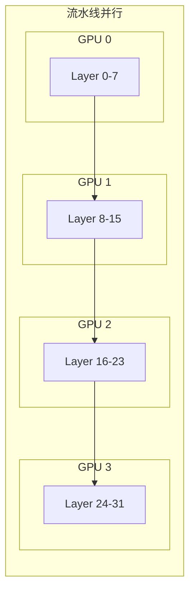
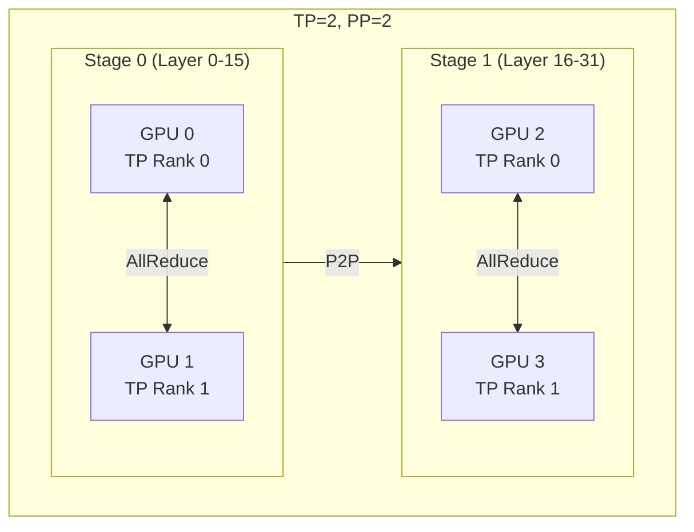

## 可切层数与流水线空隙

PP 把不同层分到不同 stage，请求必须按依赖顺序通过这些 stage。前一级把激活传到后一级后，这个微批才能继续。流水线填满时，最慢一级的计算和传输决定下一个微批多久能过去。 [0.5.23 流水线限制](https://github.com/sgl-project/sglang/blob/v0.5.23/docs/docs/advanced_features/pipeline_parallelism.mdx)

## 流水线并行原理

### 层间切分



**特点**：
- 每个 GPU 持有连续的若干层
- 前向传播顺序执行
- 需要传递激活值

### PP vs TP

| 特性 | TP | PP |
|------|----|----|
| 切分方式 | 层内 | 层间 |
| 通信模式 | AllReduce | Point-to-Point |
| 设备持有的权重 | 各层中分给本 rank 的权重分片 | 分给本 stage 的若干层 |
| 布置时先看什么 | 集合通信经过哪些链路 | 哪两个相邻 stage 要传激活 |

---

## 流水线怎样填满，又怎样排空

假设每一级前向都占一个时隙，传输耗时忽略。单个微批需要顺序走三个时隙。下图再加入 M1、M2、M3，观察同一列的三块 GPU 各在算什么。


title: 四个微批次依次穿过三个 stage
unit: 时隙
ticks: [0, 1, 2, 3, 4, 5, 6]
tracks:
  - name: GPU 0
    bars: [[0, 1, "M0"], [1, 2, "M1"], [2, 3, "M2"], [3, 4, "M3"]]
  - name: GPU 1
    bars: [[1, 2, "M0"], [2, 3, "M1"], [3, 4, "M2"], [4, 5, "M3"]]
  - name: GPU 2
    bars: [[2, 3, "M0"], [3, 4, "M1"], [4, 5, "M2"], [5, 6, "M3"]]
steps:
  - at: 1
    title: GPU 0 交出 M0
    detail: 如果只发 M0，第二个时隙 GPU 0 就会闲下来。
  - at: 2
    title: M1 接上
    detail: GPU 1 计算 M0，GPU 0 同时计算 M1。
  - at: 3
    title: 三个 stage 都在工作
    detail: 这一格从上到下分别处理 M2、M1、M0。M0 的结果先出来。
  - at: 4
    title: 最后一个微批进入流水线
    detail: GPU 0 完成 M3 后没有新输入，后两级还有工作。
  - at: 6
    title: M3 通过最后一级
    detail: 四个微批共做 12 段前向。填充和排空合计留下 6 个空闲的 GPU 时隙。


## SGLang 实现

### 配置

```bash
# PP=2
python -m sglang.launch_server \
    --model-path meta-llama/Llama-3.1-70B-Instruct \
    --pipeline-parallel-size 2

# TP=2, PP=2
python -m sglang.launch_server \
    --model-path meta-llama/Llama-3.1-70B-Instruct \
    --tensor-parallel-size 2 \
    --pipeline-parallel-size 2
```

### 初始化

```python
def init_pipeline_parallel(self):
    """初始化流水线并行"""
    # 创建 PP 通信组
    self.pp_group = create_pipeline_parallel_group(self.pp_size)

    # 计算本 rank 负责的层
    layers_per_rank = self.num_layers // self.pp_size
    self.layer_start = self.pp_rank * layers_per_rank
    self.layer_end = self.layer_start + layers_per_rank

    # 是否为首/尾 rank
    self.is_first_rank = (self.pp_rank == 0)
    self.is_last_rank = (self.pp_rank == self.pp_size - 1)
```

### 前向传播

```python
def forward_pp(self, input_ids, positions, forward_batch):
    """流水线并行前向"""
    if self.is_first_rank:
        # 首 rank：处理输入
        hidden = self.embed_tokens(input_ids)
    else:
        # 非首 rank：接收上一 rank 的激活
        hidden = recv_tensor(src=self.pp_rank - 1, group=self.pp_group)

    # 执行本 rank 的层
    for layer_idx in range(self.layer_start, self.layer_end):
        hidden = self.layers[layer_idx](hidden, positions, forward_batch)

    if self.is_last_rank:
        # 尾 rank：计算输出
        logits = self.lm_head(hidden)
        return logits
    else:
        # 非尾 rank：发送到下一 rank
        send_tensor(hidden, dst=self.pp_rank + 1, group=self.pp_group)
        return None
```

---

## 调度策略

### 选择微批次大小

上图的三个 stage 处理四个等长微批，理想化的忙碌比例是 $12/(3\times6)=2/3$。微批更多，填充与排空的空隙所占比例会下降。分得过小，每次矩阵乘能并行处理的 token 也会变少。实际选值时，同时看最慢 stage 的前向耗时、相邻设备传激活的耗时，以及一轮完成的 token 数。

## 激活传递

### 通信实现

```python
def send_tensor(tensor, dst, group):
    """发送张量"""
    # 发送形状
    shape = torch.tensor(tensor.shape, device=tensor.device)
    dist.send(shape, dst=dst, group=group)

    # 发送数据
    dist.send(tensor.contiguous(), dst=dst, group=group)

def recv_tensor(src, group, dtype, device):
    """接收张量"""
    # 接收形状
    shape = torch.zeros(4, dtype=torch.long, device=device)
    dist.recv(shape, src=src, group=group)

    # 接收数据
    tensor = torch.zeros(*shape.tolist(), dtype=dtype, device=device)
    dist.recv(tensor, src=src, group=group)

    return tensor
```

### 异步通信

```python
async def forward_pp_async(self, batches):
    """异步流水线前向"""
    pending_recv = None
    pending_send = None

    for batch in batches:
        # 等待上一个接收
        if pending_recv:
            hidden = await pending_recv

        # 异步接收下一个
        if not self.is_first_rank:
            pending_recv = async_recv(src=self.pp_rank - 1)

        # 计算
        hidden = self.forward_layers(hidden)

        # 等待上一个发送
        if pending_send:
            await pending_send

        # 异步发送
        if not self.is_last_rank:
            pending_send = async_send(hidden, dst=self.pp_rank + 1)
```

---

## TP + PP 组合

### 混合并行



### 配置

```bash
# 4 GPU: TP=2, PP=2
# GPU 0,1 -> Stage 0
# GPU 2,3 -> Stage 1
python -m sglang.launch_server \
    --model-path meta-llama/Llama-3.1-70B-Instruct \
    --tensor-parallel-size 2 \
    --pipeline-parallel-size 2
```

---

## 性能分析

### 气泡比例

```
气泡比例 = (PP_Size - 1) / (PP_Size - 1 + Num_Microbatches)

例: PP=4, 微批次=8
气泡比例 = 3 / 11 ≈ 27%

例: PP=4, 微批次=16
气泡比例 = 3 / 19 ≈ 16%
```

### 内存占用

```
每 Stage 内存 = 模型内存 / PP_Size + 激活内存

激活内存 = 微批次数 × 激活大小
```

### 选择 PP Size

| 场景 | 推荐配置 |
|------|----------|
| 单机多卡 | 优先 TP |
| 跨机部署 | TP 机内, PP 跨机 |
| 超大模型 | TP + PP 组合 |

---

## 配置建议

### 模型配置示例

```bash
# 70B on 8 GPU
# TP=4 (NVLink 连接), PP=2
python -m sglang.launch_server \
    --model-path meta-llama/Llama-3.1-70B-Instruct \
    --tensor-parallel-size 4 \
    --pipeline-parallel-size 2

# 405B on 16 GPU (2 nodes)
# 每节点 TP=8, 跨节点 PP=2
python -m sglang.launch_server \
    --model-path meta-llama/Llama-3.1-405B-Instruct \
    --tensor-parallel-size 8 \
    --pipeline-parallel-size 2
```

---

## TP 和 PP 的通信位置

| 特性 | TP | PP |
|------|----|----|
| 通信开销 | 高（AllReduce） | 低（P2P） |
| 气泡 | 无 | 有（可优化） |
| 扩展性 | 受限于 NVLink | 可跨机 |
