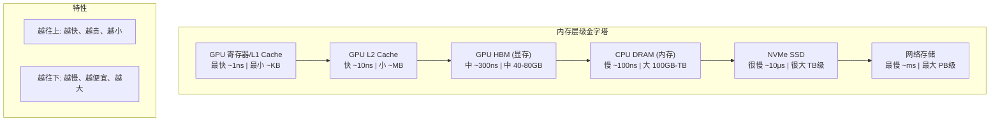
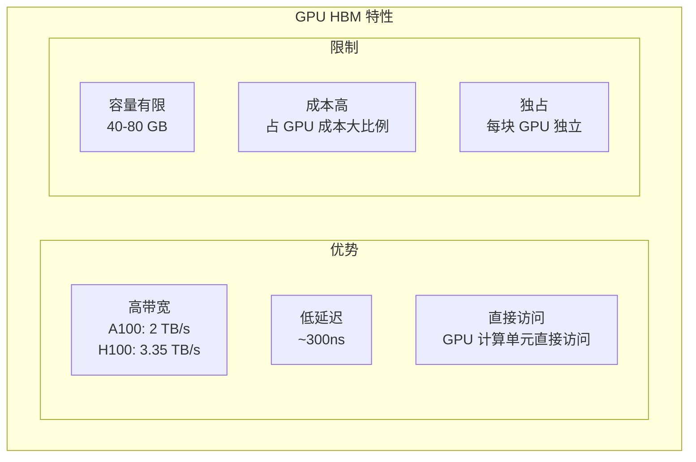
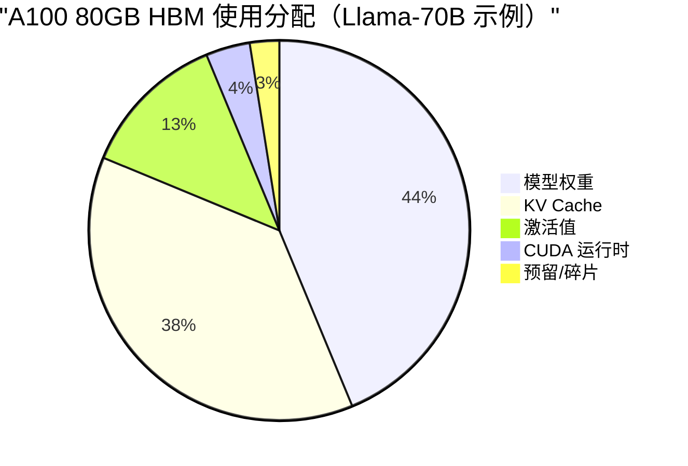
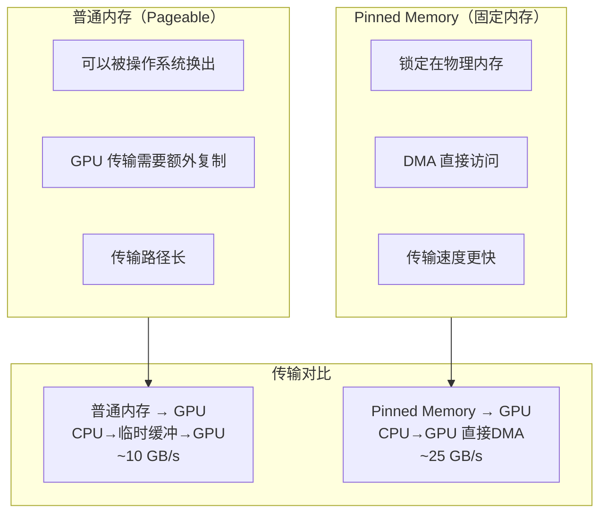
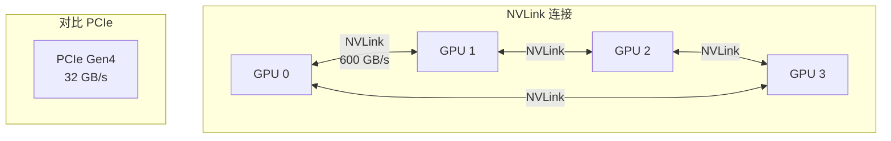
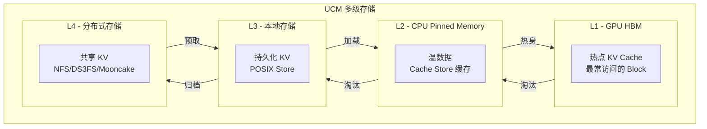
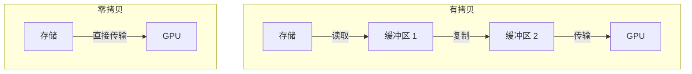

> **前置要求**: [vLLM 架构概览](./03-vllm-architecture.md)

---

## 概述

留在设备内存的 KV 可以直接供注意力内核读取。将块移到主存或磁盘能腾出设备空间，再次命中时需要把它们搬回来。

---

## 1. 内存层级金字塔

### 1.1 层级结构


### 1.2 各层级参数对比
| 存储层级 | 延迟 | 带宽 | 典型容量 | 每 GB 成本 |
|----------|------|------|----------|------------|
| GPU 寄存器 | ~1 ns | ~TB/s | ~KB | - |
| GPU L1 Cache | ~5 ns | ~10 TB/s | ~128 KB | - |
| GPU L2 Cache | ~30 ns | ~5 TB/s | ~50 MB | - |
| GPU HBM | ~300 ns | ~2 TB/s | 40-80 GB | $$$ |
| CPU DRAM | ~100 ns | ~200 GB/s | 100 GB - 1 TB | $$ |
| NVMe SSD | ~10 μs | ~7 GB/s | 1-30 TB | $ |
| 网络存储 | ~1 ms | ~10 GB/s | PB 级 | ¢ |
---
## 2. GPU 显存（HBM）

### 2.1 HBM 特性

HBM (High Bandwidth Memory) 是现代 GPU 的主要内存：



### 2.2 HBM 使用分配

以 A100 80GB 为例：



**关键洞察**: KV Cache 占用了大量显存，是优化的重点目标。

---
## 3. CPU 内存与 Pinned Memory
### 3.1 普通内存 vs Pinned Memory


### 3.2 UCM 的 Pinned Memory 使用

UCM 使用 Pinned Memory 缓冲池加速数据传输：

```python
# UCM Pinned Memory 缓冲池示意
class PinnedMemoryPool:
    def __init__(self, buffer_count=1024, buffer_size=4096):
        # 预分配固定数量的 Pinned Memory 缓冲区
        self.buffers = [
            torch.empty(buffer_size, dtype=torch.uint8, pin_memory=True)
            for _ in range(buffer_count)
        ]

    def get_buffer(self):
        # 从池中获取可用缓冲区
        return self.free_buffers.pop()

    def return_buffer(self, buffer):
        # 归还缓冲区到池
        self.free_buffers.append(buffer)
```
---
## 4. 数据传输路径

### 4.1 PCIe 传输

CPU 和 GPU 之间通过 PCIe 总线传输数据：


title: "主机上一个 KV 块怎样到达 GPU"
actors: ["主机缓冲", "复制流", "PCIe", "设备块"]
steps:
  - from: 0
    to: 1
    label: "提交 H2D"
    detail: "源缓冲中已有完整 KV，目标地址属于已分配的设备块。"
  - from: 1
    to: 2
    label: "开始复制"
    detail: "设备运行时按复制流的依赖发起传输。"
  - from: 2
    to: 3
    label: "到达设备"
    detail: "数据经过本机 PCIe 路径写入目标范围。"
  - from: 3
    to: 3
    label: "等待完成"
    detail: "模型使用这个块以前等待对应事件，源缓冲也有自己的复用时机。"


### 4.2 NVLink（多 GPU）

NVLink 提供 GPU 之间的高速直连：



### 4.3 传输带宽对比

| 传输路径 | 带宽 | 延迟 |
|----------|------|------|
| GPU 内部 (HBM) | ~2000 GB/s | ~300 ns |
| GPU-GPU (NVLink) | ~600 GB/s | ~1 μs |
| GPU-CPU (PCIe 4.0) | ~32 GB/s | ~10 μs |
| CPU-SSD (NVMe) | ~7 GB/s | ~10 μs |
| CPU-Network | ~10 GB/s | ~1 ms |

---
## 5. 异步传输与重叠
### 5.1 同步 vs 异步传输

title: "异步复制期间主线程在做什么"
actors: ["主线程", "复制流", "目标缓冲", "模型"]
steps:
  - from: 0
    to: 1
    label: "提交复制"
    detail: "主线程把指定源与目的范围交给复制流。"
  - from: 0
    to: 0
    label: "准备下一步"
    detail: "异步提交返回后，主线程可以先做与目的数据无关的工作。"
  - from: 1
    to: 2
    label: "完成写入"
    detail: "复制流完成本次传输并到达相应的事件。"
  - from: 2
    to: 3
    label: "消费数据"
    detail: "模型等待这个依赖满足后再读目的缓冲。"


### 5.2 计算与传输重叠

假设两层使用独立的目标缓冲区，设备允许复制与计算同时进行。


title: 复制下一层的 KV 时，计算流可以做什么
unit: 时隙
ticks: [0, 1, 2, 3, 4, 5]
tracks:
  - name: 复制流
    bars: [[0, 2, "读 L0"], [2, 4, "读 L1"]]
  - name: 计算流
    bars: [[2, 3, "算 L0"], [4, 5, "算 L1"]]
steps:
  - at: 0
    title: 读取 L0
    detail: 示意中每层传输用两个时隙，计算用一个时隙。
  - at: 2
    title: 两条流开始重叠
    detail: L0 已经就绪。复制流读 L1 的同时，计算流使用 L0。
  - at: 3
    title: 计算流等待 L1
    detail: L0 算完了，但 L1 还没到。空白的一格就是这次没有盖住的传输时间。
  - at: 5
    title: 两层完成
    detail: 串行需要六个时隙，这个排程用了五个。缩短的是重叠的那一个时隙。

### 5.3 CUDA Streams
下面的单层代码先把依赖关系写清楚。要得到图中的重叠，需要在算 L0 时就提交 L1 的读取，并为两层分别记录就绪事件。
```python
class AsyncTransfer:
    def __init__(self):
        self.compute_stream = torch.cuda.Stream()
        self.transfer_stream = torch.cuda.Stream()
    def overlapped_execution(self, kv_data, compute_fn):
        # 在 transfer stream 上异步加载
        with torch.cuda.stream(self.transfer_stream):
            kv_gpu = kv_data.to('cuda', non_blocking=True)

        # 在 compute stream 上执行计算
        with torch.cuda.stream(self.compute_stream):
            # 等待传输完成
            self.compute_stream.wait_stream(self.transfer_stream)
            result = compute_fn(kv_gpu)

        return result
```
---
## 6. UCM 多级存储架构

### 6.1 存储层级设计

UCM 利用多级存储层级优化 KV Cache 管理：



### 6.2 Pipeline Store 组合

UCM 支持灵活的存储层级组合：

```
配置示例:

1. Cache|Posix - 本地高速缓存
   HBM ↔ Pinned Memory Cache ↔ 本地 SSD

2. Cache|Posix - POSIX 后端也可使用各节点的共享挂载点
   HBM ↔ Pinned Memory Cache ↔ NFS 共享存储

3. Cache|DS3FS - 云存储缓存
   HBM ↔ Pinned Memory Cache ↔ S3 对象存储
```

---
## 7. 传输优化技术
### 7.1 批量传输
将多个小传输合并为大传输：

title: "四次小传输怎样共用一次提交"
rows: ["块", "独立提交", "批量提交"]
steps:
  - title: "四份数据"
    detail: "本例 A 到 D 各有一份地址和长度描述。"
    cells:
      - ["A", "B", "C", "D"]
      - ["·", "·", "·", "·"]
      - ["·", "·", "·", "·"]
    focus: [[0, 0], [0, 1], [0, 2], [0, 3]]
  - title: "独立提交"
    detail: "四次调用分别带一份描述，每次都有提交开销。"
    cells:
      - ["A", "B", "C", "D"]
      - ["1", "2", "3", "4"]
      - ["·", "·", "·", "·"]
    focus: [[1, 0], [1, 1], [1, 2], [1, 3]]
  - title: "统一提交"
    detail: "批接口一次传入四份描述；每份数据的源与目的位置仍单独保留。"
    cells:
      - ["A", "B", "C", "D"]
      - ["1", "2", "3", "4"]
      - ["批1", "批1", "批1", "批1"]
    focus: [[2, 0], [2, 1], [2, 2], [2, 3]]

### 7.2 预取（Prefetch）
提前加载即将使用的数据：

title: "预取怎样赶在模型前向之前"
actors: ["调度器", "预取任务", "存储", "worker"]
steps:
  - from: 0
    to: 1
    label: "提交候选"
    detail: "调度器预计后续计算会用到块 B，提前安排预取。"
  - from: 1
    to: 2
    label: "请求 B"
    detail: "存储开始读取 B，当前步继续使用已有数据。"
  - from: 2
    to: 3
    label: "B 到缓冲"
    detail: "worker 在之后的步骤获得可用数据或等待相应任务完成。"
  - from: 3
    to: 3
    label: "使用 B"
    detail: "若 B 在其层开始前已经就绪，预取覆盖了这次等待。"

### 7.3 零拷贝（Zero-Copy）
减少不必要的数据复制：


---

## 8. 关键概念总结

| 概念 | 说明 | UCM 应用 |
|------|------|----------|
| HBM | GPU 高带宽显存 | 热点 KV 存储 |
| Pinned Memory | CPU 固定内存 | Cache Store 缓冲池 |
| PCIe | CPU-GPU 传输总线 | 决定传输带宽上限 |
| 异步传输 | 非阻塞数据传输 | 计算传输重叠 |
| CUDA Streams | 异步操作管理 | 并行调度 |
| 预取 | 提前加载数据 | Prefetch Engine |
| 多级存储 | 分层存储架构 | Pipeline Store |

---

## 延伸阅读

- [CUDA Programming Guide - Memory](https://docs.nvidia.com/cuda/cuda-c-programming-guide/index.html#memory-hierarchy)
- [Understanding GPU Memory](https://developer.nvidia.com/blog/understanding-tensor-core-performance-with-nsight-compute/)
