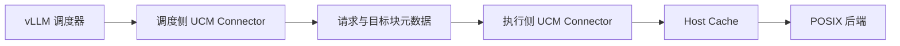

以 `Cache|Posix` 为例，调度器先算出本地已处理的 token 数，向 UCM 询问还能从外部补上多少连续前缀。分配目标块后，connector 把请求与目标块的对应关系交给 worker。worker 组织 load；存储层可以从 Host cache 或 POSIX 后端供数。满足该路径要求的等待条件后，模型才消费对应 KV。

|问题|源码所有者|
|---|---|
|谁认出本地前缀之外还能复用多少 token|`UCMConnector.get_num_new_matched_tokens` 及其实际分派实现|
|谁提供本步的目标块|引擎分配后调用 `update_state_after_alloc`；connector 在 `build_connector_meta` 中把需要的信息带给 worker|
|哪些 KV 张量或状态组成一个缓存布局|Connector 的布局实现及 HMA/HLA 适配|
|保存/加载何时完成|worker 的传输与等待回调，以及相应 Store 后端|

不同模型的布局可能包含共享 MLA KV 与 rank 私有状态。v0.9.1 修复过两者混用加载策略导致的挂起；画数据流时应明确哪一份张量属于哪个 rank。[Connector](https://github.com/ModelEngine-Group/unified-cache-management/blob/v0.9.1/ucm/integration/vllm/ucm_connector.py) · [v0.9.1 修复说明](https://github.com/ModelEngine-Group/unified-cache-management/releases/tag/v0.9.1)
