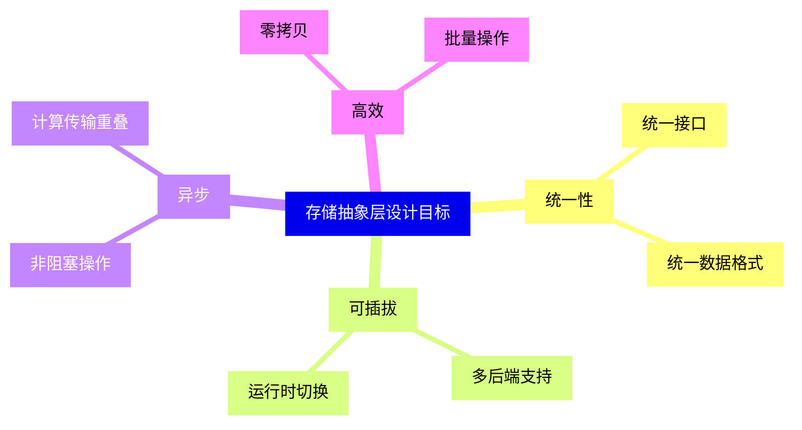
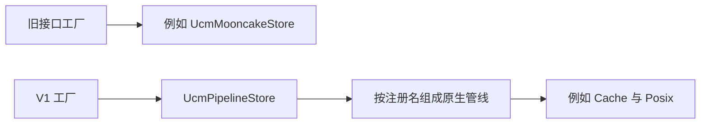

> **前置要求**: [快速开始](../01-overview/03-quick-start.md)

---

## 概述

调度侧想知道哪些前缀块可用，worker 要把对应字节搬到具体设备块。Store 分别提供查询、读写与等待接口，把这几件事接到实际后端。

---

## 1. 设计哲学

### 1.1 设计目标


### 1.2 核心原则
| 原则 | 说明 | 实现 |
|------|------|------|
| 查询与传输 | 先判断可用范围，再提交实际数据传输 | lookup、load、dump 及等待接口 |
| 异步优先 | 默认非阻塞 | Task 模型 |
| 平台无关 | 屏蔽硬件差异 | 抽象传输层 |
| 可组合 | 支持层级组合 | Pipeline Store |

---

## 2. UcmKVStoreBase 接口

### 2.1 旧 Store 接口的写入与提交回调

`UcmKVStoreBase` 定义了 `create`、`lookup`、`prefetch`、`load`、`dump`、`wait`、`check` 与 `commit` 等方法。`load` / `dump` 使用 block ID、offset 列表和设备张量集合，并返回任务句柄。`check` 返回状态码与是否完成，`wait` 等待结果，`commit` 接收块列表和成功标志。各后端分别实现这些方法。[旧版 Store 基类](https://github.com/ModelEngine-Group/unified-cache-management/blob/v0.9.1/ucm/store/ucmstore.py)

### 2.2 两个接口和原生管线



Python 工厂先创建 `UcmPipelineStore`，再由管线构造器按配置装配 `Posix`、`Cache` 等原生后端。[两层工厂的调用顺序](./02-factory-pattern.md)

## 3. 核心操作详解

### 3.1 lookup - 查询操作


title: "逐块存在与连续前缀的返回值"
rows: ["输入块", "是否存在", "前缀覆盖"]
steps:
  - title: "从左开始"
    detail: "A 已存在，连续前缀暂时覆盖第一块。"
    cells:
      - ["A", "B", "C"]
      - ["真", "·", "·"]
      - ["是", "·", "·"]
    focus: [[0, 0], [1, 0], [2, 0]]
  - title: "遇到缺口"
    detail: "B 缺失，普通前缀以 A 结束，最后连续命中下标是 0。"
    cells:
      - ["A", "B", "C"]
      - ["真", "假", "·"]
      - ["是", "否", "·"]
    focus: [[1, 1], [2, 1]]
  - title: "看后面的 C"
    detail: "逐块查询仍可返回 C 存在；普通前缀查询到 B 已经停止。"
    cells:
      - ["A", "B", "C"]
      - ["真", "假", "真"]
      - ["是", "否", "否"]
    focus: [[1, 2], [2, 2]]


**使用场景**:
- Scheduler 调用，判断哪些 Block 可以复用
- 影响调度决策：命中的 Block 不需要计算

### 3.2 load - 加载操作


title: "load 返回任务到目的块可用"
actors: ["调用方", "Store", "传输任务", "设备块"]
steps:
  - from: 0
    to: 1
    label: "提交读取"
    detail: "调用方给出想加载的 block ID 和目标张量。"
  - from: 1
    to: 2
    label: "创建任务"
    detail: "Store 返回跟踪这次加载的任务句柄。"
  - from: 2
    to: 3
    label: "填充目标"
    detail: "传输任务把命中的字节写到指定目的块。"
  - from: 0
    to: 2
    label: "确认完成"
    detail: "调用方等待相应任务后，模型才能读取这份数据。"


**关键参数**:
- `block_ids`: 要加载的 Block 哈希列表
- `offset`：与 block ID 一一对应的整数列表。旧 Mooncake 适配器将每个值拼进对象键；例如 `block_ids=["A"]`、`offset=[2]` 时读取 `A_2`。
- `dst_tensor`：目标张量列表。旧 Mooncake 后端取回整块已序列化的张量，核对 shape 和 dtype 后复制到 `dst_tensor[i]`。

### 3.3 dump - 保存操作


title: "从设备块写出一份 KV"
actors: ["worker", "Store", "复制任务", "外部存储"]
steps:
  - from: 0
    to: 1
    label: "准备写出"
    detail: "worker 提供源张量、块标识以及有关的分片信息。"
  - from: 1
    to: 2
    label: "建立任务"
    detail: "dump 将数据传输交给相应后端。"
  - from: 2
    to: 3
    label: "持久路径"
    detail: "使用 POSIX 等后端时，数据沿已配置的管线进入实际存储。"
  - from: 0
    to: 2
    label: "等待结果"
    detail: "worker 按接口等待本次操作完成，再处理源空间回收。"


### 3.4 commit - 提交操作

旧基类提供 `commit(block_ids, is_success)` 回调。观察 v0.9.1 的 `UcmMooncakeStore` 时，实际可读边界在 Mooncake 的写入路径：其 `_dump_impl` 调用 `self.store.put`，后端成功写入后管理这个 key 的可读性，随后调用 UCM 侧的 `commit` 不会再改变对象状态。[Mooncake 后端实现](https://github.com/ModelEngine-Group/unified-cache-management/blob/v0.9.1/ucm/store/mooncakestore/mooncake_connector.py)


title: "Mooncake 后端何时能读到新写入的 A"
rows: ["UCM 调用", "Mooncake", "A 的状态"]
steps:
  - title: "提交 dump"
    detail: "令 block ID 为 A、offset 为 0，实际对象键为 A_0。UCM 提交写入时，后端还没有完成 put。"
    cells:
      - ["dump"]
      - ["待写入"]
      - ["未发布"]
    focus: [[0, 0]]
  - title: "后端 put 成功"
    detail: "Mooncake 完成写入并发布可读的 A。其他读取者通过该后端查询对象。"
    cells:
      - ["任务完成"]
      - ["put 成功"]
      - ["可读"]
    focus: [[1, 0], [2, 0]]
  - title: "调用 commit"
    detail: "在这个 Python 适配器中，commit 的方法体是 pass，A 保持之前的可读状态。"
    cells:
      - ["commit"]
      - ["无新操作"]
      - ["可读"]
    focus: [[0, 0], [2, 0]]


---
## 4. 异步任务模型
### 4.1 句柄由后端定义

旧接口的 `Task` 是空基类。v0.9.1 的 `MooncakeTask` 额外保存 `task_id`。后端在后台事件循环调度协程，把对应 Future 放在自己的任务表里；调用方把句柄交回同一 Store，`wait` 按 ID 取出 Future 并等待结果。[Task 基类](https://github.com/ModelEngine-Group/unified-cache-management/blob/v0.9.1/ucm/store/ucmstore.py) · [MooncakeTask 与 wait](https://github.com/ModelEngine-Group/unified-cache-management/blob/v0.9.1/ucm/store/mooncakestore/mooncake_connector.py)

### 4.2 任务生命周期

title: "提交成功与任务完成的区别"
rows: ["时刻", "调用方", "任务"]
steps:
  - title: "刚提交"
    detail: "调用方取得句柄，用它关联此次传输。"
    cells:
      - ["提交", "执行", "完成"]
      - ["得句柄", "·", "·"]
      - ["排队", "·", "·"]
    focus: [[1, 0], [2, 0]]
  - title: "尚在执行"
    detail: "后台处理传输时，调用方可以先做与目的数据无关的工作。"
    cells:
      - ["提交", "执行", "完成"]
      - ["得句柄", "做其他事", "·"]
      - ["排队", "在途", "·"]
    focus: [[1, 1], [2, 1]]
  - title: "等待返回"
    detail: "wait 返回后，调用方根据返回状态消费缓冲或处理错误。"
    cells:
      - ["提交", "执行", "完成"]
      - ["得句柄", "做其他事", "用结果"]
      - ["排队", "在途", "已完成"]
    focus: [[1, 2], [2, 2]]

### 4.3 旧 Mooncake 适配器如何等待

在已创建的 `store` 和目标张量 `dst` 上，读取 `A_2` 可写成：

```python
task = store.load(["A"], [2], [dst])
if store.wait(task) != 0:
    raise RuntimeError("A_2 加载失败")
```

此适配器的 `check` 方法体为 `pass`。读取一组块时应检查 `wait` 的返回值；`wait` 会从任务表中移出对应 Future，同一个句柄只收尾一次。旧适配器的批量 `lookup` 拼接的是 `_0`，因此查 `A` 的零号分片与读取 `A_2` 是不同操作。

## 5. V1 的查询和数据描述

`UcmKVStoreBaseV1.lookup` 接受一组二进制 block ID，返回逐块命中列表；`lookup_on_prefix` 自左向右停在第一个缺口，返回最后的连续命中下标；`lookup_on_reverse` 自右向左返回遇到的第一份可用状态的位置。若存在性是「真、假、真」，前缀查询返回 0，反向查询返回 2。两者都可能返回 -1。

加载接口 `load` 按块接收 `shard_index` 和二维目标张量列表，写出时 `dump` 接收相同形状的源描述；地址版接口用于调用方已经持有实际缓冲区地址的场景。`wait` 等待任务完成，`check` 返回布尔完成状态。V1 没有旧基类的独立 `commit` 接口；调用方应按它实际持有的后端类型使用对应契约。[V1 抽象与参数](https://github.com/ModelEngine-Group/unified-cache-management/blob/v0.9.1/ucm/store/ucmstore_v1.py)

## 6. Block 标识设计
### 6.1 Block ID 生成
在 v0.9.1 的 vLLM 路径中，`RequestHasher` 先根据 caller 提供的模型、并行与布局命名空间得到链根。每个完整块把前一摘要、本块 token 和影响 KV 的额外语义一起序列化，哈希时再包含命名空间；末尾不足一块的 token 留给引擎计算。这种前缀链会把中间一块的变化传播给后续块。


title: "一块发生变化，后面的哈希也跟着变"
rows: ["第一次", "第二次", "块键"]
steps:
  - title: "第一块相同"
    detail: "两次请求使用同一命名空间，第一块 token 和额外语义相同。"
    cells:
      - ["A", "B", "C"]
      - ["A", "R", "C"]
      - ["同", "·", "·"]
    focus: [[2, 0]]
  - title: "第二块改变"
    detail: "第二块输入从 B 变为 R，块键开始分叉。"
    cells:
      - ["A", "B", "C"]
      - ["A", "R", "C"]
      - ["同", "异", "·"]
    focus: [[0, 1], [1, 1], [2, 1]]
  - title: "相同 C 接在不同父键后"
    detail: "第三块虽然还是 C，父摘要已经不同，沿链计算出来的键也不同。"
    cells:
      - ["A", "B", "C"]
      - ["A", "R", "C"]
      - ["同", "异", "异"]
    focus: [[0, 2], [1, 2], [2, 2]]


在 [RequestHasher](https://github.com/ModelEngine-Group/unified-cache-management/blob/v0.9.1/ucm/integration/vllm/request_hasher.py) 中跟从 `make_request_block_hasher` 到 `__call__`，对照 [多模态与 DCP 隔离测试](https://github.com/ModelEngine-Group/unified-cache-management/blob/v0.9.1/test/test_ucm_request_hasher.py)。同一前缀与实际后端可见只是必要条件，布局或模型语义改变时应检查是否还能复用。

---

## 7. 扩展存储后端

### 7.1 实现步骤

1. 继承 `UcmKVStoreBase` 或 `UcmKVStoreBaseV1`
2. 实现所有抽象方法
3. 在工厂中注册

### 7.2 给新后端定义任务与键

实现旧接口的后端需要定义各个 offset 怎样映射到实际对象，并明确读取哪个对象算命中。异步后端还要决定任务句柄如何关联执行结果、等待后何时释放源缓冲，以及失败如何传回调用方。现成的 Mooncake 示例从 block ID 和每块 offset 形成键，自己保存任务 Future，再交给 `wait` 处理。[旧接口后端示例](https://github.com/ModelEngine-Group/unified-cache-management/blob/v0.9.1/ucm/store/mooncakestore/mooncake_connector.py)

### 7.3 注册到工厂

```python
from ucm.store.factory import UcmConnectorFactory

UcmConnectorFactory.register_connector(
    name="MyCustomStore",
    module_path="my_package.custom_store",
    class_name="MyCustomStore"
)
```

---
## 8. 关键代码入口

[旧接口](https://github.com/ModelEngine-Group/unified-cache-management/blob/v0.9.1/ucm/store/ucmstore.py)和 [V1 接口](https://github.com/ModelEngine-Group/unified-cache-management/blob/v0.9.1/ucm/store/ucmstore_v1.py)分别拥有各自的参数契约。追踪当前示例时，从 [V1 工厂](https://github.com/ModelEngine-Group/unified-cache-management/blob/v0.9.1/ucm/store/factory_v1.py) 到 [Pipeline](https://github.com/ModelEngine-Group/unified-cache-management/blob/v0.9.1/ucm/store/pipeline/connector.py)，再到 [POSIX 后端](./03-posix-backend.md)。
