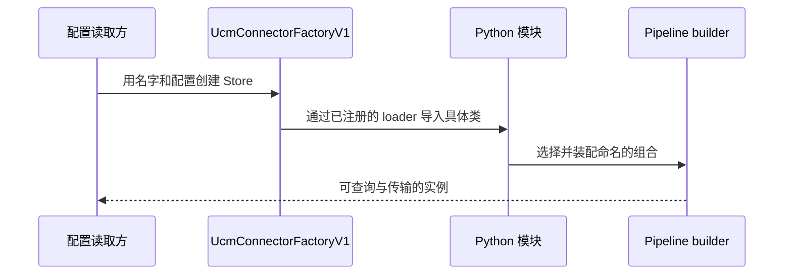

从示例配置 `ucm_connector_name: UcmPipelineStore` 开始。第一层工厂根据名字找到 Python 类，第二层 builder 再按 `store_pipeline: "Cache|Posix"` 选择具体的组合构造函数。这里的两个名字作用不同，弄错其中一个会在不同阶段报错。[V1 工厂](https://github.com/ModelEngine-Group/unified-cache-management/blob/v0.9.1/ucm/store/factory_v1.py) · [组合 builder](https://github.com/ModelEngine-Group/unified-cache-management/blob/v0.9.1/ucm/store/pipeline/connector.py)



## 为什么导入发生在创建时

`register_connector` 登记一个捕获模块路径和类名的 loader。进程只创建所选 Store 时才执行对应模块的导入，因此没有选用某个后端的进程不会仅因读取注册表而载入其原生库。相同注册名重复登记会触发错误，未登记的名字到创建时才会报不支持。

两套工厂面向不同基类。配置 `UcmPipelineStore` 调到 V1 工厂，实际注册其路径为 `ucm.store.pipeline.connector`；旧接口工厂中保留不同 Store 的注册，例如 `UcmMooncakeStore`。查看可用名称应当先从调用方选中了哪套工厂入手。[旧接口工厂](https://github.com/ModelEngine-Group/unified-cache-management/blob/v0.9.1/ucm/store/factory.py) · [V1 工厂](https://github.com/ModelEngine-Group/unified-cache-management/blob/v0.9.1/ucm/store/factory_v1.py)

## 一个拼错组合名的例子

键 `ucm_connector_name` 正确而 `store_pipeline` 填成未注册的组合时，第一步仍能导入 `UcmPipelineStore`，问题发生在 builder 查组合或加载后端库。在上游源码目录可用下面两次检索区分这些阶段。上层只需选择一种已支持的组合，文件权限、原生库和后端资源仍由实际部署提供。

```bash
rg -n 'register_connector|create_connector' ucm/store/factory_v1.py
rg -n 'UcmPipelineStoreBuilder.register' ucm/store/pipeline/connector.py
```
