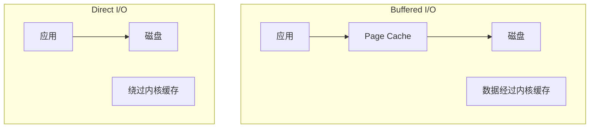

POSIX 后端把块数据存放在配置的文件系统目录。单机目录适合验证；位于共享挂载时，多个节点看到的数据范围、挂载语义和访问权限取决于该文件系统。`Cache|Posix` 还会用 Host 缓冲搬运设备数据。[部署示例](https://github.com/ModelEngine-Group/unified-cache-management/blob/v0.9.1/docs/source/user-guide/prefix-cache/pipeline_store.md)

## 从查找到加载

在 `PosixStore::Lookup` 中，后端把一批 block ID 交给 `SpaceManager` 查询并累计命中数。`LookupOnPrefix` 返回连续匹配的最后下标；统计命中块数时使用“下标加一”，返回 -1 表示起始块就未命中。即使后续位置有数据，普通连续前缀也只能从开头逐块使用。[PosixStore](https://github.com/ModelEngine-Group/unified-cache-management/blob/v0.9.1/ucm/store/posix/cc/posix_store.cc)


title: "实际示例里的两个 4 KiB 块"
rows: ["块", "文件系统", "前缀返回"]
steps:
  - title: "第一次查询"
    detail: "临时目录中还没有 A、B，最后连续命中下标为 -1。"
    cells:
      - ["A", "B"]
      - ["·", "·"]
      - ["−1", "·"]
    focus: [[2, 0]]
  - title: "写出并等待"
    detail: "两个主机缓冲写入 POSIX 后端，调用者等待 dump 完成。"
    cells:
      - ["A", "B"]
      - ["4 KiB", "4 KiB"]
      - ["·", "·"]
    focus: [[1, 0], [1, 1]]
  - title: "再次查询和读取"
    detail: "两个块均可读，最后连续命中下标为 1。独立的目的缓冲可以逐字节比对。"
    cells:
      - ["A", "B"]
      - ["可读", "可读"]
      - ["1", "·"]
    focus: [[1, 0], [1, 1], [2, 0]]


`Load`、`Dump` 将任务交给传输管理器。路径布局由 `SpaceLayout` 和实际配置决定；例如 `data_dir_shard_bytes` 控制路径分片。调试时用运行配置、后端查询结果和日志核对，客户端应通过 Store 查询对象。[文件布局](https://github.com/ModelEngine-Group/unified-cache-management/blob/v0.9.1/ucm/store/posix/cc/space_layout.cc) · [传输管理](https://github.com/ModelEngine-Group/unified-cache-management/blob/v0.9.1/ucm/store/posix/cc/trans_manager.cc)

## 一次可解释的测量

先测冷请求的保存，再测相同前缀的读取。记录 `posix_capacity_gb`、文件系统/挂载点、I/O 引擎及并发。对照 POSIX 命中与读取量，可以区分“命中 Host cache”和“访问了文件系统”；块大小、设备数和并发必须一致才能比较 TTFT。[指标定义](https://github.com/ModelEngine-Group/unified-cache-management/blob/v0.9.1/docs/source/user-guide/metrics/metrics_list.md)

## 从页缓存看一次读回



启用 direct I/O 时，地址、长度及偏移需满足所用文件系统和设备的对齐要求。诊断一次实际 I/O，应先确认配置确实生效；引擎 HBM 和 UCM Host cache 的命中都可能绕过此次文件访问。

## 无 GPU 时，验证真实 POSIX 库的读写

下面的例子使用 v0.9.1 wheel 提供的原生 `Posix` 管线。写入两个各 4 KiB 的主机缓冲区，再从同一临时目录读回。本次运行使用 `vllm/vllm-openai-cpu:v0.33.0-arm64` 镜像中的 Linux arm64、CPython 3.12.16 和 CPU PyTorch，已完成逐字节对照；这项实验只验证 POSIX 与主存，设备 H2D 和 vLLM 的前缀回填需要另外验证。

把下面的 Python 保存为当前目录的 `check_posix.py`，再在 CPU 镜像内安装固定 wheel 并运行。镜像在这里提供 Python 与 CPU PyTorch；示例不会启动其中的 vLLM 服务。

```bash
docker run --rm --platform linux/arm64 -v "$PWD/check_posix.py:/tmp/check_posix.py:ro" \
  --entrypoint bash vllm/vllm-openai-cpu:v0.33.0-arm64 -lc \
  'uv pip install --python /opt/venv/bin/python "uc-manager[cu129]==0.9.1" && /opt/venv/bin/python /tmp/check_posix.py'
```

```python
from tempfile import TemporaryDirectory

import numpy as np
from ucm.store.factory_v1 import UcmConnectorFactoryV1


def addresses(arrays):
    return [[array.ctypes.data] for array in arrays]


with TemporaryDirectory() as store_dir:
    config = {
        "store_pipeline": "Posix",
        "storage_backends": [store_dir],
        "tensor_size": 4096,
        "shard_size": 4096,
        "block_size": 4096,
        "posix_io_engine": "psync",
        "posix_data_trans_concurrency": 1,
        "posix_lookup_concurrency": 1,
        "io_direct": False,
    }

    def open_store(device_id):
        return UcmConnectorFactoryV1.create_connector(
            "UcmPipelineStore",
            {**config, "device_id": device_id},
            "ucm.store.pipeline.connector",
        )

    worker, lookup = open_store(0), open_store(-1)
    keys = [b"cookbook-block-a", b"cookbook-block-b"]
    source = [np.arange(4096, dtype=np.uint8), np.full(4096, 37, dtype=np.uint8)]
    target = [np.zeros_like(array) for array in source]
    shards = [0, 0]

    assert lookup.lookup_on_prefix(keys) == -1
    worker.wait(worker.dump_data(keys, shards, addresses(source)))
    assert lookup.lookup_on_prefix(keys) == 1
    worker.wait(worker.load_data(keys, shards, addresses(target)))
    assert all(np.array_equal(before, after) for before, after in zip(source, target))
    print("Two 4096-byte blocks matched")
```

`-1` 表示起始块也未命中，`1` 表示下标 0 和 1 两块都属于连续命中前缀。这里使用独立的目标数组，并让源/目标内存一直存活到异步任务的 `wait` 返回。用这个例子先确认后端返回的字节正确，再接上 [vLLM 外部读取](../01-overview/03-quick-start.md)，更容易判断问题在存储还是引擎侧。
