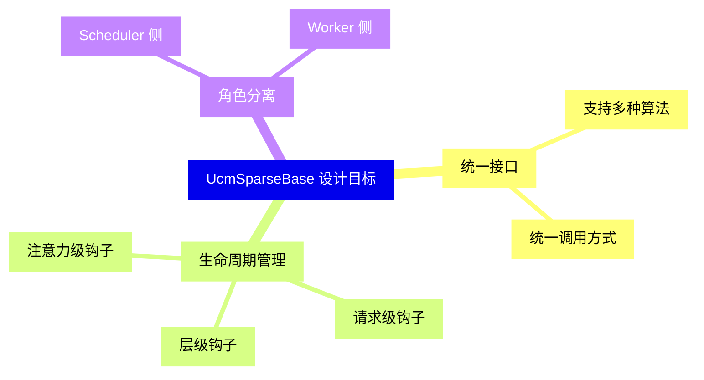
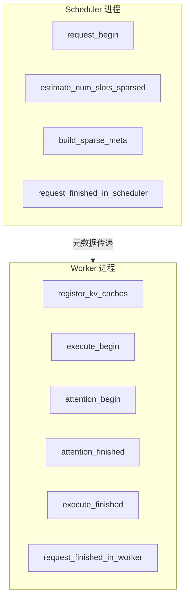

> **前置要求**: [稀疏注意力理论](./01-sparse-fundamentals.md)

---

## 概述

同一条稀疏请求在调度进程和 worker 里持有不同状态。`UcmSparseBase` 把每步的选择计划与每层实际执行的钩子分开。

---

## 1. 设计理念

### 1.1 核心设计目标


### 1.2 角色分离


---

## 2. 调度侧与执行侧的接口

`UcmSparseBase` 的构造参数为 `vllm_config` 和 `UcmSparseRole`。配置对象由实际引擎构造，role 决定当前进程是调度侧还是执行侧。两端使用的 `UcmSparseMetadata` 表达一批请求需要的计算信息。[基类与参数](https://github.com/ModelEngine-Group/unified-cache-management/blob/v0.9.1/ucm/sparse/base.py)

|问题|实际钩子|
|---|---|
|请求何时建立、按什么 token 建立|`request_begin(request_id, prompt_token_ids)`|
|调度器估计占用并分配块之后怎样更新|`estimate_num_slots_sparsed(request)`、`update_state_after_alloc(request, num_blocks)`|
|如何把本步请求与注意力元数据放在一起|`build_sparse_meta` 接收 scheduler output、requests、input batch 和 attention metadata|
|每层在哪个时刻能准备与释放操作|`attention_begin` 和 `attention_finished` 以层名、forward context 和张量为界|
|如何清理 worker 中的请求状态|`request_finished_in_worker(request_id)`|

追踪同一请求时，把请求 ID、调度步和层号记录在一起。不同请求可能恰好有相同的 token 数。

## 3. 生命周期钩子

### 3.1 完整生命周期


title: "一次稀疏请求怎样跨越两类进程"
actors: ["调度侧实例", "本步元数据", "worker", "模型层"]
steps:
  - from: 0
    to: 0
    label: "请求开始"
    detail: "调度侧记录请求 ID 和输入 token，并参与块需求估计。"
  - from: 0
    to: 1
    label: "组装批次"
    detail: "本次调度的信息与请求状态共同描述待执行的工作。"
  - from: 1
    to: 2
    label: "到达 worker"
    detail: "执行侧利用本批元数据准备相关缓冲与索引。"
  - from: 2
    to: 3
    label: "进入注意力"
    detail: "每层的 attention_begin 按当前层、请求和张量执行准备。"
  - from: 3
    to: 2
    label: "完成本层"
    detail: "attention_finished 跟进本层结果，请求结束后释放各自的状态。"

### 3.2 钩子用途
| 钩子 | 位置 | 典型用途 |
|------|------|----------|
| `request_begin` | Scheduler | 初始化请求状态、计算 Block Hash |
| `estimate_num_slots_sparsed` | Scheduler | 预估稀疏后的资源需求 |
| `build_sparse_meta` | Scheduler | 构建稀疏选择信息 |
| `register_kv_caches` | Worker | 获取 KV Cache 引用 |
| `execute_begin` | Worker | 预处理、预取 |
| `attention_begin` | Worker | 选择稀疏 KV、修改输入 |
| `attention_finished` | Worker | 后处理、结果校正 |
| `execute_finished` | Worker | 清理临时状态 |
| `request_finished_*` | 两侧 | 清理请求相关资源 |
---
## 4. 工厂与扩展路径

`create_sparse_method(config, role)` 从 `config.kv_transfer_config` 找到 `ucm_sparse_config`，以配置映射的第一个方法名查注册表。注册时保存延迟导入的 loader，成功创建后把真实 vLLM 配置和 role 交给算法构造函数。下面是 ESA 官方示例中配置的缩写；应只选择该次实验要运行的方法。

```yaml
ucm_sparse_config:
  ESA:
    sparse_ratio: 0.3
    min_blocks: 4
    init_window_sz: 1
    local_window_sz: 2
    retrieval_stride: 5
```

在这个 tag，`ESA`、`GSAOnDevice`、`KVStarMultiStep`、`Blend` 有实际注册。若要增加自己的实现，需要满足基类的调度侧和 worker 侧契约，在工厂注册真实模块，并与引擎已安装的 hook、设备 kernel 和支持的模型配对。能导入一个类只验证加载；仍应对同一输入检查选择的块和输出质量。[工厂](https://github.com/ModelEngine-Group/unified-cache-management/blob/v0.9.1/ucm/sparse/factory.py) · [ESA 完整运行示例](https://github.com/ModelEngine-Group/unified-cache-management/blob/v0.9.1/examples/offline_inference_esa.py)
