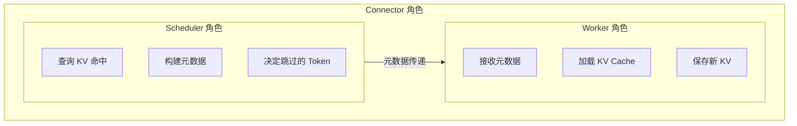

假设引擎已经在 HBM 找到 128 个前缀 token，外部还保存着连续的后两个块。connector 查询的是本地命中之后新增的可复用部分。如果本步的块长为 128，每个额外完整块对应 128 个 token。该请求新增外部命中 256 个，连同本地一共覆盖 384 个。

|阶段|接口|此时可知道什么|
|---|---|---|
|本地命中后|`get_num_new_matched_tokens`|请求在本地已算过的长度，以及外部可补的长度与加载安排|
|引擎分配目标块后|`update_state_after_alloc`|本步分给该请求的块和要读取的数据范围|
|组装执行批次|`build_connector_meta`|scheduler 交给 worker 的 load / dump 信息|
|worker 执行|`start_load_kv`、`wait_for_layer_load`|本步加载任务何时开始，使用某层前必须等待什么|
|保存与结束|`save_kv_layer`、`wait_for_save`、`get_finished`|数据何时写出、哪些异步任务可以释放关联资源|

同名回调在 Direct、LayerWise、混合布局路径上承担的实际工作不同。有的路径在一处组织整段加载，有的把等待分摊到各层。跟踪日志时先确认创建的 connector 类型，再查看实现。[外层分派和具体实现](https://github.com/ModelEngine-Group/unified-cache-management/blob/v0.9.1/ucm/integration/vllm/ucm_connector.py)

用一次冷请求和一次外部命中请求做调试。若查询给出新增 token、却没有实际 load，继续检查调度后的目标块、worker 收到的元数据和模型前向的启动顺序。[混合布局加载问题修复](https://github.com/ModelEngine-Group/unified-cache-management/releases/tag/v0.9.1)
