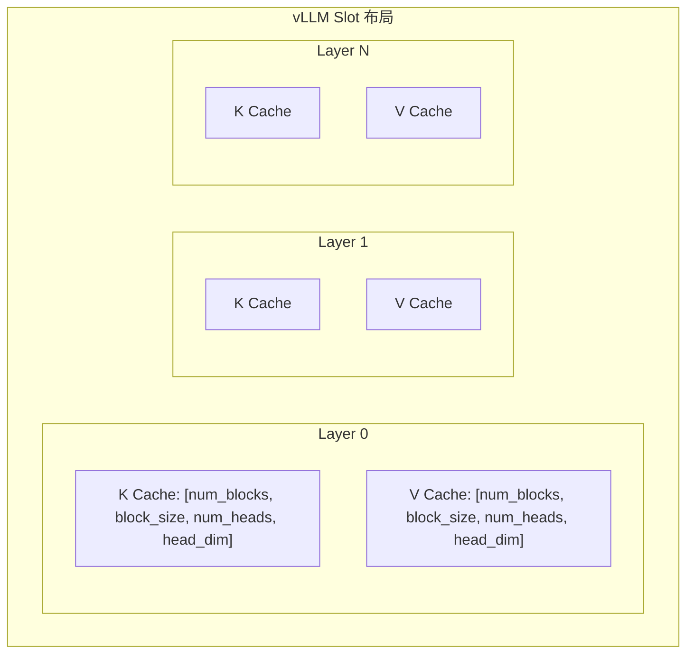

vLLM 配置使用统一的 `UCMConnector`。进入构造函数后，代码根据引擎角色、模型或缓存组布局、配置的加载方式等，选择内部实现，后续回调再委派给它。想找一次外部命中为什么没有转换成实际传输，先从这层分派查起。[固定版本源码](https://github.com/ModelEngine-Group/unified-cache-management/blob/v0.9.1/ucm/integration/vllm/ucm_connector.py)

## 跟踪一个请求

1. 从 `UCMConnector.get_num_new_matched_tokens` 进入实际 connector，记下传入的 `num_computed_tokens`、请求的 block hashes 和返回的外部可用前缀。
2. 在 `update_state_after_alloc` 对照逻辑块与引擎分配的目标块，从 `build_connector_meta` 查看哪些 load / dump 被放进本次调度。
3. 查看 worker 一侧的 `start_load_kv`。使用 LayerWise 时继续跟 `wait_for_layer_load`、`save_kv_layer` 和 `wait_for_save`，区分已提交任务和可消费的数据。
4. 若是混合模型，按实际 KV group 检查层布局和 rank 归属。v0.9.1 曾修正共享 MLA KV 和 rank 私有 Mamba/KDA 状态使用不同加载分发策略的问题。[发布说明](https://github.com/ModelEngine-Group/unified-cache-management/releases/tag/v0.9.1)

```bash
git clone --depth 1 --branch v0.9.1 https://github.com/ModelEngine-Group/unified-cache-management.git
cd unified-cache-management
rg -n 'class (UCMConnector|UCMDirectConnector|UCMLayerWiseConnector)|def (get_num_new_matched_tokens|build_connector_meta|start_load_kv)' \
  ucm/integration/vllm/ucm_connector.py
```

存储卸载与完整 P/D 服务的路由、传输和生命周期还要分别确认。这个 tag 中名为 `UCMPDConnector` 的类在两个关键回调中抛出 `NotImplementedError`；实际 P/D 部署应从已文档化的方案和对应组件进入。[分离部署指南](https://github.com/ModelEngine-Group/unified-cache-management/blob/v0.9.1/docs/source/user-guide/pd-disaggregation/index.md)

## 为什么分配块之后才知道写到哪

设每个设备块能装 128 个 token，调度器把逻辑块 1 分配到物理块 19。逻辑序号 150 的 token 在该逻辑块中的偏移是 22；普通等长块布局的 slot 索引为 `19 × 128 + 22`。业务前缀、Store 的 block ID、设备物理块号分别回答“复用什么”“去哪查”“写到哪”。

下面画的是一个常规按层分开的 K/V 布局。采用 MLA、混合注意力或其他布局时，需要读当前模型的实际张量描述。



## 当前模型走 Direct、LayerWise，还是混合布局

`UCMConnector.__init__` 先处理轻量模式和部分专门用途的实现，然后结合 `kv_cache_config`、并行配置和 `use_layerwise` 分派。Full Attention 与窗口注意力组成的布局可进入 FAWA 实现，带线性注意力状态的模型可进入 HLA 或其逐层变体；常规路径才在 LayerWise 和 Direct 之间选择。排查某个模型时，先读取实际命中的分支，并用本次缓存组的张量形状跟踪加载。[布局分派源码](https://github.com/ModelEngine-Group/unified-cache-management/blob/v0.9.1/ucm/integration/vllm/ucm_connector.py)

表面相同的逻辑块也可包含不同归属的数据。一个 rank 能代其他 rank 加载共享张量时，私有状态仍要加载到各自 rank。`test_load_task_options.py` 检查针对任务传入的分发选项和不带新参数的原后端签名；调用方可以为同一引擎的两次 load 指定不同的分发方式。[任务选项测试](https://github.com/ModelEngine-Group/unified-cache-management/blob/v0.9.1/test/test_load_task_options.py)

## 哈希与缓存隔离

Prefix hash 解决“相同 token 前缀可以找到相同缓存”的问题，布局与并行信息则用来隔离不可互用的缓存。举例来说，两次请求都使用同一份文档，但分配给 rank 的状态或 DCP 配置不同，指向同一可读文件仍不保证读出的字节可装进本模型。`build_kv_hash_meta` 及请求哈希测试覆盖这些区分。[哈希测试](https://github.com/ModelEngine-Group/unified-cache-management/blob/v0.9.1/test/test_ucm_request_hasher.py)
