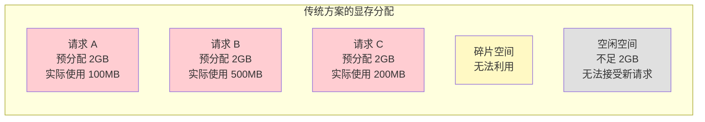
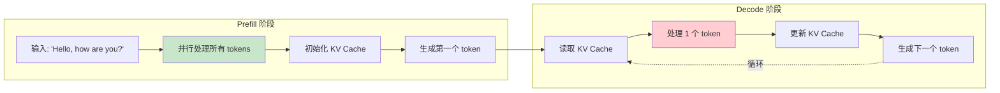
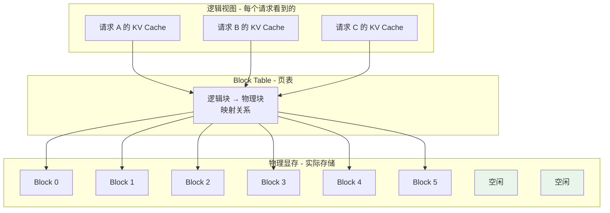

同一块 GPU 上有三条请求，一条只需再生成 1 个 token，另一条还要生成 100 个。等整批结束才接新请求，短请求腾出的计算位置就会空着。vLLM 每轮重新安排请求，并把每条请求的 KV 缓存按块分配。

## 1. 传统方案面临的三大困境

### 1.1 困境一：显存被严重浪费

以 LLaMA-2-7B 为例，每层有 32 个 KV 头，每头 128 维，模型共 32 层。FP16 下，一个 token 在所有层的 K 和 V 占 `2 × 32 × 32 × 128 × 2 = 524,288` 字节，即 512 KiB。长度达到 4,096 时，单条请求需要 2 GiB 的 KV。

如果在请求刚到达时就分配全部 4,096 个位置，一条最后只用 100 个位置的请求也会占住整段空间。下图画的是按请求预分配连续空间的情况。

**问题的本质**：
1. **内部碎片**：预分配的空间大部分没有被使用
2. **外部碎片**：剩余的小块空间无法满足新请求的预分配需求
空闲的空间能否给另一条请求，取决于分配单位和分配器对连续空间的要求。

### 1.2 困境二：静态批处理效率低下

把三个位置固定到整批结束。A、B、C 分别生成 10、50、100 个 token，每轮每个活跃请求生成一个。


title: 静态批处理里的 140 个空位
unit: 轮次
ticks: [0, 10, 50, 100]
tracks:
  - name: 位置 1
    bars: [[0, 10, "A"]]
  - name: 位置 2
    bars: [[0, 50, "B"]]
  - name: 位置 3
    bars: [[0, 100, "C"]]
steps:
  - at: 0
    title: A、B、C 入批
    detail: 三个位置都分给了请求。
  - at: 10
    title: A 结束
    detail: 接下来的 90 轮，第一个位置空着。
  - at: 50
    title: 只剩 C
    detail: 第二个位置也空出来，最后 50 轮每轮只生成一个 token。
  - at: 100
    title: 这一批结束
    detail: 三个位置合计可用 300 次，实际使用 10 + 50 + 100 = 160 次。


若三条请求都生成到各自的停止条件，总共需要 160 个有效 token；固定的三个位置在 100 轮内有 300 个可用位置。空出的 140 个位置可以解释同一批为什么会越跑越小。流式服务可以先返回已经生成的内容，新请求能否补入才决定了这些位置能否再利用。

### 1.3 困境三：GPU 利用率低

LLM 推理分为两个阶段：**Prefill（预填充）** 和 **Decode（解码）**。这两个阶段有着截然不同的计算特性：

| 特性 | Prefill 阶段 | Decode 阶段 |
|------|-------------|-------------|
| 处理内容 | 处理整个输入提示 | 逐个生成新 token |
| 计算密度 | 高（计算密集型） | 低（内存密集型） |
| GPU 利用率 | 高 | 低 |
| 瓶颈 | 计算能力 | 内存带宽 |

**Decode 阶段 GPU 利用率低的原因**：

1. **计算量小**：每次只处理 1 个新 token，计算量很小
2. **内存访问多**：需要读取整个 KV Cache，内存访问量大
3. **计算/访存比低**：GPU 大部分时间在等待数据从显存传输到计算单元

低并发解码每步处理的 token 少，读取模型权重和 KV 的时间可能主导这一轮；利用率取决于批大小、模型与设备，需要实测。

---

## 2. vLLM 的解决方案

面对上述三大困境，vLLM 提出了两项核心创新：**PagedAttention** 和 **Continuous Batching**。

### 2.1 PagedAttention：像操作系统一样管理显存

vLLM 的通过 **PagedAttention** 管理 KV（分页注意力），其灵感来自操作系统的虚拟内存管理。

**操作系统的虚拟内存是如何工作的？**

在操作系统中，物理内存被划分为固定大小的"页"（Page），程序使用的是"虚拟地址"，通过"页表"映射到物理内存。这样做的好处是：
- 程序不需要连续的物理内存
- 内存可以按需分配，不用一次性预留
- 多个程序可以共享相同的物理页

**vLLM 将这个思想应用到 KV Cache 管理**：

每轮调度时，引擎先查请求已经持有哪些块，再为将要计算的 token 补齐缺口。块表记下逻辑块和物理块的对应关系，所以相邻的 token 可以放在两块不相邻的显存里。


title: 块长为 16 时，最后一块空多少格
rows: ["按上限预留", "按块给空间"]
steps:
  - title: 已写 16 个 token
    detail: 假定请求上限为 4096。第一列是有效位置，第二列是分配容量，第三列是尚未使用的位置数。
    cells: [["用 16", "共 4096", "空 4080"], ["用 16", "共 16", "空 0"]]
    focus: [[1, 1], [1, 2]]
  - title: 写入第 17 个
    detail: 按块分配要再领一整块。第一个新位置写完后，块尾还空着 15 格。
    cells: [["用 17", "共 4096", "空 4079"], ["用 17", "共 32", "空 15"]]
    focus: [[1, 1], [1, 2]]
  - title: 写到第 100 个
    detail: 七块共有 112 个位置，尾块还空 12 格。继续生成时可以从这 12 格往后写。
    cells: [["用 100", "共 4096", "空 3996"], ["用 100", "共 112", "空 12"]]
    focus: [[0, 2], [1, 2]]


### 2.2 Continuous Batching：连续批处理

vLLM 可以在两轮解码之间调整批次。把已经就绪的 D 和 E 放在队列里，再沿用 A、B、C 的输出长度。


title: 连续批处理让 D、E 补入空位
unit: 轮次
ticks: [0, 10, 50, 80, 100]
tracks:
  - name: 位置 1
    bars: [[0, 10, "A"], [10, 50, "D"], [50, 80, "E"]]
  - name: 位置 2
    bars: [[0, 50, "B"]]
  - name: 位置 3
    bars: [[0, 100, "C"]]
steps:
  - at: 0
    title: 仍从 A、B、C 开始
    detail: 沿用上一张图的三个请求，加上已就绪的 D 和 E。
  - at: 10
    title: D 接替 A
    detail: D 还要生成 40 个 token。它从下一轮起和 B、C 一起执行。
  - at: 50
    title: E 加入
    detail: B 和 D 都已完成。这里把 E 放进位置 1，它还需 30 轮。
  - at: 80
    title: E 结束
    detail: C 继续运行到第 100 轮。同样 100 轮，这个例子多完成了 D 和 E 两条请求。


这次 100 轮共完成 230 个输出 token。新增的 70 个来自 D 和 E，使用的是原本空着的槽位。每轮耗时会随批量变化，若要得到每秒吞吐量，还要计时。

## 3. 怎样读吞吐量数据

2023 年的 vLLM 发布实验从 ShareGPT 抽取输入和输出长度，在一张 A10G 上运行 LLaMA-7B，在一张 40 GB A100 上运行 LLaMA-13B。每个请求生成一个候选时，作者在这两组配置上测得的吞吐量为当时 Hugging Face Transformers 基线的 14–24 倍。[原始测试与图表](https://vllm.ai/blog/2023-06-20-vllm)

评估今天的服务，可以固定模型、权重精度、输入和输出长度分布，再逐步增加到达率。把每秒完成的请求数与首 token 延迟一起记录：如果吞吐量增加而请求开始长时间排队，用户看到的响应会变慢。换模型或显卡后需要重新测量。

## 4. 服务入口

在线模式由服务进程为多名客户端调度。离线模式把一组提示词交给 Python 的 `LLM.generate`，调用方读取批量结果。[用同一个模型运行两种入口](../04-code-walkthrough/01-entry-points.md)

## 思考题

1. 为什么 PagedAttention 选择固定大小的块，而不是可变大小？
2. 连续批处理相比静态批处理，有什么潜在的缺点？
3. 如果你有一个 24GB 显存的 GPU，想要部署一个 7B 参数的模型服务 100 个并发用户，你会怎么做？

---

[一次长请求需要多少 KV 空间？](02-llm-inference-challenges.md)
