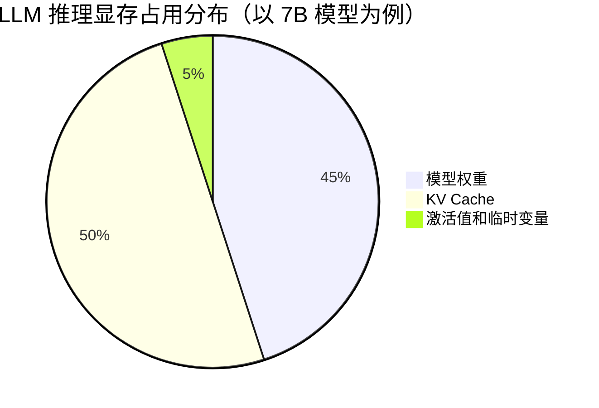
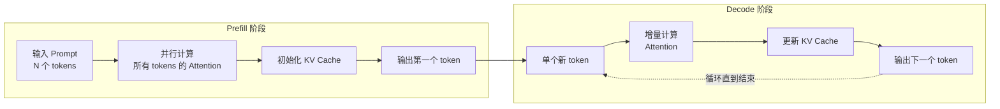
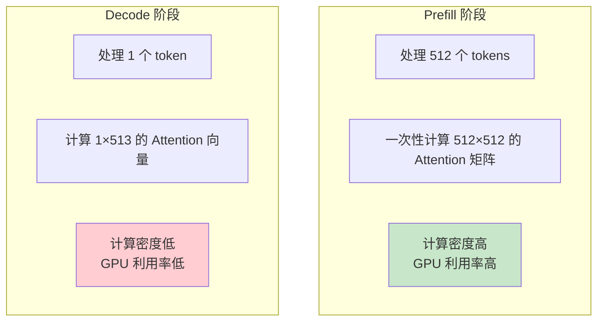
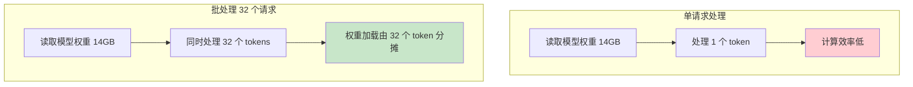
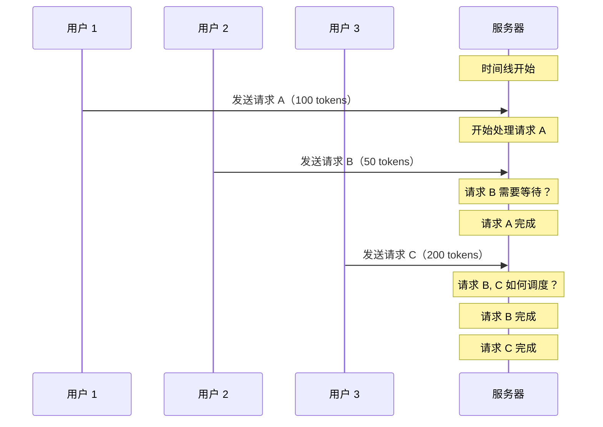
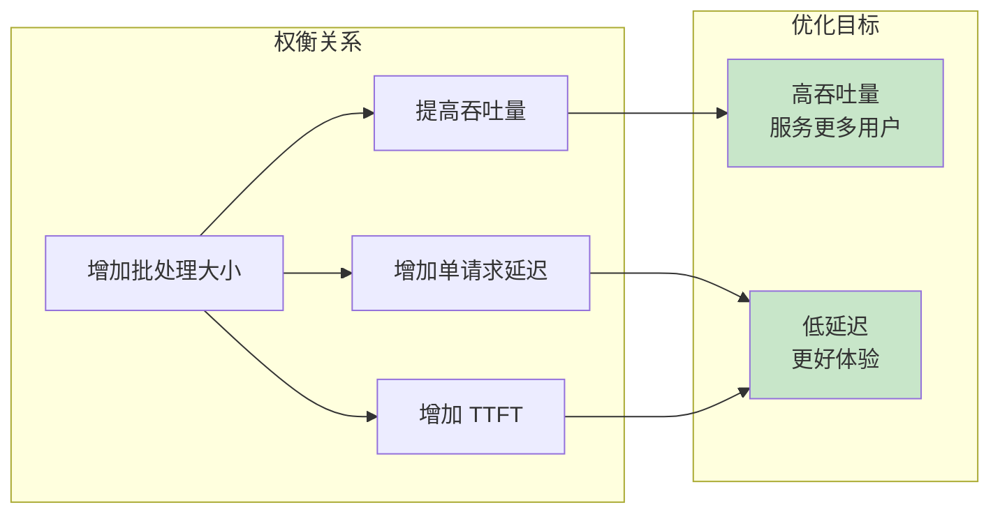
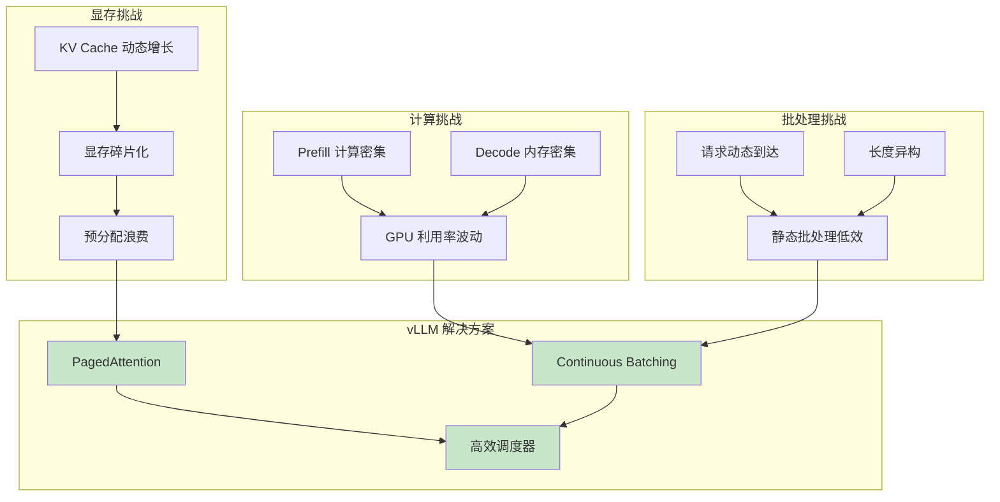

权重加载完以后，剩下多少显存能放 KV？先算每个活跃 token 的字节数，再用缓存池容量去除，就能估出同时容纳的 token 数。

## 1. 显存挑战：一道简单的数学题

### 1.1 显存占用的组成

LLM 推理时的显存占用主要由三部分组成：



| 组成部分 | 说明 | 占比 |
|---------|------|------|
| 模型权重 | 神经网络的参数 | 约 45% |
| KV Cache | 注意力机制的缓存 | 约 50%（动态增长） |
| 激活值和临时变量 | 计算过程中的中间结果 | 约 5% |

可以看到，**KV Cache 是显存占用的主要部分**，而且它还会随着生成长度动态增长！

### 1.2 模型权重的显存占用

模型权重的显存占用计算相对简单：

```
模型权重显存 = 参数量 × 每个参数的字节数
```

不同精度下的字节数：

| 精度 | 每个参数字节数 | 说明 |
|------|---------------|------|
| FP32 | 4 字节 | 全精度浮点 |
| FP16/BF16 | 2 字节 | 半精度浮点（推理常用） |
| INT8 | 1 字节 | 8 位整数量化 |
| INT4 | 0.5 字节 | 4 位整数量化 |

**示例计算**：LLaMA-2-7B 模型

| 精度 | 计算 | 显存占用 |
|------|------|---------|
| FP32 | 7B × 4 = 28GB | 28 GB |
| FP16 | 7B × 2 = 14GB | 14 GB |
| INT8 | 7B × 1 = 7GB | 7 GB |
| INT4 | 7B × 0.5 = 3.5GB | 3.5 GB |

### 1.3 KV Cache 的显存占用

KV Cache 是 LLM 推理中的关键数据结构，用于存储注意力计算的中间结果。它的显存占用计算公式：

```
KV Cache 显存 = 2 × num_layers × num_kv_heads × head_dim × seq_len × batch_size × bytes_per_element
```

在普通多头注意力中，KV 头数等于查询头数，可简化为：

```
KV Cache 显存 = 2 × num_layers × hidden_dim × seq_len × batch_size × bytes_per_element
```

其中：
- `2` 表示 Key 和 Value 两部分
- `num_layers` 是 Transformer 层数
- `hidden_dim` 是隐藏维度（= num_heads × head_dim）
- `seq_len` 是序列长度（**会动态增长**）
- `batch_size` 是批次大小（并发请求数）
- `bytes_per_element` 是每个元素的字节数（FP16 = 2）

**示例计算**：LLaMA-2-7B 模型

| 参数 | 值 |
|------|-----|
| num_layers | 32 |
| hidden_dim | 4096 |
| FP16 bytes | 2 |

单个请求，不同序列长度的 KV Cache 大小：

| 序列长度 | 计算 | KV Cache 大小 |
|---------|------|---------------|
| 512 | 2 × 32 × 4096 × 512 × 2 | 256 MiB |
| 1024 | 2 × 32 × 4096 × 1024 × 2 | 512 MiB |
| 2048 | 2 × 32 × 4096 × 2048 × 2 | 1 GiB |
| 4096 | 2 × 32 × 4096 × 4096 × 2 | 2 GiB |

**关键观察**：KV Cache 与序列长度**线性增长**！

### 1.4 KV Cache 的动态增长问题

一次普通解码前向会把刚送入模型的 token 写入 KV。刚采样出的下一个 token 要到下一轮前向时才占用相应的缓存位置。


title: 采样结果在下一轮写入缓存
rows: ["模型输入", "已写 KV", "刚采样"]
steps:
  - title: "完成预填充"
    detail: "输入 a、b、c 的 K/V 已写入，最后一个输入位置产生下一 token 的分布。"
    cells: [["a", "b", "c", "·"], ["a", "b", "c", "·"], ["·", "·", "·", "x"]]
    focus: [[1, 2], [2, 3]]
  - title: "执行第一轮解码"
    detail: "把刚采样的 x 送回模型，x 此时才拥有 KV 位置。"
    cells: [["·", "·", "·", "x"], ["a", "b", "c", "x"], ["·", "·", "·", "·"]]
    focus: [[0, 3], [1, 3]]
  - title: "得到下一个 token"
    detail: "在含 x 的上下文上采样出 y，下一轮前向才写入 y 的 KV。"
    cells: [["·", "·", "·", "x"], ["a", "b", "c", "x"], ["·", "·", "·", "y"]]
    focus: [[2, 3]]


请求开始时，调度器只知道输出上限。

传统方案的处理方式：
- **预分配最大长度**：浪费大量显存
- **动态扩展**：可能导致显存不足或碎片化

### 1.5 显存碎片化详解

假设我们有 10GB 可用显存，最大序列长度 2048 tokens（每个请求预分配 1GB）。

**场景演示**：

```
初始状态：
+--------------------------------------------------+
|                    空闲 (10GB)                    |
+--------------------------------------------------+

接受请求 A（预分配 1GB）：
+----------+---------------------------------------+
| 请求 A   |              空闲 (9GB)               |
+----------+---------------------------------------+

接受请求 B（预分配 1GB）：
+----------+----------+----------------------------+
| 请求 A   | 请求 B   |       空闲 (8GB)           |
+----------+----------+----------------------------+

接受更多请求 C, D, E, F, G, H, I, J：
+----+----+----+----+----+----+----+----+----+----+
| A  | B  | C  | D  | E  | F  | G  | H  | I  | J  |
+----+----+----+----+----+----+----+----+----+----+

请求 A, C, E, G, I 完成并释放：
+----+----+----+----+----+----+----+----+----+----+
|空闲| B  |空闲| D  |空闲| F  |空闲| H  |空闲| J  |
+----+----+----+----+----+----+----+----+----+----+
     ↑         ↑         ↑         ↑         ↑
    1GB       1GB       1GB       1GB       1GB

问题：虽然有 5GB 空闲，但都是分散的 1GB 块！
无法接受需要 2GB 连续空间的请求！
```

**碎片化的两种类型**：

1. **内部碎片（Internal Fragmentation）**：
   - 预分配 1GB，实际只用 100MB
   - 浪费了 900MB

2. **外部碎片（External Fragmentation）**：
   - 总空闲 5GB，但最大连续块只有 1GB
   - 无法满足大于 1GB 的请求

### 1.6 从缓存池容量估算请求数

沿用上面的 FP16 模型，假设权重和运行时已经分配完，设备上给 KV 留出了 **64 GiB**。扣除块对齐等开销前，池中最多能放 `64 GiB / 512 KiB = 131,072` 个 token。每个请求都达到 4,096 个 token 时是 32 条；每条只用 300 个 token、块长为 16 时，要按 304 个位置分配，池子可以放下 431 条。这里假设每条请求拥有单独的完整注意力缓存。

容量给出的是空间上限。吞吐和延迟还取决于调度预算、上下文长度与实际处理速度。

## 2. 计算挑战：Prefill vs Decode

### 2.1 两阶段的计算特性

LLM 推理分为两个截然不同的阶段：



**详细对比**：

| 特性 | Prefill 阶段 | Decode 阶段 |
|------|-------------|-------------|
| **处理 tokens 数** | N（整个输入） | 1（单个新 token） |
| **计算量** | O(N²) 或 O(N) | O(1) 或 O(N) |
| **内存访问** | 读取模型权重 + 写入 KV Cache | 读取模型权重 + 读写 KV Cache |
| **计算密度** | 高 | 低 |
| **瓶颈** | 计算能力 | 内存带宽 |
| **影响执行效率的因素** | 本轮处理的提示词长度、分块大小 | 有效批量、上下文长度与内存带宽 |
| **持续时间** | 短（一次性） | 长（循环多次） |

### 2.2 计算密度分析

**计算密度（Arithmetic Intensity）** 是衡量一个操作是计算密集型还是内存密集型的关键指标：

```
计算密度 = 浮点运算次数 / 内存访问字节数
```

对于 GPU 来说：
- **计算密度高**：GPU 计算单元充分利用，性能好
- **计算密度低**：GPU 等待数据传输，计算单元空闲



**Prefill 阶段**（以 512 token 输入为例）：
```
计算量：512 × 512 × hidden_dim × num_layers = 很大
内存访问：读取模型权重 + 写入 KV Cache
计算密度：高
→ 计算密集型，GPU 利用率高
```

**Decode 阶段**：
```
计算量：1 × seq_len × hidden_dim × num_layers = 较小
内存访问：读取模型权重 + 读取整个 KV Cache + 写入新 KV
计算密度：低
→ 内存密集型，GPU 利用率低
```

### 2.3 Decode 阶段的瓶颈分析

对于一个约 70 亿参数的 FP16 稠密模型，如果一步解码需要从显存读取约 14 GB 权重，而这一轮只处理一个新 token，权重读取很难摊薄。假设有效带宽为 2 TB/s，仅这项数据量除以带宽就是 7 ms。这个除法给出指定假设下的估算；KV 读取、内核执行和多卡通信还会占用时间。

### 2.4 批处理如何提高效率

批处理可以提高 Decode 阶段的效率，原理是**分摊模型权重的读取开销**：



如果一个权重矩阵为批中的 32 个 token 共同使用，每个输出 token 分摊的权重字节数会下降。KV 工作量仍会随各自的上下文长度增长。评估这个变化可以固定输入长度，分别记录批量为 1、8、32 时的一步耗时和每秒输出 token 数。

## 3. 批处理挑战：动态与异构

### 3.1 请求的动态特性

LLM 服务面临的请求具有高度动态性：



**动态性表现在**：

1. **到达时间不确定**：用户随机发送请求
2. **输入长度不确定**：每个请求的 prompt 长度不同
3. **输出长度不确定**：生成长度取决于模型和停止条件
4. **请求优先级不同**：可能有 VIP 用户或紧急请求

### 3.2 异构性带来的挑战

即使在同一批次中，不同请求的特性也大不相同：

```
批次中的请求分布示例：
┌─────────┬──────────┬──────────┬─────────────┐
│ 请求 ID │ 输入长度 │ 当前输出 │ 状态        │
├─────────┼──────────┼──────────┼─────────────┤
│ A       │ 10       │ 95       │ Decode 中   │
│ B       │ 500      │ 0        │ Prefill 中  │
│ C       │ 50       │ 200      │ 即将完成    │
│ D       │ 100      │ 30       │ Decode 中   │
│ E       │ 1000     │ 0        │ 等待 Prefill│
└─────────┴──────────┴──────────┴─────────────┘
```

**异构性带来的问题**：

1. **序列长度不一致**：
   - 不同请求的 KV Cache 大小不同
   - Attention 计算的工作量不同

2. **状态不一致**：
   - 有的在 Prefill，有的在 Decode
   - 计算密度差异巨大

3. **完成时间不一致**：
   - 有的即将完成，有的刚开始
   - 资源释放时机不确定

### 3.3 新请求要等多久


title: B 占满 200 轮时，C 在哪里等待
unit: 轮次
ticks: [0, 100, 200, 240]
tracks:
  - name: 位置 1
    bars: [[0, 100, "A"], [200, 240, "C"]]
  - name: 位置 2
    bars: [[0, 200, "B"]]
steps:
  - at: 0
    title: A 和 B 开始
    detail: 位置 1 给 A，位置 2 给 B。已经就绪的 C 等下一批。
  - at: 100
    title: A 的位置空出
    detail: B 还要执行 100 轮，固定批次里的空位暂时闲置。
  - at: 200
    title: C 终于入批
    detail: B 完成后，C 才开始自己的 40 轮。排队时间已经跨过一整批。


短请求可以先向客户端返回结果。影响排队时间的是调度器在哪一轮允许下一个请求补进来。

## 4. 关键性能指标详解

同一批请求有三种时间可以量：进入队列到首个 token、相邻两个输出 token 之间，以及整个批次从开始到结束。

### 4.1 吞吐量（Throughput）

**定义**：单位时间内处理的 token 数或请求数

```
Token 吞吐量 = 总生成 tokens / 总时间 (tokens/second)
请求吞吐量 = 总完成请求 / 总时间 (requests/second)
```

**影响因素**：
- GPU 计算能力
- 内存带宽
- 批处理大小
- 显存效率

### 4.2 延迟（Latency）

延迟有多个维度：


title: 首个 token 花了多久
actors: ["客户端", "调度器", "模型"]
steps:
  - from: 0
    to: 1
    label: "0 ms · 提交"
    detail: "计时从客户端发出请求开始。"
  - from: 1
    to: 2
    label: "30 ms · 开始执行"
    detail: "请求先等了 30 ms，随后进入预填充。"
  - from: 2
    to: 0
    label: "110 ms · 首 token"
    detail: "客户端在 110 ms 收到第一个输出，TTFT 为 110 ms。"
  - from: 2
    to: 0
    label: "130 ms · 第二个"
    detail: "相邻输出间隔 20 ms；排队和预填充已经结束。"
  - from: 2
    to: 0
    label: "155 ms · 第三个"
    detail: "第三个与第二个相隔 25 ms，两个间隔平均为 22.5 ms。"


**关键延迟指标**：

| 指标 | 英文 | 说明 | 用户感知 |
|------|------|------|---------|
| TTFT | Time To First Token | 首个 token 生成时间 | 响应速度感 |
| TPOT | Time Per Output Token | 每个输出 token 的时间 | 流畅度感 |
| 总延迟 | End-to-End Latency | 完整响应时间 | 等待时间 |

### 4.3 TPS（Tokens Per Second）

**定义**：每秒生成的 token 数

有两种计算方式：
1. **单请求 TPS**：单个请求的生成速度
2. **系统 TPS**：整个系统的总吞吐量

```
单请求 TPS = 输出 tokens / Decode 时间
系统 TPS = 所有请求的输出 tokens / 总时间
```

### 4.4 指标之间的权衡

这些指标之间存在权衡关系：



**权衡策略**：

| 场景 | 优先指标 | 策略 |
|------|---------|------|
| 实时对话 | 低 TTFT，低 TPOT | 小批次，快速响应 |
| 批量处理 | 高吞吐量 | 大批次，最大化效率 |
| 混合场景 | 平衡 | 动态调整批次大小 |

---

## 5. 挑战总结




---

## 思考题

1. 对于一个 70B 参数的模型，在 A100 80GB GPU 上最多能支持多长的序列？
2. 为什么 Decode 阶段不能简单地通过增加 GPU 计算核心来加速？
3. 如果用户主要发送很短的请求（< 50 tokens），显存碎片化问题会更严重还是更轻？

---

[查看 vLLM V1 中请求经过的进程](03-vllm-overview.md)
