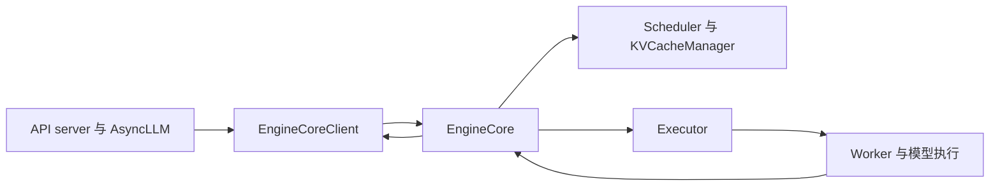
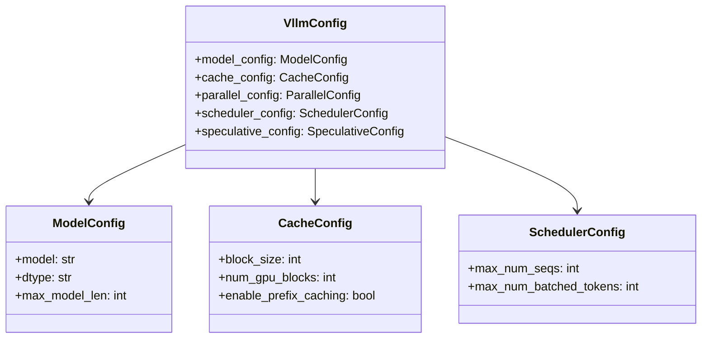

以单机在线文本生成服务为例，API server 处理 HTTP 和输入输出，EngineCore 持有调度状态，executor 负责组织 worker 执行。部署中的 GPU 数、并行策略和 API server 数量会改变进程数量。

例如两名用户同时发送同一份长文档和不同的问题。API server 分别构造请求，scheduler 每轮给它们分配 token 预算，KV 管理器查询当前实例上可复用的前缀，worker 按该轮元数据执行模型。请求结束时 engine 释放其块引用，其他请求仍可继续使用共享块。

判断一个问题应从哪层查，可以看症状。消息模板不匹配时先查输入；排队时间增长时查 token 预算和可用块；设备执行变慢时查模型、并行策略和 attention backend。[完整请求链路](/vllm/04-code-walkthrough/06-request-lifecycle/)列出各交接点。

## 配置所有者

模型的上下文长度、引擎的单轮执行预算和可供复用的缓存空间各由不同配置控制。例如错误出现在长提示进入模型之前，可先判断是否超过最大上下文，再查本轮能否划分出足够的 token，并核对块分配。

## 同一条请求会出现哪些表示

在 HTTP 入口看原始 messages，在异步引擎输入处理器看输入 token，在 core 里按请求 ID 对应 scheduler 的状态，再到 worker 查本轮的块表与位置。采样后才有输出 token ID，文本输出还需要反分词。这个顺序可将 tokenizer 差异与模型执行差异分开。

[架构设计](https://github.com/vllm-project/vllm/blob/v0.33.0/docs/design/arch_overview.md) · [EngineCore 实现](https://github.com/vllm-project/vllm/blob/v0.33.0/vllm/v1/engine/core.py)
