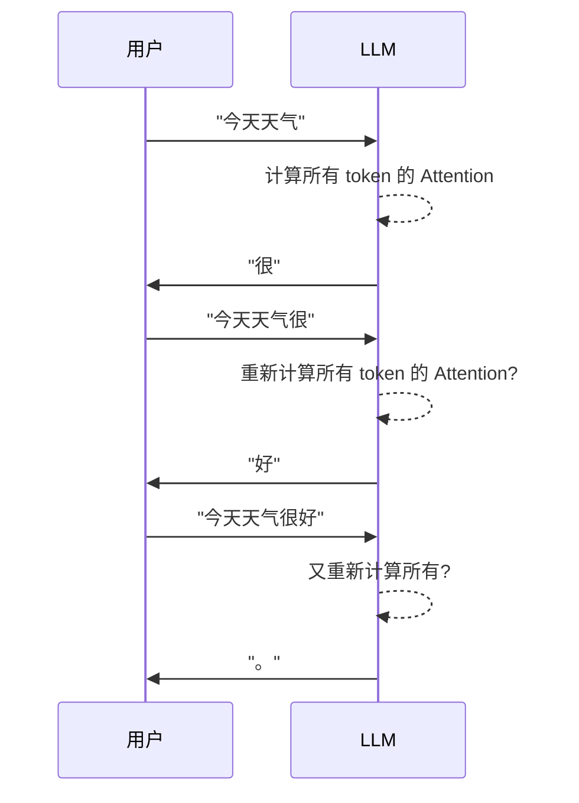
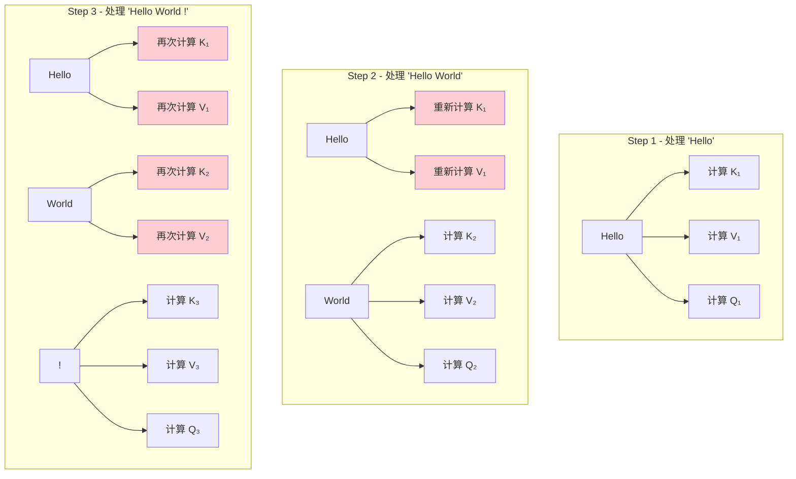
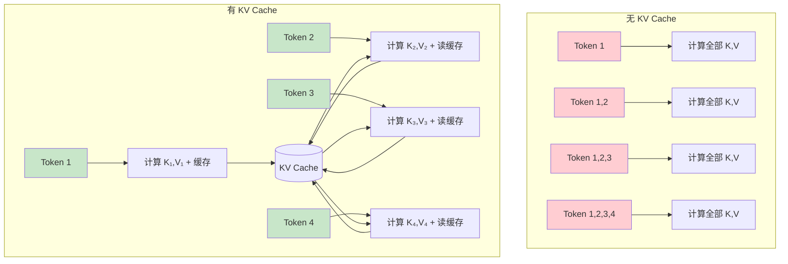
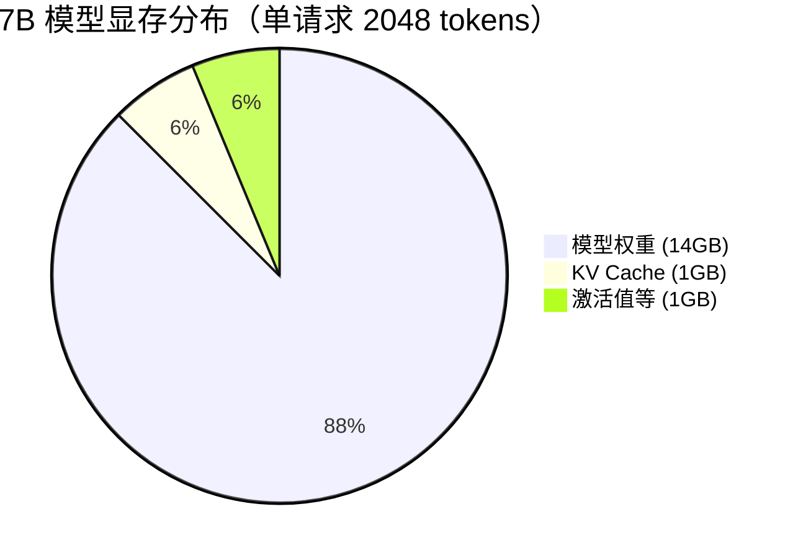
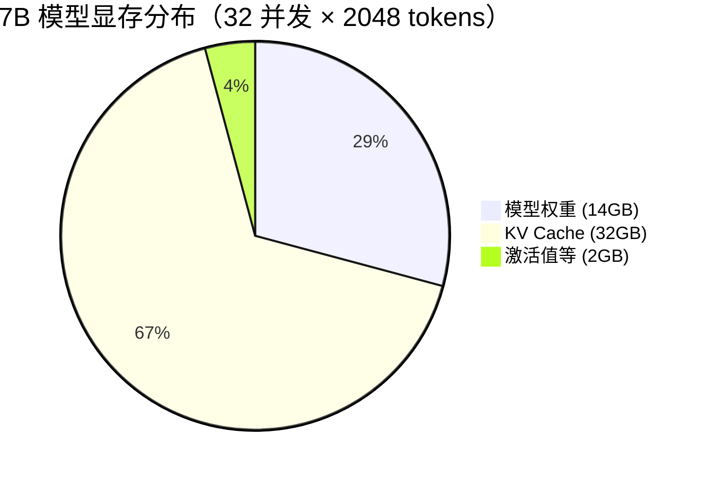
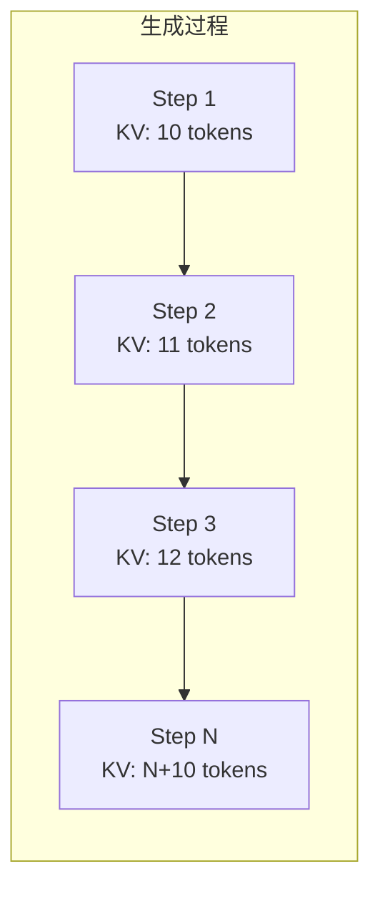
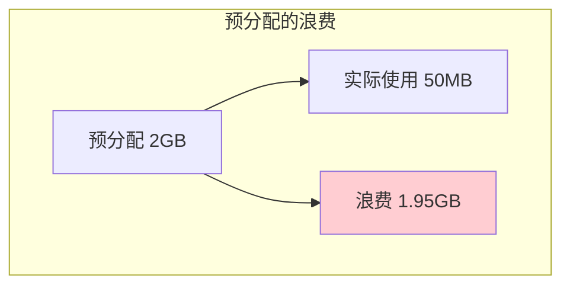
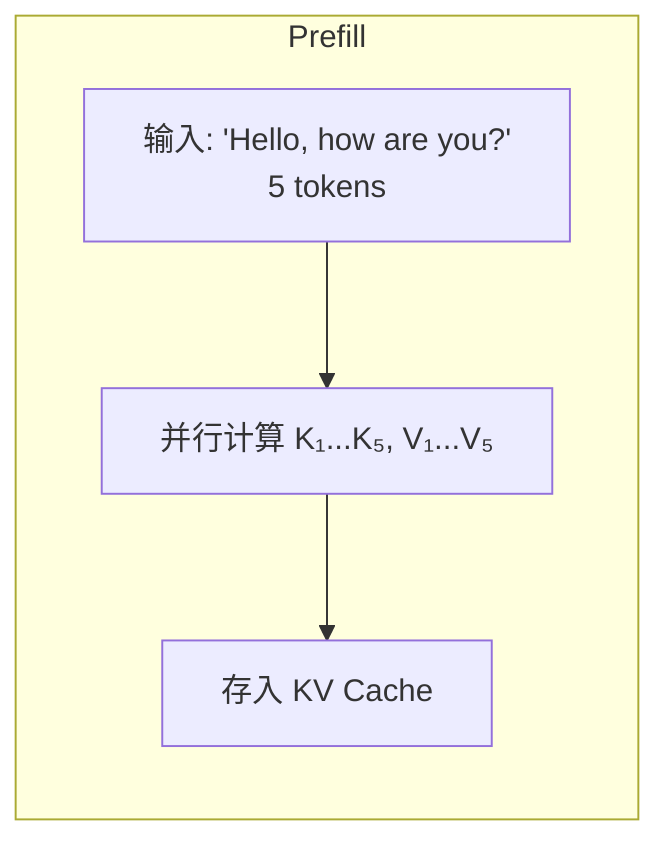
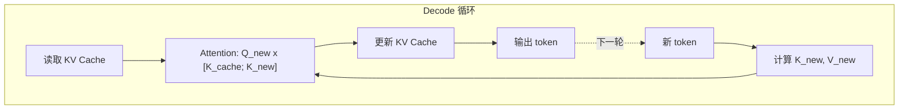

输入已有 100 个 token 时，第 101 个位置会读取前 100 个位置的 K 和 V。对固定模型的因果自注意力，后续追加的 token 不会改变前面的位置表示，已有的 K 和 V 可以直接留下来供下一轮读取。

## 1. 为什么需要 KV Cache

### 1.1 自回归生成的特点

LLM 生成文本是**自回归**的：每次只生成一个 token，然后将其加入输入，继续生成下一个。



### 1.2 没有 KV Cache 时的重复计算

在注意力计算中，每个 token 需要：
1. 计算自己的 Q（Query）
2. 计算自己的 K（Key）和 V（Value）
3. 用 Q 与**所有** K 计算注意力
4. 用注意力加权**所有** V

**问题**：历史 token 的 K 和 V 每次都要重新计算！



### 1.3 计算量分析

生成 N 个 token，不使用 KV Cache：

| Step | 需要计算的 K/V | 累计 K/V 计算次数 |
|------|---------------|------------------|
| 1 | 1 | 1 |
| 2 | 2（重新计算 1 + 新的 1） | 1 + 2 = 3 |
| 3 | 3（重新计算 2 + 新的 1） | 3 + 3 = 6 |
| ... | ... | ... |
| N | N | 1 + 2 + ... + N = N(N+1)/2 |

**K/V 投影的 token 次数**为 $N(N+1)/2$。

---

## 2. KV Cache 工作原理

### 2.1 核心思想

**观察**：在自回归生成中，历史 token 的 K 和 V 不会改变。

**解决方案**：计算一次后缓存起来，后续直接使用。


title: 第二轮能省下哪些 K 和 V
rows: ["位置 0", "位置 1", "位置 2"]
steps:
  - title: "两词提示"
    detail: "第一轮处理 a、b，两处都需要计算本层的 K 和 V。"
    cells: [["a 待算"], ["b 待算"], ["·"]]
    focus: [[0, 0], [1, 0]]
  - title: "保存前缀"
    detail: "a、b 的 KV 已写入缓存，模型选出输出 x。"
    cells: [["KV(a)"], ["KV(b)"], ["x 待输入"]]
    focus: [[0, 0], [1, 0]]
  - title: "再做一步"
    detail: "x 在位置 2 进入模型，复用前两处的 KV，只补上当前位置。"
    cells: [["KV(a)"], ["KV(b)"], ["KV(x)"]]
    focus: [[2, 0]]


### 2.2 计算量对比

使用 KV Cache 后：

| Step | 需要计算的 K/V | 累计 K/V 计算次数 |
|------|---------------|------------------|
| 1 | 1 | 1 |
| 2 | 1（只计算新的） | 1 + 1 = 2 |
| 3 | 1（只计算新的） | 2 + 1 = 3 |
| ... | ... | ... |
| N | 1 | N |

**K/V 投影的 token 次数**降到 $N$。

取 N = 1,000，两种做法分别要投影 500,500 和 1,000 个位置。用上缓存后，新查询仍要读取可见历史，对整段生成的注意力运算和用时要另外计算。

### 2.3 图解对比



---

## 3. KV Cache 的数据结构

### 3.1 基本形状

KV Cache 需要存储每层的 K 和 V：

```python
# KV Cache 形状
k_cache = torch.zeros(num_layers, batch_size, num_heads, max_seq_len, head_dim)
v_cache = torch.zeros(num_layers, batch_size, num_heads, max_seq_len, head_dim)

kv_cache = torch.zeros(num_layers, 2, batch_size, num_heads, max_seq_len, head_dim)
# kv_cache[:, 1, ...] 是 V
```

### 3.2 维度解释

| 维度 | 含义 | 示例值 |
|------|------|--------|
| num_layers | Transformer 层数 | 32 |
| 2 | K 和 V | 2 |
| batch_size | 批次大小 | 1-64 |
| num_heads | 注意力头数（或 KV heads） | 32 或 8 |
| max_seq_len | 最大序列长度 | 4096 |
| head_dim | 每个头的维度 | 128 |

### 3.3 给同一位置写入两层缓存

下面的 CPU 示例给两个注意力层各留 16 个位置。调用方指定位置，两层都写在第 4 个位置上。同一个 token 穿过两层后，序列长度仍然是 4。

```python
import torch

# 层、K/V、KV 头、序列位置、头维度
cache = torch.zeros(2, 2, 1, 16, 4)
position = 3
for layer in range(2):
    new_k = torch.full((1, 4), float(layer + 1))
    new_v = new_k + 10
    cache[layer, 0, :, position] = new_k
    cache[layer, 1, :, position] = new_v

assert cache[1, 0, 0, :position + 1, 0].tolist() == [0, 0, 0, 2]
```

在真实模型里，`new_k` 与 `new_v` 来自各层自己的投影权重。这里用常量便于看出每层写入了哪里。

## 4. 显存占用详细计算

### 4.1 计算公式

```
KV Cache 显存 = 2 × num_layers × num_kv_heads × head_dim × seq_len × batch_size × bytes_per_element
```

当 `num_kv_heads × head_dim = hidden_dim` 时，可以写成：

```
KV Cache 显存 = 2 × num_layers × hidden_dim × seq_len × batch_size × bytes_per_element
```

注意：如果使用 GQA，num_kv_heads 可能小于 num_attention_heads。

### 4.2 LLaMA-2-7B 示例

**模型参数**：
- num_layers: 32
- hidden_dim: 4096
- num_kv_heads: 32（MHA）
- head_dim: 128
- 精度: FP16（2 bytes）

**单个请求不同序列长度的 KV Cache**：

| 序列长度 | 计算 | 大小 |
|---------|------|------|
| 512 | 2 × 32 × 4096 × 512 × 2 | 256 MiB |
| 1024 | 2 × 32 × 4096 × 1024 × 2 | 512 MiB |
| 2048 | 2 × 32 × 4096 × 2048 × 2 | 1 GiB |
| 4096 | 2 × 32 × 4096 × 4096 × 2 | 2 GiB |


### 4.3 LLaMA-2-70B 示例（使用 GQA）

**模型参数**：
- num_layers: 80
- hidden_dim: 8192
- num_kv_heads: 8（GQA，原本是 64 个 attention heads）
- head_dim: 128
- 精度: FP16

**单个请求 4096 序列长度**：

```
KV Cache = 2 × 80 × 8 × 128 × 4096 × 2 = 1.34 GB
```

对比 MHA（如果 kv_heads = 64）：
```
KV Cache = 2 × 80 × 64 × 128 × 4096 × 2 = 10.7 GB
```

在这个例子中，8 个 KV 头的缓存占用是 64 个 KV 头的 1/8。

### 4.4 显存占用可视化





---

## 5. KV Cache 管理的挑战

### 5.1 动态序列长度

KV Cache 的大小随着生成过程动态增长：



**问题**：在请求开始时，我们不知道最终会生成多少 token！

### 5.2 预分配策略的问题

**传统方案**：预分配最大可能长度（如 4096 tokens）

```
预分配: 4096 tokens × 每token 0.5MB = 2GB
实际使用: 100 tokens × 0.5MB = 50MB
浪费: 1.95GB (97.5%)
```



### 5.3 显存碎片化

当多个请求同时运行时，问题更加严重：

```
显存状态：
+--------+--------+--------+--------+--------+
| Req A  | Req B  | Req C  | Req D  | 空闲   |
| 2GB    | 2GB    | 2GB    | 2GB    | 碎片   |
| 用50MB | 用100MB| 用30MB | 用200MB|        |
+--------+--------+--------+--------+--------+

实际使用: 380MB
预分配: 8GB
浪费: 7.62GB (95%!)
```

### 5.4 把分配单位缩小到块

传统方案的问题：
1. **预分配浪费**：每个请求预留最大空间
2. **内部碎片**：实际使用远小于预分配
3. **外部碎片**：释放后的空间不连续

PagedAttention 的解决方案（下一部分详细介绍）：
1. **按需分配**：用多少分配多少
2. **分块管理**：固定大小的块，减少碎片
3. **非连续存储**：块可以不连续

---

## 6. Prefill 和 Decode 中的 KV Cache

### 6.1 Prefill 阶段

处理输入 prompt，一次性计算所有输入 token 的 K、V：



**特点**：
- 批量计算，效率高
- 计算密集型
- KV Cache 从 0 增长到输入长度

### 6.2 Decode 阶段

逐个生成 token，每次只计算新 token 的 K、V：



**特点**：
- 增量计算，每次只算 1 个
- 内存密集型（需要读取整个 KV Cache）
- KV Cache 每步增长 1

### 6.3 两阶段的 KV Cache 操作对比

| 操作 | Prefill | Decode |
|------|---------|--------|
| K/V 计算 | 批量（N 个） | 单个（1 个） |
| KV Cache 读取 | 无 | 全部 |
| KV Cache 写入 | N 个 | 1 个 |
| 计算/访存比 | 高 | 低 |

---

## 7. vLLM 中的 KV Cache 相关代码

### 7.1 关键文件位置

| 功能 | 文件 |
|------|------|
| KV Cache 管理 | `vllm/v1/core/kv_cache_manager.py` |
| 块池 | `vllm/v1/core/block_pool.py` |
| 块表 | `vllm/v1/worker/block_table.py` |
| KV Cache 接口 | `vllm/v1/kv_cache_interface.py` |

### 7.2 跟踪一个块的两个属性

在 `KVCacheBlock` 看 `block_id` 和 `ref_cnt`。两个请求复用同一个前缀时，物理编号相同，引用计数随请求进入和退出而变化。[分步观察共享块](../03-core-modules/03-block-pool.md) · [0.33.0 块定义](https://github.com/vllm-project/vllm/blob/v0.33.0/vllm/v1/core/kv_cache_utils.py)

## KV 占用量的计算式

```
KV Cache = 2 × num_layers × num_kv_heads × head_dim × seq_len × bytes
```

## 思考题

1. 如果一个模型使用 GQA，KV heads 是 attention heads 的 1/8，KV Cache 显存会减少多少？
2. 为什么 Decode 阶段是"内存密集型"而不是"计算密集型"？
3. 如果 vLLM 要支持无限长度的上下文，KV Cache 管理会面临什么额外挑战？

---

[从 prefill 跟到下一个输出 token](05-llm-generation-process.md)
