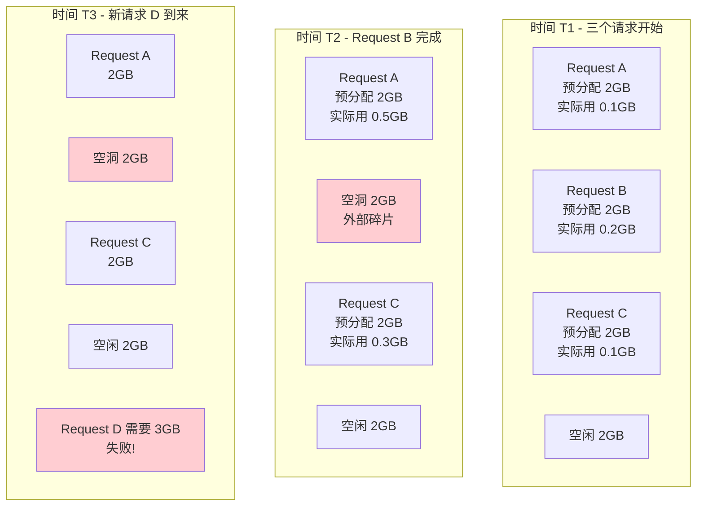
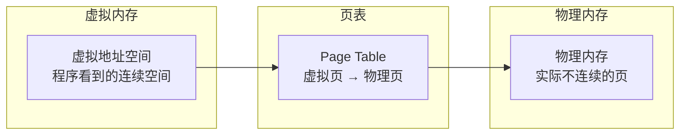
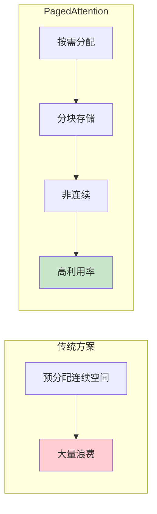
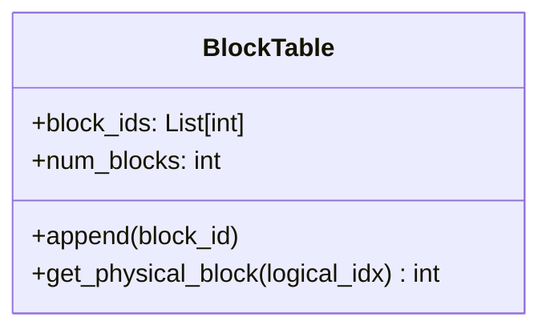
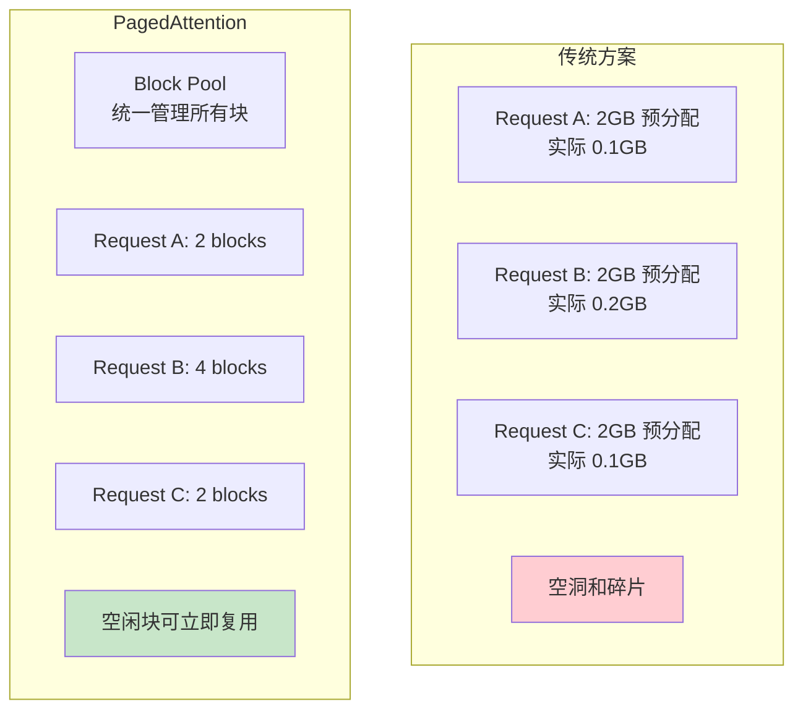
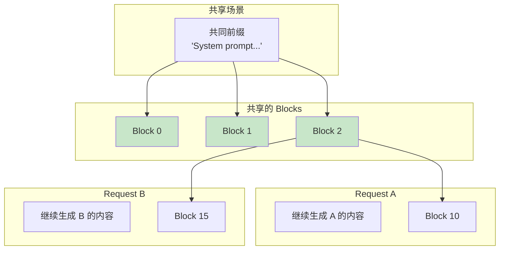
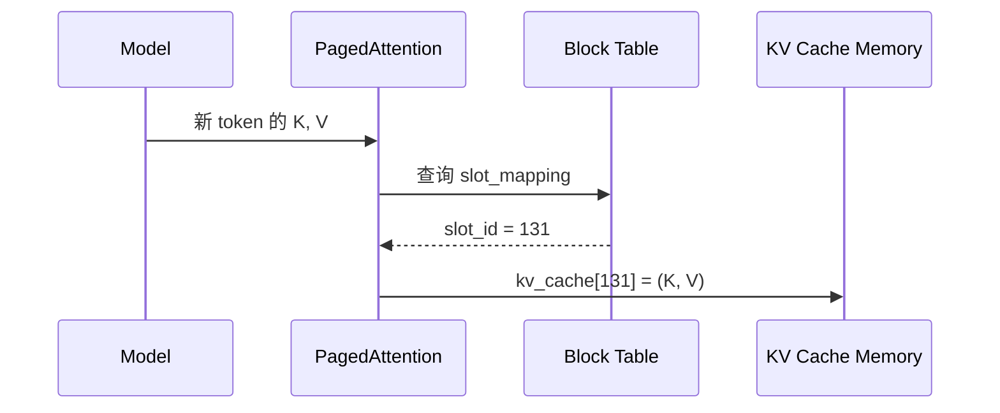
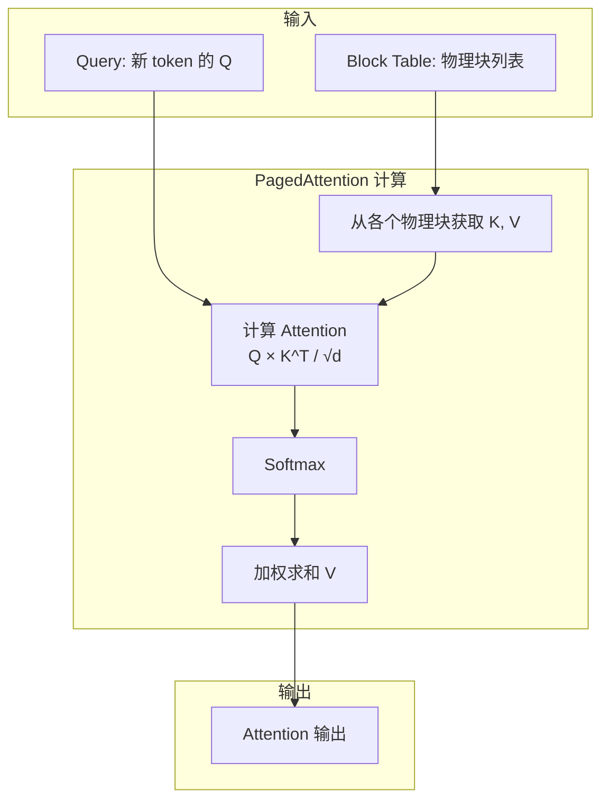
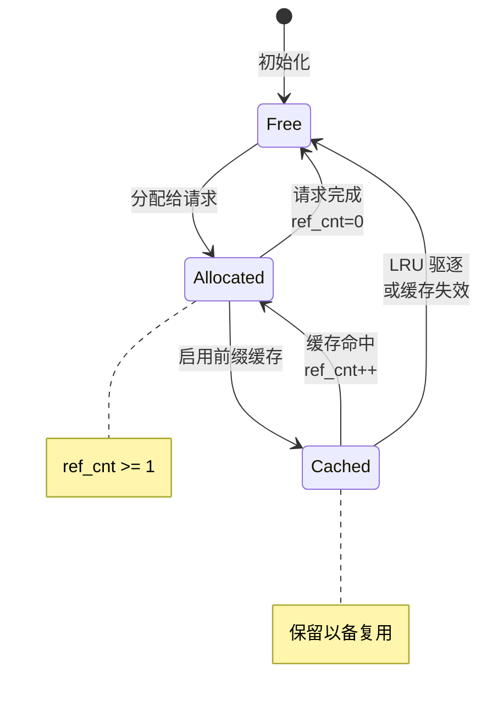

## 定位当前模型使用的后端

块表解决逻辑 token 到物理 KV 块的映射，执行 attention 的具体后端还依赖硬件、数据类型、头部维度与缓存配置。文中的核函数示意用于解释块表读取；对照 0.33.0 的实际实现，先由选择器确定后端。 [0.33.0 后端选择](https://github.com/vllm-project/vllm/blob/v0.33.0/docs/design/attention_backends.md)

## 引言

请求把第 32 和第 33 个 token 当作相邻位置，显存中的两个 KV 块却可以相隔很远。PagedAttention 通过块表找到它们。

---

## 1. 传统 KV Cache 的问题回顾

### 1.1 连续内存分配的要求

传统方案要求每个请求的 KV Cache 存储在**连续的内存空间**中：

```
传统 KV Cache 布局:
+----------------------------------------------------------+
| Request A 的 KV Cache (预分配 max_seq_len)                 |
| [K0,V0][K1,V1][K2,V2]...[Kn,Vn][   空闲预留空间   ]        |
+----------------------------------------------------------+
| Request B 的 KV Cache (预分配 max_seq_len)                 |
| [K0,V0][K1,V1]...[Km,Vm][      空闲预留空间      ]         |
+----------------------------------------------------------+
```

### 1.2 显存碎片化图解

当多个请求并发时，显存碎片化问题严重：



### 1.3 量化浪费

| 问题类型 | 说明 | 浪费比例 |
|---------|------|---------|
| 内部碎片 | 预分配 >> 实际使用 | 40-60% |
| 外部碎片 | 空洞无法利用 | 20-30% |
| **总计** | **综合浪费** | **60-80%** |

---

## 2. PagedAttention 核心思想

### 2.1 灵感来源：操作系统虚拟内存

操作系统如何管理内存？



**关键特性**：
1. 程序看到连续的地址空间
2. 物理内存可以不连续
3. 按需分配（用到才分配）
4. 页面可以共享

### 2.2 PagedAttention 的类比

将操作系统的思想应用到 KV Cache 管理：

| 操作系统概念 | PagedAttention 对应 |
|-------------|-------------------|
| 页（Page） | Block（块） |
| 页表（Page Table） | Block Table（块表） |
| 虚拟地址 | 逻辑块索引 |
| 物理地址 | 物理块 ID |
| 页帧 | KV Cache 块 |

### 2.3 核心改进



---

## 3. 关键数据结构详解

### 3.1 Block（块）

Block 是 KV Cache 的基本存储单元：

```python
# 概念定义
class KVCacheBlock:
    block_id: int              # 物理块 ID
    ref_cnt: int               # 引用计数（支持共享）
    block_hash: Optional[int]  # 用于前缀缓存匹配
```

**Block 的特点**：
- **固定大小**：每个 block 存储固定数量的 token（如 16 个）
- **独立分配**：不需要连续
- **可复用**：释放后可分配给其他请求

### 3.2 Block 的存储内容

每个 Block 存储若干 token 的 K 和 V：

```
Block 结构 (block_size = 16):
┌─────────────────────────────────────────────────┐
│ Token 0:  K[layers, heads, head_dim]            │
│           V[layers, heads, head_dim]            │
├─────────────────────────────────────────────────┤
│ Token 1:  K[layers, heads, head_dim]            │
│           V[layers, heads, head_dim]            │
├─────────────────────────────────────────────────┤
│ ...                                             │
├─────────────────────────────────────────────────┤
│ Token 15: K[layers, heads, head_dim]            │
│           V[layers, heads, head_dim]            │
└─────────────────────────────────────────────────┘
```

**实际存储形状**：

```python
# 单个 Block 的 KV Cache 形状
k_block = torch.zeros(num_layers, num_heads, block_size, head_dim)
v_block = torch.zeros(num_layers, num_heads, block_size, head_dim)

kv_cache = torch.zeros(num_blocks, 2, num_layers, num_heads, block_size, head_dim)
```

### 3.3 Block Table（块表）

Block Table 记录逻辑块到物理块的映射：



**示例**：

```
Request A 的 Block Table:
逻辑块索引:  0    1    2    3
            ↓    ↓    ↓    ↓
物理块 ID:  [5]  [2]  [8]  [12]

解释:
- 逻辑块 0 → 物理块 5
- 逻辑块 1 → 物理块 2
- 逻辑块 2 → 物理块 8
- 逻辑块 3 → 物理块 12
```

### 3.4 Slot Mapping（槽位映射）

Slot Mapping 将 token 位置映射到具体的缓存槽位：

```python
def get_slot_mapping(token_position, block_size, block_table):
    """
    token_position: token 在序列中的位置（如 35）
    block_size: 每个 block 的 token 数（如 16）
    block_table: 块表
    """
    logical_block_idx = token_position // block_size  # 35 // 16 = 2
    block_offset = token_position % block_size        # 35 % 16 = 3

    physical_block_id = block_table[logical_block_idx]  # 假设是 8
    slot_id = physical_block_id * block_size + block_offset  # 8 * 16 + 3 = 131

    return slot_id
```

**图解**：



---

## 4. 内存管理优势

### 4.1 减少显存碎片



### 4.2 按需分配


title: 越过第 16 个位置时分配新块
actors: ["请求 A", "调度器", "块池"]
steps:
  - from: 0
    to: 1
    label: "填满首块"
    detail: "A 已占用 16 个位置，块表中只有物理块 5。"
  - from: 1
    to: 2
    label: "申请下个块"
    detail: "调度器为第 17 个位置申请一块空闲空间。"
  - from: 2
    to: 1
    label: "返回块 8"
    detail: "物理块 8 接在 A 的逻辑块表末尾，已有 16 个位置留在块 5。"
  - from: 1
    to: 0
    label: "继续执行"
    detail: "第 17 个位置写到块 8 的槽位 0。"
  - from: 1
    to: 2
    label: "归还引用"
    detail: "A 结束，调度器释放 A 持有的块引用。"


### 4.3 支持 Copy-on-Write

当多个请求共享相同前缀时，可以共享 Block：



**引用计数**：
- Block 0, 1, 2 的 ref_cnt = 2（被两个请求共享）
- 只有当 ref_cnt = 0 时才真正释放

### 4.4 支持前缀缓存

相同前缀的请求可以直接复用已计算的 KV Cache：

```python
# 前缀缓存示例
request_1 = "你好，请问" + "天气怎么样？"
request_2 = "你好，请问" + "今天星期几？"

```

---

## 5. PagedAttention 计算流程

### 5.1 写入 KV Cache



### 5.2 读取并计算 Attention



### 5.3 代码实现概览

```python
# vllm/v1/attention/ops/paged_attn.py (简化版)

class PagedAttention:
    @staticmethod
    def write_to_paged_cache(
        key: torch.Tensor,           # [num_tokens, num_heads, head_dim]
        value: torch.Tensor,         # [num_tokens, num_heads, head_dim]
        key_cache: torch.Tensor,     # [num_blocks, block_size, num_heads, head_dim]
        value_cache: torch.Tensor,   # [num_blocks, block_size, num_heads, head_dim]
        slot_mapping: torch.Tensor,  # [num_tokens]
    ):
        """将新的 K, V 写入缓存"""
        # 使用 slot_mapping 确定写入位置
        # slot_mapping[i] 告诉我们 token i 应该写入哪个槽位
        pass

    @staticmethod
    def forward(
        query: torch.Tensor,         # [num_tokens, num_heads, head_dim]
        key_cache: torch.Tensor,     # KV Cache
        value_cache: torch.Tensor,
        block_tables: torch.Tensor,  # [batch, max_blocks] 块表
        context_lens: torch.Tensor,  # [batch] 每个请求的上下文长度
        ...
    ) -> torch.Tensor:
        """执行 PagedAttention 计算"""
        # 1. 根据 block_tables 定位 K, V
        # 2. 计算 Attention
        # 3. 返回输出
        pass
```

---

## 6. 块的动态管理

### 6.1 块的生命周期



### 6.2 一轮要再分配几块

```python
def additional_blocks(computed, scheduled, allocated_blocks, block_size):
    required = (computed + scheduled + block_size - 1) // block_size
    return max(0, required - allocated_blocks)

# 已算好 32 个位置，下一轮再算 1 个；已有两个完整块。
assert additional_blocks(32, 1, 2, 16) == 1
```

### 6.3 块增长过程


title: 第 33 个 token 写到哪里
rows: ["逻辑块", "已用槽位"]
steps:
  - title: 提示词长 16
    detail: 第 0 块正好写满。
    cells: [["0", "·", "·"], ["16/16", "·", "·"]]
    focus: [[1, 0]]
  - title: 提示词长 32
    detail: 处理完整段提示词后，两块都已写满。
    cells: [["0", "1", "·"], ["16/16", "16/16", "·"]]
    focus: [[1, 1]]
  - title: 解码输入第 33 个 token
    detail: 调度器为新位置分配第 2 个逻辑块，当前只需写入一个槽位。
    cells: [["0", "1", "2"], ["16/16", "16/16", "1/16"]]
    focus: [[1, 2]]


---

## 7. CUDA 内核实现

### 7.1 文件位置

- Python 接口：`vllm/v1/attention/ops/paged_attn.py`
- CUDA 内核：[按平台、模型与缓存布局选择 attention backend](https://github.com/vllm-project/vllm/blob/v0.33.0/vllm/v1/attention/selector.py)

### 7.2 V1 vs V2 内核

| 特性 | V1 | V2 |
|------|----|----|
| 适用场景 | 短序列 | 长序列 |
| 分块策略 | 简单 | 两级分块 |
| 性能 | 中等 | 更优 |

### 7.3 内核参数

```cpp
// 教学伪代码：展示块表寻址与加权累积
template<typename T, int BLOCK_SIZE, int NUM_THREADS>
__global__ void paged_attention_v2_kernel(
    T* __restrict__ out,              // 输出
    const T* __restrict__ q,          // Query
    const T* __restrict__ k_cache,    // Key Cache
    const T* __restrict__ v_cache,    // Value Cache
    const int* __restrict__ block_tables,  // 块表
    const int* __restrict__ context_lens,  // 上下文长度
    const float scale,                // 缩放因子
    ...
) {
    // 1. 确定当前线程处理的 query
    // 2. 遍历 block_table 中的所有块
    // 3. 计算 Attention 分数
    // 4. Softmax 和加权求和
}
```

---

## 8. 性能对比

### 8.1 显存效率

最大长度预留会留下未使用空间，分页分配则按实际进度增长。对普通全注意力、单个不共享的请求，若每块 16 个 token、当前序列长 35，则需要 3 块共 48 个槽位，尾块尚余 13 个。共享前缀后物理块数还会受同时活跃的请求与缓存回收影响。可用这组计数在运行中核对块表，实际吞吐仍需结合模型、输入分布与并发测量。

### 8.2 尾块随序列长度变化


title: 同一个请求的尾块能空多少
rows: ["物理块", "已用槽位"]
steps:
  - title: "序列长 35"
    detail: "三个已分配块共 48 个槽，尾块只用 3 个，空余 13 个，占已分配空间约 27.1%。"
    cells: [["P5", "P2", "P8", "·"], ["16", "16", "3", "·"]]
    focus: [[0, 2], [1, 2]]
  - title: "增长到 48"
    detail: "第 3 个块填满，48 个槽全部使用。"
    cells: [["P5", "P2", "P8", "·"], ["16", "16", "16", "·"]]
    focus: [[1, 2]]
  - title: "再增加 1 个位置"
    detail: "引擎为位置 48 另取一块。49 个位置放进 64 个槽，尾块余 15 个，占约 23.4%。"
    cells: [["P5", "P2", "P8", "P12"], ["16", "16", "16", "1"]]
    focus: [[0, 3], [1, 3]]


### 分页怎样影响吞吐

当 KV 空间限制了并发，分页节省的槽位可以让更多请求进入执行批。比较部署时，固定模型、显存预算、输入和输出长度，分别记录能同时接纳的请求数与每秒输出 token。论文中的性能数字对应当时的模型、请求分布与对照实现。[PagedAttention 原论文](https://arxiv.org/abs/2309.06180)

## 分页相关代码入口

| 功能 | 文件 |
|------|------|
| Python 接口 | `vllm/v1/attention/ops/paged_attn.py` |
| 后端选择入口 | `vllm/v1/attention/selector.py` |
| 块管理 | `vllm/v1/core/block_pool.py` |
| 块表 | `vllm/v1/worker/block_table.py` |

## 思考题

1. 为什么选择固定大小的 Block 而不是可变大小？
2. 前缀缓存和 Copy-on-Write 有什么区别和联系？
3. 如果 block_size 设置得太大或太小，会有什么影响？

---

## 下一步


[下一章：KV Cache 管理器](02-kv-cache-manager.md)
