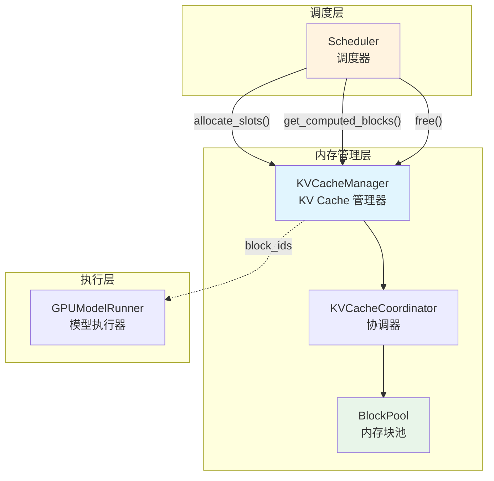

调度器计算每条请求本轮要执行的 token 数，KVCacheManager 查询可复用的前缀并为其余位置预留空间。遇到同时包含全注意力与滑动窗口的模型时，协调器按各层的保留范围组织缓存组。

## 一轮调度中的三个调用

| 操作 | 对请求意味着什么 |
|---|---|
| `get_computed_blocks` | 查找可复用的本地前缀，返回各组块、命中 token 数及共享边界。默认把查询上限设为请求长度减一，以便计算生成首个 token 所需的 logits。 |
| `allocate_slots` | 接受本轮要计算的 token 数及已有块等信息。若剩余容量不能满足分配，调度器需要重新安排请求。 |
| `free` | 请求完成或其执行状态被释放时归还引用。物理空间能否回收，还取决于其他请求是否仍在使用。 |

以块长 16 的普通全注意力模型为例。长度 35 的 B 与此前 A 共用前 32 个 token，尾部 3 个 token 需要计算。若 B 恰好只有 32 个 token，最后一个 token 的 logits 仍然需要计算，块对齐会影响最终命中长度。

## 全注意力和滑动窗口为何分组

取一个块长为 2、滑动窗口为 4 的例子。当前位置从 4 走到 6 时，两种层处理的是同一条序列，可读的历史却开始分开。留意块 A 中的两个位置先后何时滑出窗口，就能看出同一套保留规则为什么不适合这两类层。



## 估算单卡的缓存容量

0.33.0 的 `gpu_memory_utilization` 默认值是 **0.92**。模型权重、中间结果和运行时也占用这个实例的显存预算，余下空间才可分给 KV。显式设置 `kv_cache_memory_bytes` 时，按每 GPU 的字节数配置。缓存组、精度、对齐和并行切分决定最终块数。

## 调度层如何访问物理块



scheduler 维护请求的计算进度；管理器返回的是按组组织的块，worker 依据块表准备设备侧的索引。观察一次命中应同时记录组号、块号及计算长度。

## 为什么块键必须包含历史前缀


title: 相同后缀为什么会得到不同缓存键
rows: ["请求 A", "请求 B"]
steps:
  - title: "第一块相同"
    detail: "两次请求都从同一组 token 开始，第一个整块的键相同。"
    cells: [["H₀", "·", "·"], ["H₀", "·", "·"]]
    focus: [[0, 0], [1, 0]]
  - title: "第二块分叉"
    detail: "A 的第二块内容为 x，B 为 y；即使父键相同，两个块键也不同。"
    cells: [["H₀", "Hₓ", "·"], ["H₀", "Hᵧ", "·"]]
    focus: [[0, 1], [1, 1]]
  - title: "第三块都为 z"
    detail: "第三块的 token 虽然相同，父键分别是 Hₓ 和 Hᵧ，不能共享这段 KV。"
    cells: [["H₀", "Hₓ", "Hₓ𝓏"], ["H₀", "Hᵧ", "Hᵧ𝓏"]]
    focus: [[0, 2], [1, 2]]


前缀键串联此前上下文。A、B 的第二块一旦分叉，第三块即使装着相同 token z，也会因父键不同而分开保存。

## 自行推导命中长度

固定本例的缓存假设，只考虑同一模型、一个全注意力组和整块命中。下面的算式可验证“至少留下最后一个输入位置，以便取 logits”的限制：
```python
def reusable_tokens(prompt_length, common_prefix, block_size):
    matched = min(common_prefix, max(0, prompt_length - 1))
    return matched // block_size * block_size

assert reusable_tokens(35, 32, 16) == 32
assert reusable_tokens(32, 32, 16) == 16
```
这段演算只预测该例的本地普通前缀路径；开启其他缓存组、外部连接器或特殊采样请求时，应直接检查管理器的查询条件。

[KVCacheManager](https://github.com/vllm-project/vllm/blob/v0.33.0/vllm/v1/core/kv_cache_manager.py) · [缓存配置](https://github.com/vllm-project/vllm/blob/v0.33.0/vllm/config/cache.py) · [缓存组设计](https://github.com/vllm-project/vllm/blob/v0.33.0/docs/design/hybrid_kv_cache_manager.md)
