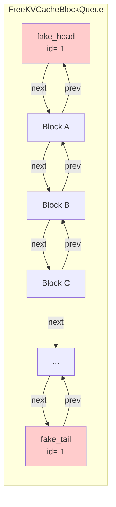

块池给请求分配设备 KV 缓存中的位置。块号表示物理位置，前缀哈希帮助寻找可复用内容，引用计数记录当前有多少使用者。以单个全注意力缓存组为例，假定每块容纳 16 个 token，并已启用自动前缀缓存。



请求 A 和 B 的前 32 个 token 完全相同，从第 33 个 token 开始分叉。A 先完成这两个整块的计算，随后 B 到达；B 可以引用相同的两个物理块。两条后缀各自占用块，如果 A 的共享块还未计算完或已经被回收覆盖，B 的查找结果就会不同。同一份可见文本还需要经相同的 tokenizer、模板及与缓存键有关的上下文处理。

| 时刻 | 共享块上的活动引用 | 调度器可以怎样使用这块空间 |
|---|---:|---|
| A 已写入，B 尚未使用 | 1 | A 保留该物理块 |
| B 命中同一前缀 | 2 | 两个请求读取同一份前缀 KV |
| A 完成 | 1 | B 仍然需要这块 KV |
| B 也完成 | 0 | 块可重新分配；被覆盖之前，旧哈希仍可能命中 |

源码中，`touch` 为命中块增加引用，`free_blocks` 归还不再使用的块，`get_new_blocks` 取出可用物理块并处理旧缓存条目。缓存命中与“空闲”因此可以同时描述同一物理块。整块示例对应普通全注意力前缀路径；混合缓存组还需要协调各组的匹配边界。

## 为什么空闲队列使用双向链表

**链表结构示意图：**



**为什么用双向链表而不是 Python 的 deque？**

```python
# 场景：缓存命中，需要从队列中间移除块

def remove_from_deque(deque, block):
    deque.remove(block)  # O(n)

def remove_from_linked_list(block):
    block.prev_free_block.next_free_block = block.next_free_block
    block.next_free_block.prev_free_block = block.prev_free_block
    block.prev_free_block = block.next_free_block = None
```

## 一条前缀的两个索引

物理块池按可重新分配的顺序维护队列，同时保留按键找缓存的索引。如果同一空闲块被命中，已知节点地址就可以把它从队列中摘下；若先分配给新的内容，就要撤销与旧键的关系。


title: 旧前缀何时失去物理块 X
actors: ["分配方", "空闲队列", "哈希索引"]
steps:
  - from: 0
    to: 1
    label: "取队首 X"
    detail: "X 的活动引用为 0，因此可以重新分配。"
  - from: 1
    to: 2
    label: "检查旧内容"
    detail: "X 仍挂在旧前缀 A 的哈希键下。"
  - from: 0
    to: 2
    label: "撤下 A → X"
    detail: "块池先移除这条映射，避免下一次查 A 时得到已被复用的位置。"
  - from: 1
    to: 0
    label: "交回 X"
    detail: "分配方拿到 X 写新内容；其他仍在引用的块保持原状。"


## 读取源码时跟踪哪些值

先在 `BlockPool.touch` 找到从零引用变回受保护状态的条件，再在 `free_blocks` 对照减引用与加入队列的先后。记录 A/B 前两块的 `block_id`、引用计数以及是否在队列中，分别在 A 完成、B 完成和下一个无关请求到达时更新。

在 SGLang 中，同一类前缀查找可以沿一棵树观察。把两条请求的 token 放进 [Radix 树的分叉图](/sglang/03-memory-cache/10-radix-attention/)，可以看到匹配停在哪里。

## 手工检查空闲队列中的缓存命中

假设物理块 X 已缓存 A 的首个整块并已归还，当前状态是 `ref_cnt=0`，X 仍带着这段前缀的哈希。下面两种事件只差发生次序，却会得出不同命中结果。

| 事件顺序 | X 先发生什么 | 下一次查 A 的首块 |
|---|---|---|
| B 先查到 A 的前缀 | touch 将 X 从可分配集合移出，再增加活动引用 | B 可以复用 X，其他请求不能覆盖它。 |
| 无关请求先取走 X | 分配方清理 X 的旧缓存索引，再把它交给新内容 | 原哈希不再指向一份可复用的 A 前缀。 |

这解释了为什么衡量命中率时要同时记录请求到达顺序和空闲块压力。相同的两份提示在不同并发下可能有不同结果。[0.33.0 分配、touch 和释放](https://github.com/vllm-project/vllm/blob/v0.33.0/vllm/v1/core/block_pool.py#L706)

[块池实现](https://github.com/vllm-project/vllm/blob/v0.33.0/vllm/v1/core/block_pool.py) · [前缀缓存设计](https://github.com/vllm-project/vllm/blob/v0.33.0/docs/design/prefix_caching.md) · [混合 KV 缓存组](https://github.com/vllm-project/vllm/blob/v0.33.0/docs/design/hybrid_kv_cache_manager.md)
