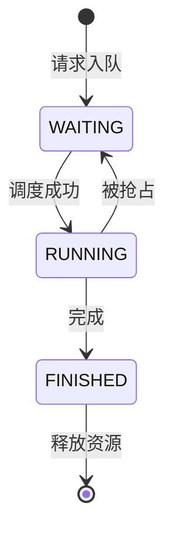

一次调度的单位是本轮允许执行的 token。一个新请求可能有数千个提示词 token 尚未处理；一个正在生成的请求可能只差下一个 token。两者都通过已计算 token 数与目标进度之间的差值表达。调度器结合 token 预算、可用 KV 块、并发约束和请求状态决定本轮新增工作。

某一轮有 8 个 token 的预算。A、B 各要解码一个位置，新请求 C 的长提示已经获准分块处理，KV 空间充足。调度器可以给 A、B 各 1 个，给 C 6 个。


title: 一轮 8 个 token 怎样分
rows: ["解码 A", "解码 B", "预填充 C", "剩余预算"]
steps:
  - title: "准备调度"
    detail: "本轮上限为 8，A、B 各追一个位置，C 的提示词仍有至少六个位置待算。"
    cells: [["0"], ["0"], ["0"], ["8"]]
    focus: [[3, 0]]
  - title: "分给 A 和 B"
    detail: "两个解码请求各得到一个位置，剩余预算是 6。"
    cells: [["1"], ["1"], ["0"], ["6"]]
    focus: [[0, 0], [1, 0], [3, 0]]
  - title: "加入 C 的片段"
    detail: "C 取得六个提示词位置。这轮设备共处理八个位置，三条请求的输出仍各自独立。"
    cells: [["1"], ["1"], ["6"], ["0"]]
    focus: [[2, 0], [3, 0]]


普通 step 中，EngineCore 调用 scheduler 的 `schedule`，提交 executor 的 `execute_model`，需要时再取采样结果，然后调用 `update_from_output`。打开批次流水或采用特定后端时，执行与收取结果的时序有变化。长提示词延迟大应分别查看等待时间、实际分到的 token 预算和前缀命中；增加最大并发可能同时增加显存压力。

## 从预算追到调度输出

先在 `schedule` 找到本轮共享的 token 预算。跟踪一个请求的 `num_computed_tokens` 与要追上的目标，遇到前缀命中时把命中长度加入起始进度。再看 `SchedulerOutput.num_scheduled_tokens` 以及 `finished_req_ids`；前者是这轮分给各请求的工作量，后者用于通知执行侧更新已经结束的请求。

对于长输入，vLLM 支持分块预填充，将 prefill 分成多个 chunk 处理。

### 工作原理

```
传统 Prefill（一次性处理）:
step 1: [token_1 ... token_1000] → 处理 1000 个 token

分块 Prefill:
step 1: [token_1 ... token_256] → 处理 256 个 token
step 2: [token_257 ... token_512] → 处理 256 个 token
step 3: [token_513 ... token_768] → 处理 256 个 token
step 4: [token_769 ... token_1000] → 处理 232 个 token
```

## 当 GPU 块分配不足

当 running 请求的 `allocate_slots` 失败，调度器可能抢占另一条运行请求。释放其资源后，它会回到候选集合；再次选中时按当时的缓存重新计算命中和剩余工作。具体抢占对象取决于 FCFS 或 priority 策略。



## 怎样读取分块实验

用相同模型交替送入短输出与长提示，固定到达间隔与最大输出长度。看日志中的实际 token 预算、首 token 延迟与已开始生成请求的间隔；仅用总 token/s 会把长请求占用一轮的影响平均掉。

## 对照普通 step 与批次队列

固定版本的 `EngineCore.step` 返回引擎输出以及是否执行了模型。普通路径先取得 `SchedulerOutput`，然后以非阻塞方式提交执行。如果后端此次没有直接给出模型输出，core 再经采样路径取得结果。最后将 scheduler 的输入记录与相应模型结果送回 `update_from_output`。开启批次队列的 `step_with_batch_queue` 可以交错提交与取结果，单看日志打印先后容易把不同批次误配。[EngineCore 两种执行路径](https://github.com/vllm-project/vllm/blob/v0.33.0/vllm/v1/engine/core.py#L667)

再看一个总预算为 4 的 `SchedulerOutput`。A 解码 1 个位置，B 还有 3 个提示位置待算，分配结果是 `{A: 1, B: 3}`。worker 接收 4 个输入位置。B 的提示用于计算后续输出，回复里只包含它实际生成的内容。

| 遇到的问题 | 断点处先记录 | 下一步看什么 |
|---|---|---|
| B 等待但没出现在本批 | 等待状态、剩余 token 预算、可用 KV 块 | 确认准入失败原因，区分缓存空间与预算。 |
| B 已分配但没收到文本 | 新计算 token、是否走到取样、core 返回的请求 ID | 去输出处理和反分词处找这条请求。 |
| A 的生成间隔突然拉长 | 本轮 B 的新增提示词数量、实际设备时间 | 缩小分块进行对照，分别观察首 token 与逐 token 延迟。 |

[V1 调度器](https://github.com/vllm-project/vllm/blob/v0.33.0/vllm/v1/core/sched/scheduler.py) · [执行与结果回收](https://github.com/vllm-project/vllm/blob/v0.33.0/vllm/v1/engine/core.py)
