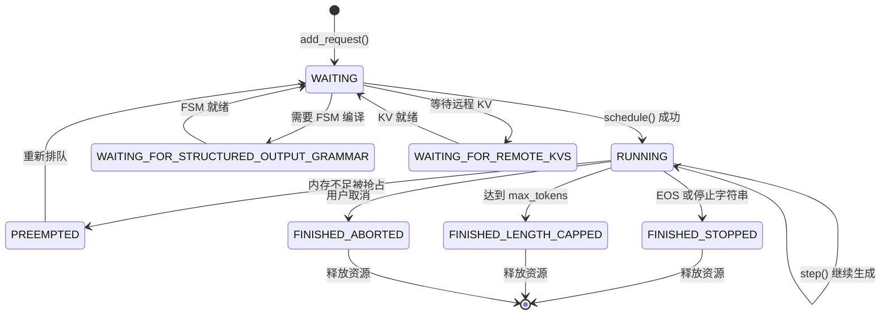

同一个 `request_id` 串起前端流、调度记录和 worker 的批次输出。下面沿单引擎的普通文本生成路径定位状态。

| 时刻 | 谁持有状态 | 可检查的证据 |
|---|---|---|
| 收到聊天请求 | API server / AsyncLLM | 消息经聊天模板和 tokenizer 转为输入，前端保存接收输出的状态。 |
| 加入引擎 | EngineCore / Scheduler | 请求进入等待集合；已有 KV 块、token 预算和执行容量影响它何时进入一个批。 |
| 执行前向 | Executor / Worker | worker 根据调度结果准备输入和块表，执行模型并生成或返回供采样的结果。 |
| 收到新 token | Scheduler / OutputProcessor | 引擎更新每个请求的进度；前端把增量 token 转成文本，按流式或完整响应交回 HTTP 客户端。 |
| 达到停止条件 | 引擎与前端 | 停止条件可能是结束标记、长度限制或取消；请求退出后释放自己的块引用。 |

前缀命中省去已计算的提示词部分。每个请求仍有自己的采样历史、停止条件和输出通道。排查首 token 延迟时，依次对齐前端入队、首轮调度、设备开始执行和客户端收到首字节的时间。

## 区分等待、运行和终止状态

## 一次请求怎样与另一个请求拼批

设 A 已有 32 个前缀 token 并生成了第一个新 token。此时 B 带相同前 32 个 token 和 3 个独有 token 进入。用 4 个 token 的教学预算，可安排 A 的下一个位置和 B 的 3 个剩余位置。worker 看见本轮这 4 个位置；前端随后仍然收到两条独立的输出流。若不足以保存 B 的新块，应回头查 scheduler 的分配结果。

## 与源码核对时要分开的计数

提示词长度包含已命中 token，本轮累计的命中量与本轮实际执行量不同。记录 `request_id`、`num_computed_tokens`、这一轮的 `num_scheduled_tokens` 和当前输出 token 数；将输出同步回前端时，再记录 HTTP 返回的 finish reason。

[进程边界](https://github.com/vllm-project/vllm/blob/v0.33.0/docs/design/arch_overview.md) · [EngineCore](https://github.com/vllm-project/vllm/blob/v0.33.0/vllm/v1/engine/core.py) · [输出状态](https://github.com/vllm-project/vllm/blob/v0.33.0/vllm/v1/engine/output_processor.py)
